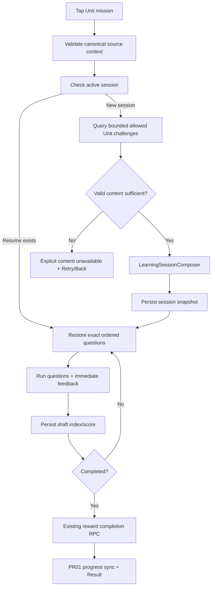
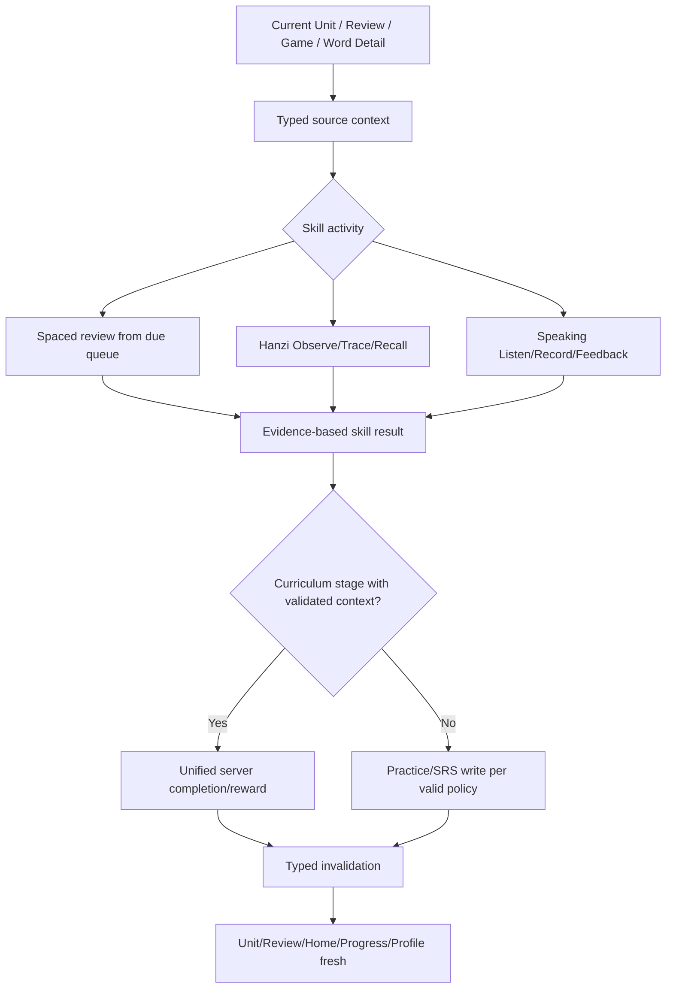
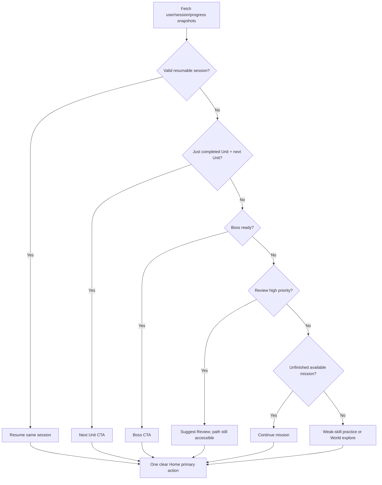
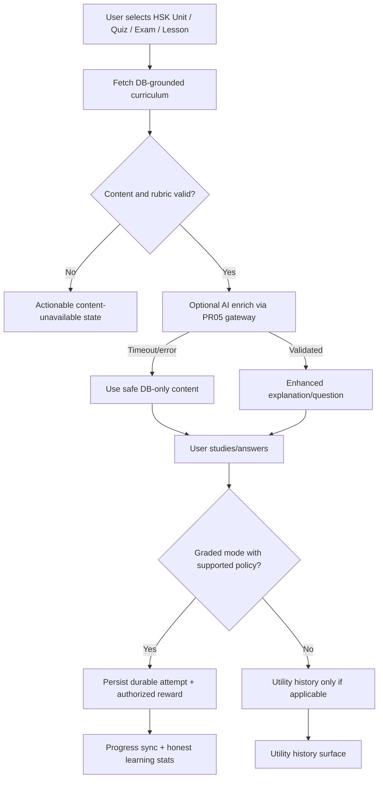
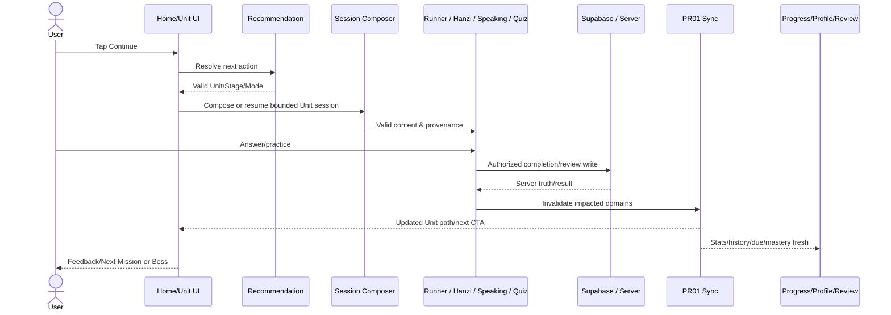

# AI EXECUTION SPEC — PR 06 → PR 09

**Dự án:** APP Tiếng Trung — Chinese Learning Adventure (Flutter/GetX + Supabase)  
**Repository:** `learnappChinese/learnchinesene`  
**NHÁNH TÍCH HỢP DUY NHẤT:** `hieu`  
**Tài liệu gốc:** `AI_MASTERPLAN_HOAN_THIEN_APP_TIENg_TRUNG.md`, `docs/CURRENT_APP_FLOW_ARCHITECTURE.md`, `docs/AI_HANDOFF.md`, `docs/IMPLEMENTATION_STATUS.md`.  
**Mục đích:** Bốn PR liên tiếp để chuyển app từ các trò chơi rời rạc thành hệ thống học tiếng Trung có chương trình nhất quán, bài tập đúng Unit, luyện tập cá nhân hóa và AI hỗ trợ học hiệu quả.

> Đây là **spec triển khai**, không phải báo cáo code đã sửa. Các tên class/API được đưa ra bên dưới là gợi ý, AI phải đối chiếu HEAD và schema thực tế. Không tuyên bố đã chạy test, truy cập Supabase live, hoặc merge PR khi chưa làm được.

---

## A. LỆNH BẮT ĐẦU (ĐỌC TRƯỚC KHI CODE)

**Hãy thực hiện lần lượt PR 06 → PR 07 → PR 08 → PR 09. Không dừng ở việc viết kế hoạch.** Mỗi PR phải hoàn thành code, test, push, tạo PR nhắm vào `hieu`, chờ CI, sửa lỗi, **merge thực sự vào `hieu` khi đủ điều kiện**, fetch/check merge commit và cập nhật handoff, **sau đó mới** tạo branch cho PR tiếp theo từ `origin/hieu` mới nhất. Không gộp cả bốn PR thành một PR khổng lồ.

1. Đọc `AI_MASTERPLAN_HOAN_THIEN_APP_TIENg_TRUNG.md`, `docs/CURRENT_APP_FLOW_ARCHITECTURE.md`, `docs/AI_HANDOFF.md`, `docs/IMPLEMENTATION_STATUS.md` (đường dẫn có thể thay đổi; tìm trong repo trước khi kết luận thiếu).
2. `git status --short`; `git branch --show-current`; `git fetch origin`; `git log origin/hieu -5 --oneline`. Kiểm tra PR 01–05 có **thực sự MERGED** vào `origin/hieu` không. Nếu PR 05 còn blocker không liên quan PR 06 nhưng chính sách merge yêu cầu hoàn tất, báo rành mạch; không tự nhận đã merge, không bỏ qua yêu cầu của chủ repo.
3. Chỉ rà soát có mục tiêu phần liên quan mỗi PR; không làm lại full audit. Tạo danh sách `ALREADY_FIXED / OPEN / NOT_APPLICABLE / NOT_VERIFIED` và **không code lại phần đã có**.
4. Nếu access live Supabase không khả dụng, kiểm tra migrations, RPC signatures và tests; đánh dấu `LIVE_DB_NOT_VERIFIED`. Không deploy SQL lên production khi chưa được cho phép.
5. Không phá vỡ những gì PR 01–05 đã đúng: đồng bộ cross-tab, server-authoritative completion, phân loại mastery, idempotency, guest merge, session lifecycle, auth/RLS, verified entitlement/AI gateway (nếu đã triển khai thật).
6. Mọi thay đổi có mục tiêu đo được, tests và cập nhật docs; không fake content/score, không xóa test, không ignore lint, không `catch (_) { return [] }` làm che lỗi.

**Git invariant:** `base=origin/hieu` → `feature/prNN-...` → commit/push → PR target `hieu` → CI/review → merge → xác nhận `origin/hieu` chứa commit → handoff → tạo nhánh kế tiếp. Không merge vào `main`/`master`, không force push `hieu`, không bypass bảo vệ nhánh. Nếu thiếu quyền merge, dừng có blocker cụ thể và PR URL; tuyệt đối không báo là `MERGED`.

---

# PR 06 — CURRICULUM, ADAPTIVE SESSION COMPOSER & CONTENT QUALITY

## 06.1 Kết quả cần đạt

Khi người học mở **HSK → Section → Unit → Mission**, phiên học chỉ sử dụng **nội dung đúng Unit và mục tiêu kỹ năng**, số lượng vừa phải, không tự nhiên trộn câu/ngữ liệu toàn bộ HSK khác vào như nội dung chính. Thoát giữa chừng có thể resume cùng session; replay có chính sách; thiếu content báo đúng lỗi thay vì bịa câu.

Điều này cần sửa điểm yếu ở snapshot: `DuoGameRepository` có nhiều loader giới hạn riêng (thường 10 câu, matching khoảng 6 cặp), journey đôi khi tải nhiều challenge để group rồi lọc client, fallback random/hard-code; mapping **Duo Unit ID dạng text** và **lexicon Unit ID dạng integer** có chỗ dựa vào section/unit-number.

## 06.2 Thực hiện trong code

**A. Canonical learning source context**

- Truy vết `duo_courses`, `duo_sections`, `duo_units`, `duo_levels`, `duo_sessions`, `duo_challenges`; `lexicon_hsk_levels`, `lexicon_units`, `lexicon_word_units`, `lexicon_words`, `lexicon_examples`; `boss_stages` và các RPC v2.
- Định nghĩa hoặc chuẩn hóa `LearningSourceContext`: course/section ID, canonical `duo_unit_id`, stage/level ID, gameCode, optional lexiconUnitId, sourceType, mode (`curriculum` / `practice` / `review` / `boss`) và provenance IDs.
- Đừng ép `duo_unit_id` (text) thành integer hay dùng `unit_number` làm ID. Nếu bridge phải theo số thứ tự, cần xác minh quan hệ duy nhất và kiểm tra mismatch có log/error; ưu tiên explicit mapping nếu dữ liệu thực hỗ trợ.
- Tạo một data ownership boundary; không để Widget/Runner tự suy ra nguồn học bằng cách parse title hay index.

**B. `LearningSessionComposer`**

- Tách lựa chọn challenge khỏi render bằng một domain service testable. Input gồm: user/guest, `LearningSourceContext`, skill objective, allowed content IDs, mastery/recent attempts/due-review (nếu có), budget, seed/session key. Output: `ComposedSession` (stable IDs/order, challenge payload refs, provenance, metrics schema).
- Ưu tiên query server **đúng Unit/stage, có limit/pagination**. Không fetch 64k challenges hoặc tất cả từ vựng vào client.
- Session cơ bản **3–5 phút**, khoảng 5–10 câu *mang tính gợi ý/cấu hình*, không hard-code ép nếu dữ liệu thực khác; matching dùng budget cặp riêng.
- Mỗi session gồm nội dung liên quan Unit, coverage mục tiêu, tránh trùng câu vô nghĩa, tăng retrieval theo trình độ, và fallback hợp lệ (ví dụ dạng challenge khác **trong cùng Unit**) chỉ khi policy cho phép.
- Nếu thiếu dữ liệu hợp lệ: show `content_unavailable` có retry/back; **không random từ ngoài Unit để người học tưởng đúng bài**.
- Giữ stable question order khi resume, không regenerate từ seed mới.

**C. Active sessions và repeat behavior**

- Tái sử dụng `duo_active_sessions` cho signed-in, guest persistence hiện có; không tạo `learning_sessions` trùng.
- Save current index/score/answer state phù hợp dữ liệu thực; resume sau process kill, back và app relaunch.
- Tôn trọng `complete_learning_activity_v2` + event key trên completion; retry network không tạo event mới cho cùng completion.
- Replay có thể đổi tập câu theo chính sách nhưng **không** ghi first-clear XP lần hai hoặc xóa completion cũ.

**D. Curriculum correctness và performance**

- Mỗi mission phải có skill goal/learning objective trong Unit Overview: số từ, ví dụ, listening/sentence task; chỉ dùng nội dung xác thực trong DB.
- Chuẩn hóa error states (`loading`, `empty`, `offline`, `content_unavailable`, `unauthorized`, `schema_mismatch`).
- Query scoped/indexed; chỉ thêm index/migration khi có `EXPLAIN` hoặc bằng chứng query plan và không làm lệch security.
- Áp dụng dễ dàng cho Duo Runner, Vocabulary Adventure, matching, listening, sentence và các mode khác; không rewrite toàn bộ UI.

## 06.3 Mermaid implementation target



## 06.4 Tests bắt buộc

- `duo_unit_id` và `lexicon_unit_id` không bị trộn; bridge tìm đúng hoặc báo mismatch.
- Selected questions đều thuộc allowed Unit/content provenance; không có fallback ngoài Unit.
- Max question budget, count không âm, sample nhỏ vẫn hoạt động hoặc báo thiếu.
- Session gồm listening/translation/matching và vocabulary đúng schema.
- Resume giữ thứ tự + câu đang dở, kể cả app relaunch.
- Session hoàn thành 1 lần; duplicate retry không nhận XP trùng.
- Guest và signed-in đều dùng curriculum constraints phù hợp.
- Missing Supabase data, timeout, offline có UI fallback chính xác.
- Mốc performance đo được: số DB request/session, số rows fetch, thời gian load; báo actual measured, không tự tuyên bố nhanh.
- Focused widget test for Mission → Runner → Result + `flutter analyze` + full test + APK compile (nếu môi trường hỗ trợ).

## 06.5 Definition of Done

- Không có câu hỏi ngoài Unit bị ngụy trang thành bài đúng Unit.
- Không bắt user tải toàn bộ challenge pool để bắt đầu 1 mission.
- Resume đúng session; progression, XP và Boss gate PR 01–03 không regression.
- PR 06 **MERGED và verify trên `origin/hieu`**. Cập nhật handoff, sau đó mới mở PR 07.

---

# PR 07 — REVIEW, HANZI & SPEAKING: ONE LEARNING CONTEXT

## 07.1 Kết quả cần đạt

Người học hoàn thành từ vựng → hệ thống biết từ nào cần ôn; vào Speaking/Hanzi từ một Unit → bài luyện đúng nội dung Unit; luyện xong → điểm, lịch sử, trạng thái kỹ năng/Review nhất quán với mọi tab. Không tự phong “phát âm 95/100” chỉ dựa trên speech-to-text text similarity. Không bắt learner nhìn danh mục 935 chữ Hán mới bắt đầu tập viết.

Hiện trạng theo snapshot: `lexicon_user_progress`, `lexicon_hanzi_progress`, `lexicon_speaking_practice` đã có; Review, Flashcard, Hanzi, Speaking là nhiều entry points; một số `mark_word_learned`/flashcard không invalidation toàn app; Speaking/Hanzi stage đôi khi mất canonical Unit context.

## 07.2 Thực hiện trong code

**A. `LearningSourceContext` xuyên suốt**

- Tận dụng contract từ PR 06, truyền nguồn origin từ Unit stage, review queue, Word Detail, Game Hub và quick practice.
- Context có canonical `duo_unit_id`, optional `lexicon_unit_id`, stage ID, source word/character/example ID, mode (`curriculum`/`review`/`practice`); validate ở domain/server.
- Tạo typing đủ chặt để không truyền `chapter number` vào `unitId` text, không infer skill context theo tên screen.
- Nếu user mở Speaking/Hanzi tự do, mode là `practice` và **không tự hoàn thành Unit stage**.

**B. Review và SRS**

- Canonical Review Hub: due counts, categories vocabulary/listening/speaking/Hanzi **chỉ những loại có đủ evidence ở DB**; nếu không có lịch ôn Hanzi, ghi “gợi ý luyện lại” thay vì giả `due`.
- Dựa `lexicon_user_progress.next_review_at`, correct/wrong count, ease_factor/interval; kiểm tra rule SQL hiện tại trước khi sửa SRS.
- Sai → review sớm hơn theo rule, đúng → mở rộng interval hợp lý; không “mastered sau 3 lần” nếu chất lượng hồi tưởng chưa đủ. **Threshold phải được thống nhất với config backend đang áp dụng**, test boundaries.
- Sau flashcard rating/mark learned/review quiz/speaking/Hanzi success → bắn typed `lexiconReviewed`/domain invalidation vào PR 01 sync coordinator, không bắt screen chủ tự refresh Home.
- Review Hub reload sau quay về/from child, không show fake 0 khi error.

**C. Hanzi Journey**

- Trang chính theo Unit/theme/nhóm 3–6 ký tự đủ dữ liệu; catalog search giữ trong “Thư viện chữ Hán”.
- Một mission: Observe stroke order/pinyin/meaning → Trace guidance → Write from memory → Recall char/meaning/pinyin → Result; chia stage nếu engine hiện tại chưa đáp ứng đầy đủ, không fake stroke validator.
- Dùng `lexicon_characters.stroke_paths`, `lexicon_hanzi_progress`; không dựa vào `lexicon_radicals` nếu bảng rỗng/chưa populated.
- Score từ stroke order/shape/position/completion **chỉ khi validator có thể đo**; nếu chỉ có score tổng, display trung thực.
- `mastered` cần evidence đạt ngưỡng và số lần tập phù hợp backend, không tự set mastered từ UI.
- Chỉ count Unit mastery/progress nếu Stage context hợp lệ và RPC chấp nhận.

**D. Speaking Journey**

- Mic permission → listen target `zh-CN` → record → actual transcript/metric → explanation → retry/complete; TTS ngừng khi mic bắt đầu.
- Phân biệt recognition confidence, text similarity, pronunciation acoustic/tone/fluency. Nếu app chỉ dùng OS STT thì label “nhận diện lời nói/độ khớp từ” chứ không gọi là chấm tone chuẩn.
- Không random từ Unit khác cho stage-bound speaking; content source word/example phải có provenance.
- Persist vào `lexicon_speaking_practice` khi schema hỗ trợ, đồng bộ learning completion chính thức qua reward pipeline nếu rubric đủ tin cậy.
- Không lưu audio/transcript vượt nhu cầu và không expose user recording public; kiểm tra storage policy và RLS.

**E. UX/Audio**

- Dùng centralized `TtsService` của app; stop/speak sequencing và engine availability, STT fallback.
- Warm paper/jade/gold Chinese calligraphy UI, contrast đúng, hit targets đủ lớn, không gây mệt.
- All entry paths → Back đúng screen nguồn/return outcome; progress sync không làm reload trắng toàn màn hình.

## 07.3 Mermaid



## 07.4 Tests bắt buộc

- Flashcard mark → Review count và Home badge update without restart.
- Review quiz completion updates appropriate SRS fields and learning history without double XP.
- Reviewed word not due / due today / overdue boundary with timezone correct.
- Hanzi stage from Unit preserves `duo_unit_id`; free library mode does not falsely complete Unit.
- Hanzi write scoring when stroke data unavailable fails gracefully.
- Speaking stage uses exact Unit word; permission denied and offline STT handled.
- Text similarity cannot silently populate false tone_score/fluency metrics.
- Recording does not play simultaneous TTS; device TTS engine unavailable fallback.
- Signed-in, Guest, retry, return navigation, app resume.
- No RLS leak of recordings, word progress or transcripts.
- Analyze, focused/full Flutter tests, DB tests (if available), Android smoke.

## 07.5 Definition of Done

- Review is truthful and reactive.
- Hanzi/Speaking practice is pedagogically grounded and unit-aware when launched from Unit.
- XP, mastery, attempts, SRS and navigation have no contradiction.
- PR 07 **MERGED into `hieu` and verified**; open PR 08 from fresh `origin/hieu`.

---

# PR 08 — PERSONALIZED HOME, SMART NEXT ACTION & LEARNING RECOMMENDATION

## 08.1 Kết quả cần đạt

**Một câu hỏi duy nhất người dùng luôn được app trả lời:** “Hôm nay tôi nên học gì tiếp?” Người học nhìn Home thấy một CTA đúng, có lý do rõ, ước lượng thời gian phù hợp và có quyền chọn hướng khác. Không có Home trả Unit A trong khi Journey mở Unit B. Không tối ưu retention bằng cách ép streak, khóa cứng review hoặc giả AI cá nhân hóa.

Audit snapshot báo recommendation logic còn overlap giữa `HomeJourneyRepository` và `LearningJourneyRepository.getNextAction`, Home loaded nhiều nguồn riêng và một lỗi `Future.wait` có thể làm fail cả view. PR01/03 phải là nền cho PR08.

## 08.2 Thực hiện trong code

**A. One `LearningRecommendationService`**

- Tìm những resolver có sẵn, hợp nhất vào một **contract** trả `RecommendedNextAction`; không nhân đôi business rules.
- Input server truth: current Unit, `unit_learning_path_v2`, active session, Boss readiness, SRS due, mastery weak points, User goal/time budget, last completion; preserve provenance.
- Output typed:
  `actionType` (`resume`, `start_mission`, `fight_boss`, `review`, `practice_weakness`, `next_unit`, `explore`), `destination`, `unitId`, `stageId`, `reasonCode`, `label`, `estimatedMinutes`, `dataVersion`.
- Priority ví dụ: **Resume** trước; sau vừa hoàn thành Unit → **Next Unit**; Boss ready → Boss; heavy overdue review có thể được đề xuất nhưng **không chắn path**; active unfinished mission; weak-skill practice; explore. Product policy là cấu hình/testable và context-aware, không hard-code logic khác nhau ở Home/Unit/Game.
- Không tự chuyển Unit vì recommendation stale; validate node unlocked trước navigate.
- Nếu load partial fail, sử dụng last-known-valid snapshot có nhãn stale/offline và retry, **không chuyển Today XP sang Lifetime**.

**B. Onboarding personalization vừa phải**

- Tận dụng PR04 onboarding/profile: learning goal (conversation/HSK/character), estimated available minutes (3/5/10), HSK level/experience; cho Skip/edit.
- Không yêu cầu form dài hoặc user khai nhạy cảm không cần thiết.
- Trong 5 phút đầu: 1 CTA, 1 Unit, 1 quick win và celebration đúng data.

**C. Daily quest + weak skill**

- Daily quest nhỏ, based on real due words, incomplete mission hoặc listening weakness. Không tạo một chuỗi thưởng mới độc lập.
- Weak skill dựa supported mastery evidence, không suy diễn tone/fluency từ các điểm không có.
- Home show `Continue` / `Resume` / `Review` / `Boss Ready`; Game Center show contextual quick practice chứ không duplicate curriculum path.
- Người học có lựa chọn “Luyện nhanh”, “Về bản đồ”, “Để sau”. Không phạt vì chọn cách khác.

**D. Shared cross-tab reactive state**

- `LearningProgressSyncService` invalidates recommendation on completion, review, logout/login, guest merge, app resume, day-boundary.
- No direct screen-to-screen controller dependencies; no manual `HomeController` conditionals outside presentation concern.
- Profile/Progress/Journey UI không tự định nghĩa “điều nên học tiếp”.
- Analytics events: recommendation shown/tapped/skipped with `reasonCode`, not raw answers/transcripts.

## 08.3 Mermaid



## 08.4 Tests bắt buộc

- New user has valid first CTA under 5-minute intro path.
- Active session outranks other suggestions; resume correct challenge.
- Boss ready but incomplete prior mastery contradictory state → read server, no guessing.
- Review due appears but does not lock curriculum path.
- Unit complete yields next Unit; no next Unit gives appropriate exploration/achievement CTA.
- XP Today = 0 but Lifetime > 0 displays correct labeled values.
- Partial failure of review or history source doesn't blank Home journey.
- Tab switching, logout/account switch, guest merge, background/resume re-evaluate correctly.
- Recommendation tap destination exists, arguments valid, unlocked at time of navigation.
- Deterministic resolver tests for same snapshot; measurable query/payload budget.
- Accessibility semantics, width 320/360/390/440, screen-reader primary CTA.

## 08.5 Definition of Done

- Exactly one clear Home primary CTA derived from truth; optional alternatives available.
- Home, Learning, Game, Review and Progress don't disagree on current Unit/action.
- No fake personalized AI claim, no hard-coded today/lifetime switch.
- PR 08 **MERGED into `hieu` and verified**; PR 09 based on updated `origin/hieu`.

---

# PR 09 — AI LEARNING QUALITY, HSK QUIZ/EXAM & UNIFIED LEARNING OUTCOMES

## 09.1 Kết quả cần đạt

AI làm bài học **dễ hiểu và thú vị hơn**, không làm rối tiến độ chính thức hoặc bịa chất lượng học. HSK Quiz dùng DB curriculum làm nguồn chuẩn; HSK Exam lưu kết quả cơ bản ngay cả khi Gemini analysis lỗi; Dictionary và Conversation tách **utility history** khỏi graded learning attempts, trừ khi có activity objective/rubric hợp lệ. Dùng AI Gateway đã được bảo vệ ở PR05, không quay lại gọi Gemini trực tiếp bằng key trong client.

Audit snapshot: Lessons lấy từ Supabase + Gemini grammar enrichment, HSK Quiz có câu hỏi do Gemini sinh không có durable attempts, HSK Exam score local và history ghi phụ thuộc Gemini analysis, AI local history `history_logs.json` khác `learning_attempts`/`learning_xp_events`. Đây là việc cần đồng bộ semantics, không được “cứ có AI là cộng XP”.

## 09.2 Thực hiện trong code

**A. AI Gateway consistency**

- Xác minh PR05 Edge Function + entitlements + quota hoàn thành thật; không tạo endpoint lộ secret hoặc client direct Gemini HTTP.
- Typed response schema, feature whitelist, bounded input/output/token/timeouts, auth/guest policy, error codes (`premium_required`, `quota_exceeded`, `ai_unavailable`, `invalid_content`, `network_error`).
- Caching có giới hạn theo curriculum revision; log kỹ thuật không lưu API secrets/PII/transcript không cần thiết.

**B. HSK Quiz grounded in real curriculum**

- Select `hskLevel/unitId` → query official words/examples and appropriate challenge types from Supabase; AI chỉ có thể **enrich distractor/explanation** khi validate.
- Bài quiz phải chứa `source_word_id` hoặc `challenge_id` và Unit/HSK provenance khi có; phát hiện trùng, đáp án sai, câu không đúng Unit, không thuộc HSK, pinyin lỗi.
- Khi AI unavailable: có thể dùng valid DB challenge pool, không tạo câu hỏi ngoài Unit.
- Nếu muốn ghi learning attempt và XP: phải dùng *đúng* rubric, source IDs và `complete_learning_activity_v2`, xác minh policy cho mode `practice` không tự unlock curriculum node hoặc lạm dụng thưởng.
- Không được gắn skill mastery cho câu hỏi nếu năng lực đo không tương ứng.

**C. HSK Exam durability**

- Chấm objective answers từ rubric deterministic/DB gốc; lưu raw exam attempt/result **trước khi** gọi Gemini explanation; nếu schema chưa có chỗ lưu, nghiên cứu phù hợp với `learning_attempts` và existing history, chỉ bổ sung có lý do.
- Nếu Gemini analysis fail/timeout, score/history vẫn còn; UI show partial result + retry analysis theo policy, không submit exam/reward lần hai.
- Chỉ cho AI diễn giải điểm mạnh/yếu dựa exam result thật; không cho LLM tự thay số điểm đã tính.
- Exam thuộc **assessment mode** có ghi nhận riêng, không tự mở Unit hoặc cộng XP first-clear nếu không có quy tắc rõ.

**D. AI Lessons / Conversations / Dictionary**

- Lessons: words/examples từ lexicon DB làm nguồn chuẩn; Gemini enrich grammar/situational context; mỗi generated suggestion cần schema validation, không ghi lại nội dung gốc sai.
- Conversations: cho người học luyện đọc/nghe, tùy chọn comprehension/roleplay có rubric; generated free conversation không tự tạo mastery. Lưu history có consent/retention rõ và đồng bộ nếu đã có backend thích hợp.
- Dictionary: utility tra cứu, cho phép bookmark/add-to-review **chỉ sau khi user chọn**, không tự “từ đã thuộc”.
- TTS sử dụng central audio service, không tạo `FlutterTts()` instance mới.

**E. Two history systems — truthful UI**

- `learning_attempts`/`learning_xp_events` là learning/XP history authoritative.
- Local `history_logs.json` là AI utility history khi chưa sync account; UI label **“Lịch sử học tập”** và **“Lịch sử công cụ AI”** rõ ràng.
- Chỉ unify vào một timeline theo representation có nguồn/provenance rõ; không silently mix và suy luận XP.
- Khi có kết quả graded, invalidation PR01 cập nhật stats/history/recommendation.

**F. AI quality and safety**

- Structured schema validation of pinyin/Chinese/translation/distractors/correct answer, language content grounding.
- Hallucination/error handling: show validated DB facts independently; Gemini unavailable không làm trắng Lesson.
- Quyền riêng tư: không gửi mic audio/PII ngoài mục đích rõ ràng; có consent, retention.
- Quota/premium: surface rõ “hết lượt/ngày” thay vì nuốt lỗi; don't route around gateway.

## 09.3 Mermaid



## 09.4 Tests bắt buộc

- Quiz challenge source always belongs to selected Unit/HSK; no hallucinated correct answers.
- Invalid Gemini JSON, fake distractor answer, malformed pinyin or missing provenance rejected or fallback safe.
- Quiz passes correct mode to reward pipeline; practice cannot bypass stage unlock.
- Exam raw score and history saved when Gemini analysis times out; optional analysis retry does not duplicate reward.
- Dictionary lookups do not modify SRS/mastery unless explicit legitimate action.
- Conversation sessions do not fake pronunciation/tone/learning grade.
- Gemini key not in APK, direct client call not reintroduced, entitlement/quota enforced.
- Free/Premium/Guest + offline + unauthorized + 429/500 + bad response tested.
- Two history labels/data semantics correct; Account switch privacy preserved.
- `flutter analyze`, tests full/focused, Edge Function/DB integration as access allows, APK build.

## 09.5 Definition of Done

- AI activities are curriculum-grounded and robust to Gemini outage.
- No score/XP/mastery without rubric and authorized completion policy.
- HSK Exam score/history survives analysis failure.
- Correct separation of AI utility vs official learning history.
- PR 09 **MERGED into `hieu` and verified**, with report + handoff for PR10 design-system polishing.

---

# B. CROSS-PR ACCEPTANCE & REGRESSION GATES

## B.1 End-to-end learner journey



Regression requirements apply after **each** PR:
- Unit/Stage/Boss remains server source-of-truth, never inferred by Widget index.
- XP event idempotency, first clear/replay, fail/retry and Boss completion still correct.
- User A/B isolation, Guest merge, offline/relaunch and sensitive API boundaries still correct.
- No contradiction between Home/Unit/Game/Progress/Profile/Review.
- Responsive 320/360/390/440, visible error/loading/empty, no layout assertions.
- Reduce Motion, semantics for voice/TTS and tappable controls; UI not breaking Panda/Dragon theme.

## B.2 Required verification commands / evidence

Use commands supported by repository/CI. Typical baseline:

```bash
git status --short
git fetch origin
git log origin/hieu -5 --oneline
flutter pub get
dart format --output=none --set-exit-if-changed lib test
flutter analyze
flutter test
flutter build apk --debug
```

For SQL/Edge changes, run staging Supabase integration/RLS/grants tests; **do not** deploy production migrations without approval. If Flutter/toolchain/device missing, report `BLOCKED` or `NOT_RUN`, never claim PASS.

## B.3 PR completion protocol — ONLY `hieu`

At the end of **every** PR 06, 07, 08, 09:

1. Update tests, docs, changelog and `docs/AI_HANDOFF.md` + `docs/IMPLEMENTATION_STATUS.md` **on the feature branch**, with issue IDs.
2. Commit and push feature branch.
3. Create/update PR with `base=hieu`; compare diff to latest `origin/hieu`.
4. Wait for CI, review, QA. Fix failed checks and merge conflicts, do not bypass branch protection.
5. If authorized and green: **merge**, fetch origin and confirm GitHub PR state `MERGED` and merge/squash commit actually present on `origin/hieu`.
6. Record PR URL, branch, merge SHA, exact tests, migrations, blockers in handoff. Because merge may create new SHA, if you need to update docs afterward, make an additional small PR and merge it as well, or ensure merge metadata can be recorded in the next PR without falsely claiming it was included in the earlier merge.
7. Start next PR from **new `origin/hieu`**, not from outdated feature branch or unmerged commits.
8. If CI fails, branch is protected, access/store/backend creds are missing or security review incomplete: **stop and report blocker**; do not claim the PR or the 4-PR chain finished.

**No push/rebase/force on `hieu` directly; no `master`/`main` merge target.**

## B.4 Output report after each merge

```markdown
# PR NN — IMPLEMENTATION REPORT
- Branch / base HEAD:
- PR URL / number:
- GitHub state: MERGED / OPEN / BLOCKED
- Merge SHA verified in origin/hieu:
- Code features done (vs scope):
- Existing features reused:
- Supabase migrations/RPC changes:
- `flutter analyze`: PASS/FAIL/NOT_RUN
- `flutter test` (+ count): PASS/FAIL/NOT_RUN
- Backend integration: PASS/FAIL/NOT_RUN/BLOCKED
- Android/iOS smoke: PASS/FAIL/NOT_RUN/BLOCKED
- Golden E2E user-flow assertions:
- Regressions and risks:
- Next PR readiness:
- Docs/handoff committed where:
```

---

# C. CONTEXT HANDOFF, TOKEN LIMIT & NEXT STEP

When context approaches limit, write `docs/AI_HANDOFF.md`:
- repo/branch/origin/hieu SHA/feature SHA;
- current PR + open issue IDs;
- changed files/migrations, **actual test commands/results**;
- PR URL/state/merge SHA where verified;
- what NOT to redo;
- next 3 exact coding steps;
- risks/blockers requiring user authorization.

Do not restart full research when a fresh agent takes over: inspect `git status`, prior PR and handoff, continue precise unfinished work.

**After PR09 merge into `hieu`:** Continue with **PR10 — Unified Chinese Fantasy Design System & UX**, then **PR11 — Release Hardening** as specified in the Master Plan. Do not jump to UI-only polish before PR06–09 correctness and continuity tests pass.

---

# D. SHORT COPY-PASTE EXECUTION MESSAGE

> Đọc toàn bộ `AI_IMPLEMENTATION_PR06_PR09.md`, `AI_MASTERPLAN_HOAN_THIEN_APP_TIENg_TRUNG.md`, `docs/AI_HANDOFF.md`, `docs/IMPLEMENTATION_STATUS.md` và current code/DB migrations. Thực thi tuần tự PR06 (Unit-grounded Session Composer), PR07 (SRS/Review/Hanzi/Speaking), PR08 (Personalized Recommendations), PR09 (AI Quiz/Exam/Lessons/History). Bắt đầu từ PR06 ngay sau khi kiểm tra PR05 đã **MERGED trên origin/hieu**. Mỗi PR phải sửa code, test, tạo PR **base hieu**, sửa CI, **merge thực sự vào hieu và xác minh merge SHA** trước khi tạo branch cho PR tiếp theo. Không audit lại toàn app, không tạo bảng trùng, không fake score/progress, không bypass branch protection hay deploy production SQL không được phép. Nếu bị blocker, báo chính xác và cập nhật handoff. Kết thúc mỗi PR xuất implementation report và tiếp tục theo thứ tự.
