# Current App Flow Architecture

> Reverse-engineering snapshot: 2026-10-11
>
> Base inspected: `hieu` (`a618640`)
>
> Implementation snapshot: `feature/pr01-learning-progress-sync`
> Scope: current implementation only; no mass-refactor and no large redesign.

## 1. Audit basis and limits

This document traces the current application from UI interaction through GetX/controller code, repositories and services, Supabase RPCs/tables, returned state, rewards/history, unlocks, navigation, and cross-tab refresh.

Sources inspected:

- Flutter code under `lib/`.
- SQL migrations under `supabase/migrations/`.
- `docs/ai/AI_DATABASE_GROUNDED_LEARNING_ADVENTURE_SPEC.md` in full.
- `docs/ai/AI_MASTERPLAN_HOAN_THIEN_APP_TIENg_TRUNG.md` in full.
- `docs/AI_HANDOFF.md`.

Important limitation: the requested `AI_FULL_APP_FLOW_REVERSE_ENGINEERING.md` is not present in this repository, its parent Flutter project tree, or the available Git history. Therefore this is an evidence-based reconstruction from the implementation and the database-grounded spec, not a claim to have applied unavailable instructions. No live Supabase MCP connection was available in this session, so database behavior below is grounded in committed migrations and the supplied live-database inventory; current production drift is not verified.

## 2. Executive summary

The signed-in learning path is mostly server-authoritative:

1. Journey UI reads `current_learning_unit_v2`, `learning_sections_v2`, `learning_units_v2`, and `unit_learning_path_v2`.
2. A stage opens a specialized screen or `DuoGameRunnerScreen`.
3. Completion goes through `LearningRewardService` and `SupabaseLearningProgressRepository`.
4. Signed-in users call `complete_learning_activity_v2`; the database writes attempt, XP, mastery, aggregate stats, progression, and unlock state.
5. `LearningRewardService` emits one typed domain invalidation after persistence succeeds; mounted owners re-read their canonical sources before the result flow continues.

PR01 closes the former direct-refresh gap with `LearningProgressSyncService`. Completion, Boss, review, flashcard/SRS, auth identity change, and app resume invalidate typed domains. Home/Progress/Game, Unit overview, Sections/Units, Review, Stats, XP History, and Profile register lifecycle-owned refreshers. Rapid events are coalesced, refreshes are serialized, stale consumer responses are rejected, failures are isolated, and each failed owner is retried once by default.

The second P0 mismatch is semantic activity mapping: most Duo core games are submitted as `game_mission`. The server accepts and rewards them, but unit mastery only aggregates semantic types such as `vocabulary`, `listening`, `speaking`, and `hanzi`. This makes reward/progression and mastery disagree.

## 3. Runtime composition and navigation ownership

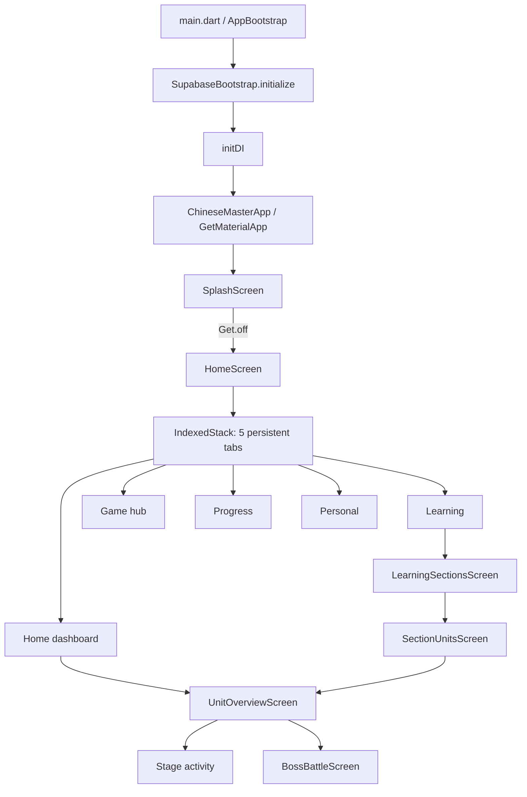

There is no named `GetPage` route table. Navigation is direct `Get.to`/`Get.off`, with route bindings used for `UnitOverviewScreen`, `VocabularyAdventureScreen`, and chapter adventure. `HomeController` is globally lazy-registered with `fenix: true`. Home tabs live in an `IndexedStack`, so their widgets remain mounted while the selected tab changes.

Dependency/lifecycle observations:

- `HomeController` owns cross-tab dashboard data and is reconstructed if removed because its factory uses `fenix`.
- `UnitOverviewController` is route-bound, but `UnitOverviewScreen` also has a fallback `Get.put(UnitOverviewController())`; this permits opening without arguments and creates a second ownership path.
- `DuoGameRunnerController` is registered with a `gameId_levelId` tag in the screen, but the screen does not explicitly delete that tagged registration. Correct cleanup depends on GetX route disposal behavior.
- `initDI()` registers `IAPService` and `SubscriptionController` twice. This is not part of the learning flow, but it is a real composition-root mismatch.

## 4. Source-of-truth map

| Domain state | Current read source | Current write source | Main consumers |
| --- | --- | --- | --- |
| Current unit | `current_learning_unit_v2()` | completion pipeline/unlock SQL | Home journey, learning entry |
| Sections | `learning_sections_v2()` | curriculum/import + progression | Sections screen |
| Units | `learning_units_v2(section_id)` | progression/unlock SQL | Units screen |
| Unit stage path | `unit_learning_path_v2(unit_id)` | completion pipeline | Unit overview, recommendation |
| Mastery | `unit_mastery_v2` and attempts-derived reads | `complete_learning_activity_v2` | unit cards, recommendation, analytics |
| Attempts/history | `learning_attempts` | start/abandon/complete RPCs | recent timeline, history |
| XP ledger | `learning_xp_events` | completion RPC | Home/Progress/XP history |
| Lifetime stats | `app_user_stats` / `learning_stats` | completion RPC | Home/Profile |
| Active session | `duo_active_sessions` | Duo session helpers | recommendation/resume |
| Review due | lexicon progress tables | review/lexicon flows | Home recommendation/review |
| Guest state | SharedPreferences plus guest Duo storage | local rules/repositories | guest result/history/stats |

The app correctly avoids a second signed-in XP/reward system. There are still multiple overlapping read facades (`DbHelper`, `LearningJourneyRepository`, `ChapterAdventureRepository`, `HomeJourneyRepository`, `LearningHistoryRepository`), but PR01 now gives them a central domain invalidation contract without replacing their source-of-truth reads.

## 5. Main curriculum flow: UI to database and back

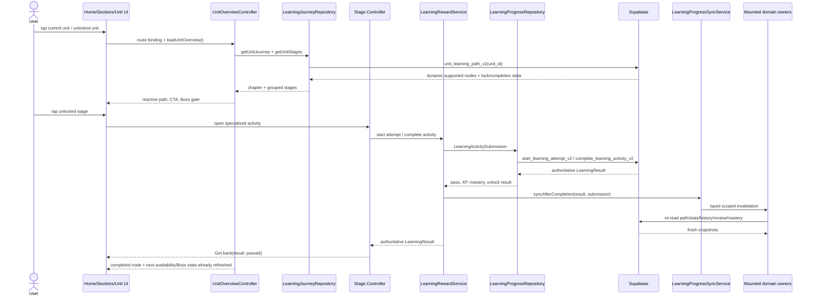

### Click routing by stage type

`UnitOverviewScreen._openStage` currently routes:

| Stage activity | Destination | Completion path |
| --- | --- | --- |
| vocabulary | `VocabularyAdventureScreen` | `processVocabularyReward` -> completion RPC |
| listening | `DuoGameRunnerScreen` | `processDuoGameReward` -> completion RPC |
| sentence | `DuoGameRunnerScreen` | `processDuoGameReward` -> completion RPC |
| dialogue | `DuoGameRunnerScreen` | `processDuoGameReward` -> completion RPC |
| quiz | `DuoGameRunnerScreen` | `processDuoGameReward` -> completion RPC |
| hanzi | `HanziWritingHomeScreen` | per-character Hanzi reward |
| speaking | `SpeakingScreen` | speaking reward |
| boss | `BossBattleScreen` | Boss reward |

The stage list is dynamic and based on server path rows; it does not blindly render all ten game definitions. Raw challenges are loaded only for levels in the selected unit, then grouped with the server path. This matches the database-grounded requirement at the path level.

### Session composition reality

The user session does not equal the full `challenge_count`: most Duo loaders request a limit of 10; word learning derives up to 10 flashcards; matching returns up to 6 pairs. This is a useful bounded-session behavior, but it is distributed across `DuoGameRepository` methods rather than represented by a formal `LearningSessionComposer`. Some fallback content is random or hard-coded, so the selection is not yet mastery/history-adaptive.

## 6. Completion, reward, history, mastery, and unlock

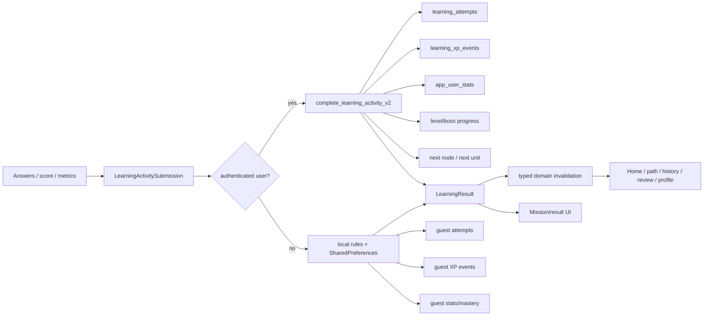

### Server-authoritative behavior

For signed-in users, `SupabaseLearningProgressRepository.completeActivity` calls `complete_learning_activity_v2` and maps the response directly to `LearningResult`. The migration implements pass/fail, stars, XP, idempotency, attempts, XP events, mastery/progress, streak/stat updates, next-node unlock, Boss progress, and next-unit unlock. Flutter does not recompute signed-in XP.

`LearningResult` can consume `boss_ready`, `unit_completed`, and `next_unit_id`, including metadata fallbacks. The committed completion migration visibly returns `unlocked_next` and `next_node_id`, but does not visibly return the three extended top-level fields. Current correctness therefore depends on later live-function drift or metadata that is not represented in the committed migration. Unit flow mostly protects itself by rereading `unit_learning_path_v2` after returning.

### Semantic activity mapping

Current Duo mapping is:

```text
speaking     -> speaking
dialogue     -> dialogue
listen_select-> listening
learn_words  -> vocabulary
everything else -> game_mission
```

Consequences:

- `select_answer`, `match_pairs`/`word_connect`, `translate`, `gap_fill`, `tap_complete`, and `sentence_order` receive XP and can participate in generic progression.
- They do not contribute to vocabulary/listening/speaking/Hanzi mastery buckets as intended by `private.unit_mastery_for_user`.
- The UI may show a completed stage and awarded XP while mastery/Boss threshold changes less than expected or not at all.

### Guest divergence

Guests use local rule evaluation and local XP/attempt/stat JSON, and Duo guest progression additionally calls `saveProgress` plus `_unlockNextGuestLevel()` by iterating to the next non-empty level. This is explicitly client-side unlock inference. It is isolated to guest mode, but behavior can diverge from the server dependency graph and Boss gating. Migration to cloud exists in `LearningProgressRepository`, but it is not a substitute for identical unlock semantics.

## 7. Boss flow

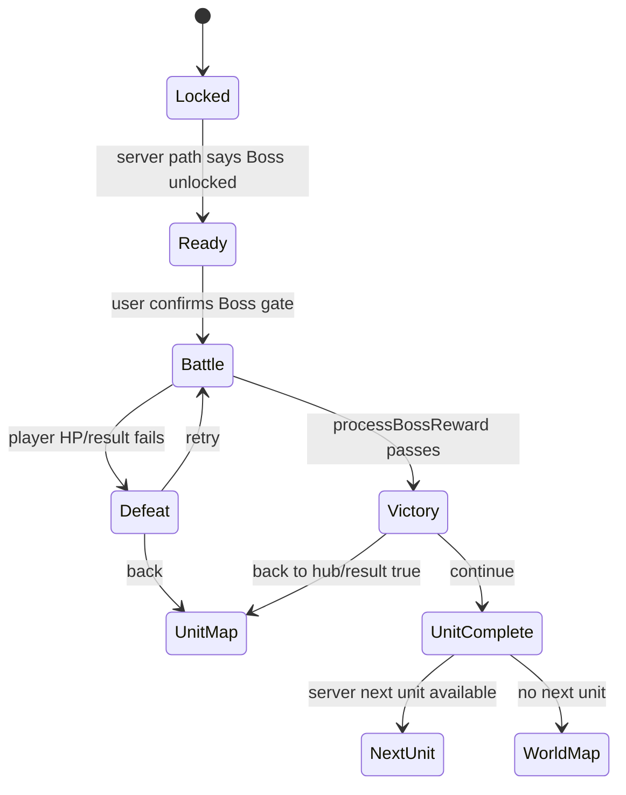

The Unit overview treats the Boss path node as authoritative for availability and completion. `BossBattleScreen` starts a Boss attempt and calls `processBossReward` on victory or defeat; both persisted outcomes now pass through the common invalidation boundary. On victory it still uses `Get.off` to a victory screen, then can `Get.off` again to `UnitCompleteScreen`. The immediate `xpEarned: 50` passed to `UnitCompleteScreen` remains hard-coded instead of using the actual returned `LearningResult.xpEarned`.

The caller `_openBossWithStage` reloads the unit only if the navigation result reaches it. Because the Boss route is replaced by `Get.off`, the exact result propagation is fragile; some routes rely on subsequent reads rather than a single explicit result contract.

## 8. Cross-tab state and refresh behavior

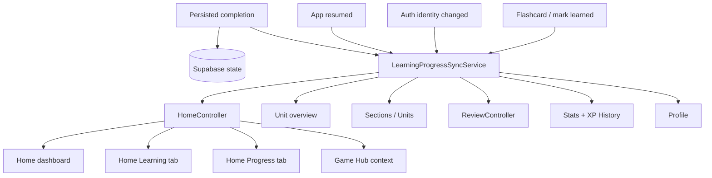

### What refreshes immediately today

- Completion has one success boundary: repository success → `LearningProgressSyncService.syncAfterCompletion`.
- Home dashboard, Learning, Progress, and the embedded Game Hub receive the refreshed `HomeController` snapshot.
- Mounted Unit overview, Sections/Units, Review, Stats, XP History, and Profile re-read their own canonical repository/table sources.
- Flashcard ratings and mark-learned actions emit `lexiconReviewed`; app resume emits a global revalidation; Supabase auth identity change first clears user-scoped snapshots, then reloads.
- Owners unregister on controller/widget disposal. Duplicate events in the same scheduling window are coalesced; later events are serialized; request generations reject stale responses.
- `HomeController` assigns seven data slices independently, so one failed endpoint no longer hides successful journey/stat/history/mastery updates.

### Remaining limits

- A refresh is a post-commit read, not a database transaction. If all retries fail, canonical database state remains correct and the affected owner exposes/retains its last usable snapshot.
- Game Hub has no separate repository cache; it reacts through the Home journey owner. Standalone alternate game routes still need runtime acceptance testing.
- `ProfilePage.lastStudyDate` is still synthesized as the current time rather than read from canonical stats.
- Live Supabase drift and authenticated multi-device behavior are not verified in this static environment.

## 9. History and analytics flow

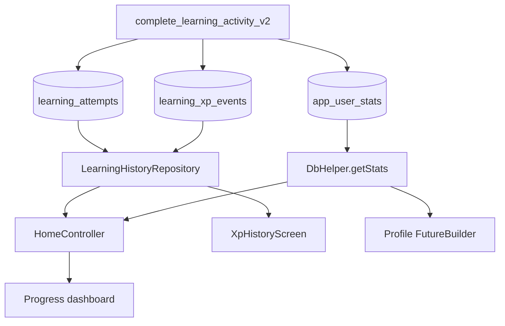

The current Progress tab uses real data: today XP, lifetime XP, streak, seven-day XP, skill mastery, and recent timeline. XP history reads the existing ledger; it does not create a duplicate table. Recent timeline can fall back from attempt history to XP events. This is aligned with the database-grounded spec.

Remaining limitations include client-side multi-query aggregation, partial error masking/fallbacks, and no single dashboard/history RPC. Profile exposes only a subset of `app_user_stats` and assigns `lastStudyDate: DateTime.now()` instead of the database value.

## 10. Actual mismatch register

Severity meanings: **P0** breaks progression/cross-tab correctness; **P1** creates material inconsistency or fragile behavior; **P2** is architecture debt or bounded product mismatch.

| Priority | Mismatch | Evidence/current effect | Spec/source-of-truth expectation |
| --- | --- | --- | --- |
| Resolved in PR01 | No shared post-completion sync coordinator | One reward success boundary now emits typed, scoped invalidation; direct gameplay-to-Home refresh calls were removed | Runtime/live acceptance remains to be executed |
| P0 | Most Duo game types map to `game_mission` | `_duoActivityType` only maps four explicit codes | Semantic skill mapping must feed accurate mastery and Boss threshold |
| Implemented; runtime pending | Cross-tab acceptance | Mounted Home/Progress/Game, Unit, Sections/Units, Review, Stats, XP History and Profile owners subscribe to domain events | Verify authenticated/guest and app-resume scenarios on device/live Supabase |
| P1 | Extended result contract may exceed committed RPC response | model reads `boss_ready`, `unit_completed`, `next_unit_id`; committed migration return visibly centers on `next_node_id` | Server response and Flutter model must have one verified contract |
| P1 | Boss result XP displayed as fixed 50 | Boss UI discards `processBossReward` result and constructs Unit Complete with `xpEarned: 50` | Render authoritative RPC reward |
| P1 | Boss navigation result propagation is fragile | nested `Get.off` replacement between battle, victory/defeat, Unit Complete | caller should receive a deliberate completion result and refresh exactly once |
| P1 | Guest unlock is client-inferred linear progression | `_unlockNextGuestLevel` chooses the next non-empty level | dependency graph/path rules should remain consistent with authoritative progression |
| Resolved in PR01 | `HomeController.refreshStats` was all-or-nothing | seven reads now assign independently with request-generation guards and a partial error state | successful slices remain visible; failed event owners are retried once |
| P1 (partial) | Profile canonical fields remain incomplete | Profile now observes sync events and no longer races against Home fallback values, but `lastStudyDate` is still `DateTime.now()` | read all profile values from canonical database fields |
| P1 | Hanzi/speaking stage launch loses explicit unit identity | Hanzi opens generic home; speaking passes integer chapter number to a parameter named `unitId` | optional practice should retain canonical Duo unit/level context when contributing to unit mastery |
| P1 | Raw challenge loading can fetch the whole unit pool for grouping | journey repository queries all challenges for all unit sessions before client grouping | fetch/composition should be scoped and bounded; 64k global data makes this increasingly costly |
| P2 | No formal `LearningSessionComposer` | fixed per-loader limits and random/hard-coded fallbacks | session subset should consider mastery/history/diversity and avoid repeated items |
| P2 | Fallback learning content can be unrelated | random flashcards and hard-coded word-connect pairs | curriculum/unit-context data should remain grounded |
| P2 | Duplicate controller ownership path | route binding plus screen fallback `Get.put` | one explicit route owner with validated required inputs |
| P2 | DI duplicates subscription registrations | repeated `Get.lazyPut` calls | one registration per type/tag |
| P2 | Recommendation logic duplicated | `HomeJourneyRepository` recommendation service and journey repository `getNextAction` overlap | one next-action contract/source |
| P2 | Silent repository fallbacks hide mismatch | several broad `catch (_) {}` return empty/null | distinguish genuine empty state from backend/schema failure |
| P2 | `HomeScreen` XP card falls back from today XP to lifetime XP | zero today can display lifetime value in the same XP slot | label/value must preserve today vs lifetime semantics |

## 11. Security and database boundary observations

- Reward/progression mutation is correctly routed through authenticated RPCs rather than direct client writes for signed-in users.
- Public journey RPC grants are intentionally present in migrations for guest content/path reads. Any `SECURITY DEFINER` implementation must validate user-specific access; the supplied spec identifies this as requiring live grant review.
- Direct table reads exist for attempts, XP events, active sessions, lexicon progress, and content tables. RLS correctness cannot be proven solely from Flutter code.
- No new schema or migration is proposed or applied by this audit.

## 12. PR01 implementation and next dependency

PR01 implements the smallest P0 correction without redesigning screens:

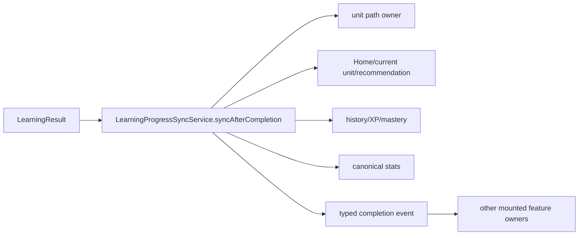

The typed event, lifecycle-owned refreshers, reward boundary, coalescing, stale-response guards, partial refresh behavior, bounded retry, SRS invalidation, auth change, and app-resume invalidation are implemented. The next dependency is PR02: correct and test the Duo `gameCode -> skill evidence` mapping against the live mastery aggregator. PR01 intentionally does not change that taxonomy or add database objects.

## 13. Verification performed

- Repository-wide static search of navigation, controller registration, RPC/table access, completion calls, refresh calls, and relevant migrations.
- Manual trace of Home -> Unit -> Stage -> Result -> reload, Boss victory/defeat, guest completion, history/XP, and tab consumers.
- Focused sync/reward/path/Boss contract tests pass; full verification evidence is maintained in `docs/IMPLEMENTATION_STATUS.md`.
- Dart code changed for PR01. No SQL migration or live database state was changed.
- Supabase CLI/MCP access is unavailable in this environment; claims about live database state remain explicitly unverified.

## 14. Whole-app feature inventory and reachability

The following inventory expands the audit beyond the learning-progression spine. “Primary” means reachable from the five Home tabs. “Nested” means reachable through another feature. “Alternate/legacy” means code exists but is not a normal Home entry in the current composition.

| Feature/module | Reachability | Main entry | State owner | Backend/external boundary |
| --- | --- | --- | --- | --- |
| Bootstrap/splash | App root | app launch | `AppBootstrap`, `SplashController` | Supabase initialization/connectivity |
| Home shell | Primary | splash completion | `HomeController` | multiple Supabase repositories/RPCs |
| Learning sections/units | Primary | Learning tab / HSK map | local screen state | journey v2 RPCs |
| Unit overview/stage map | Nested | current journey/unit card | `UnitOverviewController` | unit path, content and Boss data |
| Duo game center/path/runner | Nested/alternate | game path or Unit stage | three Duo controllers | Duo tables/RPCs, reward pipeline |
| Vocabulary adventure | Nested | vocabulary stage | `VocabularyAdventureController` | Duo + lexicon + reward RPC |
| Chapter adventure | Nested/alternate | Unit map action | `ChapterAdventureController` | Duo level/path data |
| Boss stage map/battle | Primary/nested | Game tab or Unit Boss | Boss controllers / battle state | Boss RPCs + reward RPC |
| Game Hub | Primary | tab 2 | screen local state + Home context | learning journey + mini-game sources |
| Four Dragon/Panda mini-games | Nested | Game Hub cards | widget-local state | lexicon data + reward RPC |
| HSK/lexicon browser | Primary | Learning vocabulary action | `HskController` | lexicon tables/RPCs |
| Legacy Unit/overview | Nested/alternate | HSK level | `UnitController`, `LearningOverviewController` | lexicon + journey repositories |
| Word list/detail | Nested | lexicon Unit/word card | word controllers | lexicon tables + progress RPCs |
| Flashcards | Primary | Learning/practice | `FlashcardsController` | lexicon + word progress RPC |
| Review/SRS | Primary | Home/Learning review | `ReviewController` | three lexicon progress tables |
| Legacy quiz/review quiz | Nested | Unit/review | `QuizController` | lexicon progress + unified reward RPC |
| Speaking | Primary/nested | quick action, word, review, stage | `SpeakingController` | Speech-to-Text, TTS, lexicon, reward RPC |
| Hanzi writing | Primary/nested | Learning/Game/word/review | two Hanzi controllers | character/progress tables + reward RPC |
| Conversations | Primary/premium | Home/Review | `ConversationsController` | Gemini, TTS, local AI history |
| Lessons | Primary/premium | Home/Learning | `LessonsController` | Supabase lexicon + Gemini enrichment + TTS |
| Dictionary | Primary | Personal tab | `DictionaryController` + screen local speech | Gemini, STT, TTS, local AI history |
| HSK Quiz | Primary | Home/Practice | `HskQuizController` | Gemini vocabulary + TTS |
| HSK Exam | Primary/premium | Progress tab | `HskExamController` | Gemini, TTS, local AI history |
| Progress dashboard | Primary | tab 3 | `HomeController` | attempts, XP ledger, stats, mastery |
| Stats | Nested | Progress action | `StatsController` | `learning_stats`, `app_user_stats` |
| XP history | Nested | Progress dashboard | screen local state | `learning_xp_events` |
| AI activity history | Nested | Progress action | `HistoryController` | local JSON file |
| Profile/achievements | Nested | Personal tab | widget-local `Future` | `learning_stats`, `app_user_stats` |
| Subscription/IAP | Primary | Personal/upgrade dialogs | `SubscriptionController` | Google/Apple store + SharedPreferences |
| Authentication | Infrastructure only | persisted Supabase session | Supabase SDK | no login/logout/profile-auth UI found |

No normal Home entry was found for every alternate screen. Their code is still included because they can be reached indirectly, invoked by older navigation, or represent overlapping architecture that affects maintenance.

## 15. Whole-app context diagram

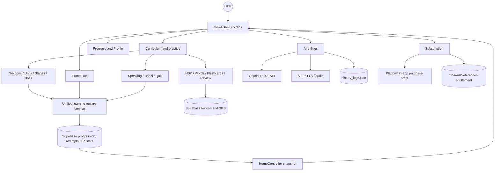

## 16. System and shell feature chains

Each row below follows the required chain: entry → action → controller → service/repository → backend → state/result → navigation → cross-feature effect.

| Feature | Entry UI → action | Controller/state owner | Service/repository | Backend/external | State/result | Navigation | Cross-feature effect |
| --- | --- | --- | --- | --- | --- | --- | --- |
| Bootstrap | OS launches `main` | `_AppBootstrapState._initialize` | `SupabaseBootstrap` then `initDI` | Supabase SDK initialization, 15-second timeout | loading/error/ready | ready mounts `ChineseMasterApp`; retry remains on bootstrap | creates all global dependencies; app cannot enter Home on failure |
| Splash | `SplashScreen` starts | `SplashController.start` | `DbHelper.database` connectivity probe | `lexicon_hsk_levels` one-row query | error Rx or success | `Get.off(HomeScreen)` | triggers first `HomeController` creation/load |
| Home shell | bottom nav/rail tap | `HomeController.setIndex` | none | none | `currentIndex` Rx | switches persistent `IndexedStack` | no refresh is triggered merely by switching tabs |
| Home dashboard | pull refresh/retry/start learning/quick action | `HomeController.refreshStats` | Home journey, review, history, mastery, `DbHelper` | journey RPCs, stats, XP, attempts, review tables | journey/stats/timeline/mastery Rx | current Unit or selected utility | supplies shared state to Home, Learning and Progress tabs |
| Personal tab | tap Profile/Premium/Dictionary | callbacks in `HomeScreen` | destination-owned | varies | no shared personal-tab state | pushes destination | returning does not automatically refresh Home unless destination does it |
| Feature gating | tap premium Lessons/Conversation/Exam | `SubscriptionController.isFeatureUnlocked` | `UpgradeDialogHelper` | local entitlement only | allow or dialog | destination or Subscription page | gates AI features, not server-authorized capabilities |

### Bootstrap/auth mismatch

Supabase Auth session persistence is used implicitly, but there is no visible sign-in, sign-up, sign-out, password recovery, or account-switch flow. Consequently:

- signed-in versus guest behavior is decided by `auth.currentUser` left by the SDK;
- users without a persisted session silently enter guest/local reward behavior;
- there is no UI owner for clearing user-scoped GetX state on logout;
- subscription entitlement is unrelated to Supabase identity.

## 17. Curriculum, journey, gameplay, and Boss chains

| Feature | Entry UI → action | Controller/state owner | Service/repository | Supabase | State/result | Navigation | Cross-feature effect |
| --- | --- | --- | --- | --- | --- | --- | --- |
| Sections | Learning tab → “lộ trình” | `LearningSectionsScreen` local state | `SupabaseLearningJourneyRepository` | `learning_sections_v2` | list/error/loading | unlocked section → Units | reloads itself after child returns; no global event |
| Units | section card → select Unit | `SectionUnitsScreen` local state | journey repository | `learning_units_v2(section_id)` | lock/progress/mastery cards | Unit binding → overview | reloads units after overview returns |
| Unit overview | Home/Units → open Unit | `UnitOverviewController` | journey + chapter repositories | `unit_learning_path_v2`, Duo levels/sessions/challenges, `boss_stages` | chapter, grouped stages, Boss readiness | stage, adventure map, Boss, Unit Complete | child return reloads path; Home may already have been refreshed separately |
| Chapter adventure | Unit map → mission/Boss tap | `ChapterAdventureController` | `ChapterAdventureRepository` | Duo level and grouped progress data | chapter mission map | vocabulary/Duo/Boss | reloads chapter after mission return |
| Duo center/path | alternate game browser → game/level tap | center/path controllers | `DuoGameRepository`/`DuoDbHelper` | game definitions/path/progress RPCs | available/locked levels | Duo runner | overlaps server Unit path and can expose an alternate progression entry |
| Duo runner | stage/path → answer/check/continue | tagged `DuoGameRunnerController` | Duo repository + `LearningRewardService` | challenge queries, active session, start/abandon/complete RPCs | questions, score, combo, `LearningResult` | result overlay → back true/false | reward success invalidates Home/path/history/mastery/profile owners through the sync service |
| Vocabulary adventure | vocabulary stage → answer/finish | `VocabularyAdventureController` | vocabulary repository/audio/reward service | Duo challenges, lexicon words/examples/progress, completion RPC | mission state + `LearningResult` | CTA returns/retries/map | pending lexicon writes are awaited, then reward sync refreshes all affected owners |
| Boss catalog/map | Game Hub → Boss stages | `BossStageMapController` | `BossBattleRepository` | `boss_stage_catalog`, detail/question RPCs | catalog and lock states | selected stage → Boss battle | independent Boss entry can bypass Unit overview presentation |
| Boss battle | Unit/Game → answer until victory/defeat | screen-local battle state or alternate Boss controller | Boss repository + reward service | Boss data + completion RPC | HP, score, reward result (currently discarded by screen) | replace with victory/defeat; then Unit Complete/retry/back | both persisted outcomes invalidate shared owners; XP display/result navigation remain fragile |
| Unit Complete | Boss victory/path completion → CTA | widget-local | journey repository indirectly through the completion sync | next Unit already server-unlocked | completion summary | next Unit or world/map | reads the path refreshed at reward boundary; does not create a second unlock system |

## 18. Lexicon, SRS, word, and quiz chains

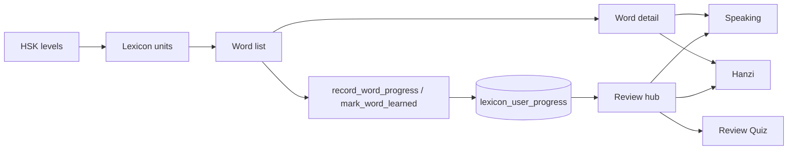

| Feature | Entry UI → action | Controller/state owner | Service/repository | Supabase | State/result | Navigation | Cross-feature effect |
| --- | --- | --- | --- | --- | --- | --- | --- |
| HSK browser | Learning → vocabulary | `HskController` | `DbHelper` | `lexicon_hsk_levels`, units/count/progress reads | HSK cards + metrics | HSK level → legacy Unit screen or journey sections | subscription limits level access; this hierarchy uses integer lexicon IDs |
| Legacy Unit list | HSK card | `UnitController` | `DbHelper` + journey repository | `lexicon_units`, metrics and journey v2 | lexicon Units plus mapped journey Unit | word/overview destinations | implicit section/unit-number mapping bridges two ID systems |
| Learning overview | legacy Unit → overview | `LearningOverviewController` | `DbHelper` | `unit_learning_metrics` | words/learned/examples | child learning actions | snapshot is not invalidated by other screens |
| Word list | Unit → browse cards/mark learned/open word | `WordListController` | `ProgressService`, `DbHelper`, sync service | `lexicon_word_units`, `lexicon_words`, `mark_word_learned` | page index + local learned set | Word Detail, Quiz | successful mark emits SRS invalidation for mounted review/Home/profile/path owners |
| Word detail | word tap → play/speak/write/mark | `WordDetailController` | audio, progress, `DbHelper`, sync service | examples/character lookup/progress RPC | examples, character ID, learned Rx | Speaking bottom sheet or Hanzi screen | practice uses unified rewards; mark emits SRS invalidation |
| Flashcards | Learning/practice → choose deck/rate | tagged `FlashcardsController` | `DbHelper`, sync service | review words or all Unit words; `record_word_progress` | shuffled max-30 deck | remains in deck/returns | updates word SRS and invalidates review/stats/mastery; still no XP for an individual rating |
| Review hub | Home/Learning → category/item/start | `ReviewController` | `SupabaseReviewRepository`, sync service | `lexicon_user_progress`, `lexicon_speaking_practice`, `lexicon_hanzi_progress`, content tables | due summary/items by category | Quiz, Conversations, Speaking, Hanzi, Word Detail | mounted hub reloads after review/reward/SRS events and clears on identity change |
| Review Quiz | Review/Unit → answer/finish | `QuizController` | `QuizService`, `ProgressService`, reward service | lexicon reads/progress RPC + unified completion RPC as `review` | per-word SRS writes + `LearningResult` | result UI/back | reward boundary refreshes Home/Progress/Profile/Review without a direct Home dependency |
| HSK Quiz | Home challenge → select level/start/answer | `HskQuizController` | injected Gemini vocabulary loader + local generator | none | local score/questions only | same screen/reset | no attempts, XP, mastery, SRS, or history; AI curriculum can diverge from DB |

The application therefore has two distinct quiz concepts: database-grounded review quiz with SRS/reward writes, and Gemini-generated HSK Quiz with no durable learning result.

## 19. Speaking and Hanzi chains

| Feature | Entry UI → action | Controller/state owner | Service/repository | Backend/external | State/result | Navigation | Cross-feature effect |
| --- | --- | --- | --- | --- | --- | --- | --- |
| Speaking | Home/word/review/stage/Game → record | tagged `SpeakingController` | `VocabularyService`, `SpeechService`, `LearningRewardService`, TTS/audio | lexicon tables/random-word RPC, OS mic/STT, completion RPC | target, transcript, similarity/scores, `LearningResult` | next item/back/bottom-sheet close | reward event refreshes all registered owners; Unit identity is unreliable for some callers |
| Speaking permission | tap microphone | controller + `PermissionHelper` | permission plugin | Android/iOS permission settings | granted/denied dialog | optionally opens system settings | denial blocks activity before reward flow |
| Hanzi catalog | Learning/Game/review → search/filter/select | `HanziWritingHomeController` | `DbHelper` | characters, complete word catalog, Hanzi progress | filtered characters/progress | selected character → writing | catalog query can load 935 characters plus 2,205-word catalog |
| Hanzi writing | character → draw strokes/retry/finish | `HanziWritingController` + stateful canvas | stroke parser/sampler/validator, reward service | character data + completion RPC | stroke accuracy/best score/`LearningResult` | next/close | reward event includes Review scope and reloads mounted category/Home/path owners |

Hanzi core correctly uses character stroke data, not the empty radicals table. `RadicalBuilderScreen`, however, is a separate mini-game and should not be interpreted as database-backed radical progression.

## 20. Game Hub and mini-game chains

| Feature | Entry UI → action | Controller/state owner | Service/repository | Backend/external | State/result | Navigation | Cross-feature effect |
| --- | --- | --- | --- | --- | --- | --- | --- |
| Game Hub | tab 2 → game card/current Unit activity | screen-local future/state + Home journey | journey repository | current Unit/stages | cards and contextual stage | mini-game, Duo stage, Speaking, Hanzi, Boss map | observes Home journey; Home is a registered Game/Journey sync owner |
| Quick Answer | Game Hub → answer set | widget-local | `DbHelper`/reward service | lexicon content + completion RPC (`quiz`, `quick_answer`) | score/accuracy/XP dialog | pop/back | emits common reward sync; not mapped to a curriculum node |
| Tone Ninja | Game Hub → listening answers | widget-local + TTS | content loader/reward service | lexicon/content + TTS + completion RPC (`listening`, `tone_ninja`) | victory/game-over reward | pop/back | emits common reward sync; contributes generic listening mastery without Unit context |
| Chinese Restaurant | Game Hub → assemble orders | widget-local + TTS | content loader/reward service | content + completion RPC (`sentence`, `chinese_restaurant`) | completed orders/XP | pop/back | server accepts only activity types supported by live function; committed migration allow-list must be verified for `sentence`/`quiz` |
| Radical Builder | Game Hub → build character | widget-local + TTS | content loader/reward service | word/character content + completion RPC (`hanzi`, `radical_builder`) | attempts/XP | pop/back | updates Hanzi-like mastery but source is not core radical progression |
| Reference Dragon/Panda Boss flow | Game Hub demo Boss | screen-local navigation callbacks | no canonical Boss repository in the intro/gameplay demo chain | mostly local assets/state | demo victory/defeat | chained `Get.off` screens | separate from authoritative `BossBattleScreen` unless launched into canonical stage flow |

The mini-games use the shared reward API but are optional practice. They do not unlock a specific curriculum stage unless the server deliberately associates their source/unit metadata. Directly constructed `LearningRewardService` instances resolve the registered sync service at construction, so they no longer bypass the invalidation boundary.

## 21. AI, dictionary, lessons, exam, and local history chains

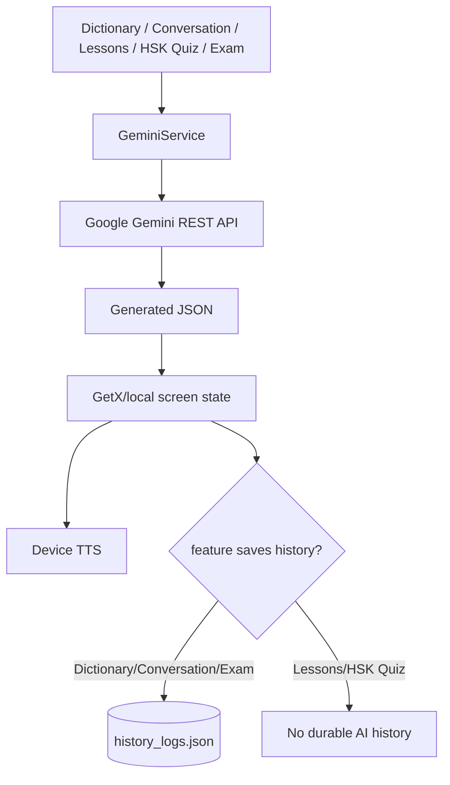

| Feature | Entry UI → action | Controller/state owner | Service/repository | External/data source | State/result | Navigation | Cross-feature effect |
| --- | --- | --- | --- | --- | --- | --- | --- |
| Dictionary | Personal → type/speak query/search | `DictionaryController`; screen owns STT/TTS | injected `GeminiService.fetchDictionaryEntry`, `HistoryService` | Gemini REST, microphone/STT, device TTS, local JSON | latest dictionary entry/error | stays screen/back | appends local AI history; no lexicon favorite/progress/reward integration |
| Conversations | Home/Learning/review → topic/start/load more/play line | `ConversationsController` | Gemini, TTS, local history | Gemini REST + device TTS | generated lines/topic/loading | stays screen/back | initial conversation saved locally; added lines are not resaved; no learning attempt/XP |
| Lessons | premium action → select HSK Unit/open detail/play speech | `LessonsController` | `DbHelper`, Gemini, TTS | Supabase lexicon first; Gemini grammar enrichment second | DB vocabulary/examples immediately, optional AI grammar replacement | pushes private lesson detail view | no attempt, completion, SRS, XP, or shared refresh |
| HSK Quiz | Home/practice → generate/start/answer | `HskQuizController` | Gemini vocabulary + local question generator + TTS | Gemini REST/device TTS | transient score | reset/change level/back | not saved to either history system and not rewarded |
| HSK Exam | premium Progress action → generate/select/submit | `HskExamController` | Gemini, TTS, `HistoryService` | Gemini exam + Gemini analysis + local JSON | local score plus AI assessment | reset/back | saves history only inside successful analysis path; no unified XP/attempt |
| AI activity history | Progress → view/clear | `HistoryController` | `HistoryService` | application documents `history_logs.json` | local list | detail dialog/back | deleting this does not delete `learning_attempts` or XP history |

### AI boundary mismatches

- `GEMINI_API_KEY` is a client build-time value and requests are sent directly from the app. It cannot be treated as a server secret.
- AI HSK Quiz generates curriculum content instead of reading the existing curriculum database.
- AI activities have a separate local history and do not participate in learning attempts, XP, streak, mastery, or cross-tab analytics.
- HSK Exam’s raw score is calculated locally. When AI analysis fails, the catch path reports that scoring succeeded, but history persistence is skipped because it is inside the same `try` block after analysis.

## 22. Analytics, profile, and the two history systems

| Feature | Entry UI → action | Controller/state owner | Service/repository | Data source | State/result | Navigation | Cross-feature effect |
| --- | --- | --- | --- | --- | --- | --- | --- |
| Progress tab | tab 3 | shared `HomeController` | history/mastery/Home repositories + sync owner | XP events, attempts, stats, mastery | reactive summary/chart/timeline | Stats, XP history, AI history, Exam | completion/resume/auth events refresh the mounted shared owner |
| Stats | Progress → Stats | `StatsController` | `DbHelper` + sync service | `learning_stats` + `app_user_stats` | stats map | back | mounted controller refreshes for Stats/identity domains with stale-response protection |
| XP history | Progress → XP ledger | screen-local repository/future + sync registration | `LearningHistoryRepository` | `learning_xp_events` | paged/filtered XP rows | back | authoritative reward history refreshes while mounted; separate from AI history |
| Profile | Personal → Profile/manual refresh | `FutureBuilder` local state + sync registration | `DbHelper` | learning/app stats | partial `UserStats` and derived achievements | back | reacts to completion/resume/identity; still uses current time as last-study date |
| Learning history | Progress timeline | `HomeController.recentTimeline` | learning history repository | attempts with XP fallback | latest learning events | rendered in Progress | tied to reward pipeline only |
| AI history | Progress → History | `HistoryController` | local `HistoryService` | JSON file | Dictionary/Conversation/Exam records | detail modal | device-local, not account-synced, survives independently of Supabase rows |

“History” is therefore overloaded. The authoritative learning record is `learning_attempts`/`learning_xp_events`; `history_logs.json` is a local log of selected AI utilities. The UI should not imply they are one complete activity history.

## 23. Subscription and purchase chain

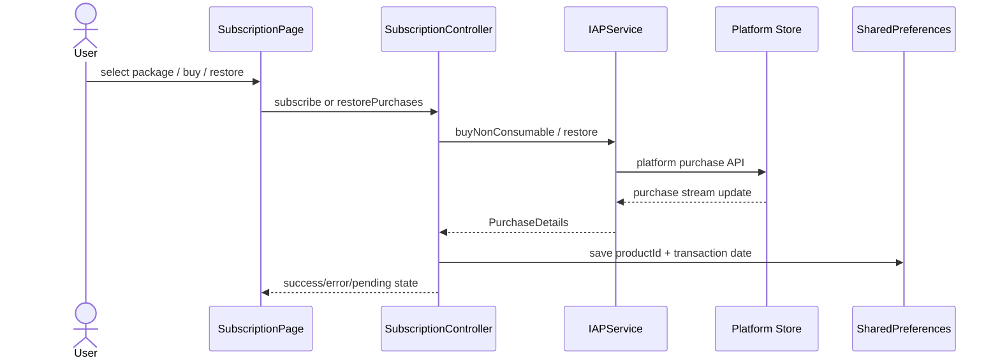

| Entry/action | State owner | External/storage | Result/navigation | Cross-feature effect |
| --- | --- | --- | --- | --- |
| Personal Premium or upgrade dialog → package purchase | `SubscriptionController` | platform IAP and purchase stream | success/pending/error overlay; stays Subscription page | `isPremium`/`isStandard` gates features and HSK levels |
| Restore purchases | same | platform restore API | purchase stream restores local state | unlocks features in current process |
| App restart | controller `_loadSubscriptionStatus` | SharedPreferences | reconstructs entitlement from product ID/date | controls all client-side gates |

Critical mismatches:

- Receipt verification is explicitly not implemented.
- Any purchased/restored product is persisted as entitlement based only on the client purchase stream.
- Expiry is inferred locally as 30/365 days; no store subscription status or server clock is checked.
- `IAPService` completes purchases even though delivery/verification is only a comment.
- DI registers the IAP service/controller twice and the service itself is not disposed by `SubscriptionController.onClose`.
- Subscription is not tied to Supabase user identity, so it is not portable/account-authoritative.

## 24. Device services and lifecycle

| Device capability | Owners | Lifecycle behavior | App-wide risk/effect |
| --- | --- | --- | --- |
| TTS | Conversations, Lessons, Exam, Quiz, Dictionary, Boss, mini-games, word widgets, vocabulary audio | most controllers call `stop`; individual widgets/screens vary | multiple independent `FlutterTts` instances can overlap; no central audio focus policy |
| Speech-to-Text | Speaking, Duo speaking, Dictionary | permission requested before use; speaking service has its own recognition lifecycle | microphone denial is handled locally, not as shared capability state |
| Audio URLs | `AudioService`, word/quiz/detail | player disposed by owning controller | network/audio error generally has limited surfaced state |
| Local documents | `HistoryService` | JSON read/write/delete; write errors swallowed | history is device-only and can be lost/corrupted without user-visible diagnostics |
| SharedPreferences | guest rewards/progress, subscription | loaded independently by repositories/controllers | no account namespace; logout/account switching could expose stale local entitlement/guest state |
| App lifecycle | `HomeScreen` owns the single resume observer | calls `LearningProgressSyncService.syncOnAppResume` | all mounted domain owners reconcile through the same coordinator |

## 25. Complete cross-feature effect map

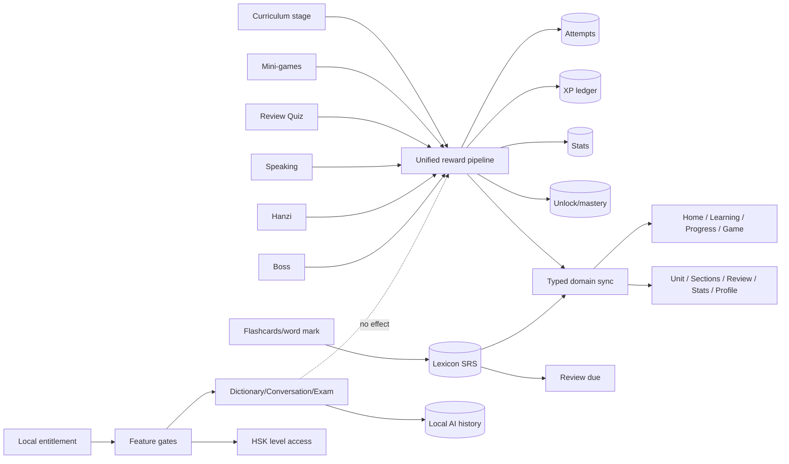

Expected versus actual propagation:

| Originating event | Immediate actual consumers | Delayed/stale consumers |
| --- | --- | --- |
| Curriculum/Duo completion | result plus every mounted owner whose domain intersects the event | unmounted screens re-read on their next construction; live multi-device still unverified |
| Boss victory | sync owners, victory/Unit Complete | exact caller path may miss its typed result due route replacement |
| Review Quiz completion | quiz result, word SRS, Home/Progress/Profile/Review/path owners | none while registered; live RPC contract remains unverified |
| Speaking/Hanzi completion | local result plus Home/path/history/mastery/review/profile owners | canonical Unit attribution can still be missing for some callers |
| Flashcard rating/mark learned | current card/list, lexicon SRS and registered review/stats/mastery owners | no individual XP attempt by design |
| Mini-game completion | game dialog and registered sync owners | curriculum path only changes if server source metadata links it |
| AI utility completion | current screen and sometimes local history | all learning analytics/reward tabs |
| Purchase/restoration | subscription Rx and feature gates | no server/account state; other device has no entitlement |

## 26. Additional whole-app mismatch register

These findings supplement the learning-focused register in section 10.

| Priority | Area | Mismatch and impact |
| --- | --- | --- |
| P0 | Subscription security | Premium entitlement has no receipt/server verification and is reconstructed from local preferences |
| P0 | Identity | No explicit auth/account lifecycle owns guest→user migration, logout cleanup, or user-scoped controller reset |
| P1 | History semantics | Two unrelated systems are both presented as history: authoritative learning history and local AI history |
| Resolved in PR01 | Review propagation | word/flashcard/review writes now emit review/stats/mastery invalidation |
| P1 | HSK Quiz | AI-generated questions have no durable attempt, history, reward, or DB-grounded curriculum link |
| P1 | HSK Exam | score/history/reward are outside learning pipeline; analysis failure also skips history save |
| P1 | Mini-game contract | some submitted activity types (`quiz`, `sentence`) must be verified against the live RPC allow-list |
| P1 | Unit identity | integer lexicon Unit IDs and text Duo Unit IDs are joined by implicit section/unit assumptions in several flows |
| P1 | Audio | many independent TTS instances lack an app-wide audio/session coordinator |
| Implemented; runtime pending | Resume/relaunch | Home lifecycle emits app-wide domain invalidation; device/live acceptance remains |
| P2 | AI history durability | local JSON errors are swallowed and records are not account-synced |
| P2 | Controller ownership | many screens use `Get.isRegistered ? Get.find : Get.put`, creating ambiguous route/widget/global ownership |
| P2 | Alternate architectures | legacy lexicon Unit flow, journey v2 flow, chapter adventure, and Duo center overlap without a canonical entry policy |
| P2 | Errors | multiple controllers swallow backend/write failures and advance UI, hiding unsynced state |

## 27. Whole-app completeness statement

This document now inventories every feature directory under `lib/screen` and traces all user-facing feature families through the requested chain. It includes primary, nested, and alternate/legacy routes; Supabase, Gemini, platform stores, device speech/audio, SharedPreferences, and local-file persistence.

“Complete” here means static architecture coverage of the repository at the inspected commit. It does **not** mean every runtime branch has been exercised on a device, every live Supabase object matches migrations, or every platform purchase/speech path has been integration-tested. Those require a separate runtime evidence pass with authenticated and guest accounts, live database inspection, Android/iOS purchase sandboxes, microphone permissions, process relaunch, and cross-tab acceptance tests.
