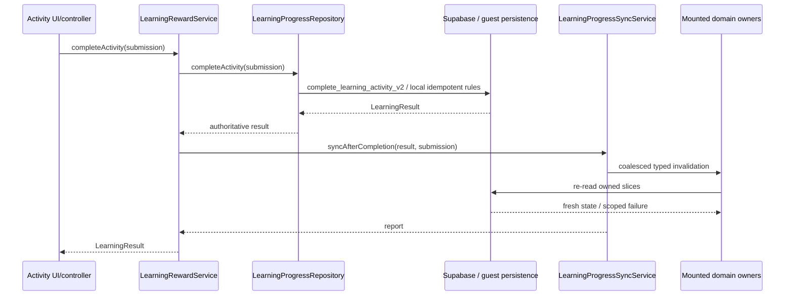

# Implementation Status

- Snapshot date: 2026-10-11
- Base: `hieu` at `6658d662811ad8178cef224d9d1986121a5937c6` (PR #23 merged)
- Implementation branch: `feature/pr02-skill-taxonomy-unit-mastery`

This is the PR00 baseline and living issue matrix for `AI_MASTERPLAN_HOAN_THIEN_APP_TIENg_TRUNG.md`. Status is based on current Flutter code and committed SQL migrations. It does not claim live-production verification.

## Verification boundary

- Flutter 3.47.5; Dart 3.13.4.
- Latest committed migration: `20261011150000_unify_skill_taxonomy_and_unit_mastery.sql`.
- Supabase CLI is not installed and no Supabase MCP/live connection is available in this environment. Live function bodies, grants, RLS drift, production data and authenticated multi-device behavior are `NOT_VERIFIED_LIVE`.
- Migration `20261011150000_unify_skill_taxonomy_and_unit_mastery.sql` unifies skill buckets and normalizes historical `game_mission` attempts safely.
- Baseline at `hieu`: `test/core/learning` passed 63 tests; `flutter analyze` on changed PR02 files reported 0 issues.

Status vocabulary:

- `DONE_CODE`: implemented and covered by local automated tests; live/device acceptance may still remain.
- `PARTIAL`: useful portion is implemented, but the masterplan acceptance is not complete.
- `OPEN`: verified current-code mismatch remains.
- `NOT_VERIFIED_LIVE`: code/migrations were inspected but the production Supabase claim cannot be made.

## Issue matrix

| ID | Status | Current evidence | Next owner/PR |
| --- | --- | --- | --- |
| P0-01 | DONE_CODE | `LearningProgressSyncService` is registered in DI; reward success emits typed scoped invalidation; direct gameplay calls to `HomeController.refreshStats()` are removed; rapid events coalesce and serialize; failed owners retry once | PR01 live/device acceptance |
| P0-02 | DONE_CODE | Standardized 11 Duo game codes via `LearningSkillTaxonomy` to canonical activity types (`vocabulary`, `listening`, `speaking`, `dialogue`) and 4 skill buckets. Migration `20261011150000_unify_skill_taxonomy_and_unit_mastery.sql` resolves legacy attempts into proper skills and updates `private.unit_mastery_for_user` & `unit_mastery_v2`. Guest mode computes real local mastery in `SupabaseLearningProgressRepository._fetchLocalUnitMastery` | PR02 live/device acceptance & PR03 Boss/Unit navigation |
| P0-03 | DONE_CODE | Home/Progress/Game, Unit, Sections/Units, Review, Stats, XP History and Profile register lifecycle-owned refreshers; app resume revalidates all mounted owners | PR01 authenticated/guest runtime matrix |
| P0-04 | OPEN | Entitlement remains client purchase-stream/SharedPreferences based; duplicate IAP DI registrations remain; no server receipt verification | PR04/PR05 security work |
| P0-05 | PARTIAL | Auth identity changes clear/reload registered learning snapshots, but no explicit login/account/guest-migration product flow exists | PR04 identity lifecycle |
| P1-01 | PARTIAL / NOT_VERIFIED_LIVE | Dart fixture covers reward/unlock/next-unit parsing and RPC idempotency context; committed migration response still needs direct live RPC comparison | PR03 + live Supabase |
| P1-02 | OPEN | `BossBattleScreen` still passes hard-coded `xpEarned: 50` to Unit Complete | PR03 |
| P1-03 | OPEN | Boss victory/defeat/Unit Complete still chain `Get.off`; typed navigation outcome is not implemented | PR03 |
| P1-04 | OPEN | guest `_unlockNextGuestLevel()` still infers the next non-empty level linearly | PR03/PR04 |
| P1-05 | DONE_CODE | Home loads seven slices independently, preserves successful values, exposes partial error state and rejects stale requests | PR01 |
| P1-06 | PARTIAL | Profile now observes canonical invalidation and no longer overwrites fresh DB stats from a racing Home snapshot; `lastStudyDate` is still `DateTime.now()` | PR06 |
| P1-07 | OPEN | Hanzi/Speaking context remains optional/inconsistent for several entry paths | PR03/PR07 |
| P1-08 | DONE_CODE | review completion, flashcard rating and mark-learned actions invalidate Review/Stats/Mastery/Profile/Path scopes | PR01 |
| P1-09 | OPEN | loaders still contain broad Unit pools and random/hard-coded fallbacks | PR07 |
| P1-10 | OPEN | HSK Quiz and Exam remain outside the canonical durable learning result policy | PR09 |
| P1-11 | OPEN | Gemini key remains a client build-time value and requests go directly from the app | PR09/backend blocker |
| P1-12 | OPEN | multiple independent `FlutterTts` instances remain | PR08 |
| P1-13 | OPEN | integer lexicon IDs and text Duo IDs still rely on implicit bridges | PR07 |
| P1-14 | OPEN | Supabase learning history and local `history_logs.json` remain separate/overloaded in product terminology | PR06/PR09 |
| P2-01 | OPEN | legacy HSK/Unit, journey v2, chapter adventure and Game Center remain overlapping navigation/progression surfaces | PR06 |
| P2-02 | OPEN | session selection is not yet mastery/history-adaptive | PR07 |
| P2-03 | OPEN | route bindings/fallback `Get.put` ownership overlap and duplicate subscription DI remain | PR10 |
| P2-04 | OPEN | Home still substitutes lifetime XP when today XP is zero | PR06 |
| P2-05 | OPEN | broad silent catches and empty fallbacks remain across the repository | PR10 |
| P2-06 | DONE_CODE | lifecycle refresh moved from Profile-only behavior to app-wide typed invalidation owned by Home lifecycle | PR01 |

## PR01 implementation boundary

The coordinator does not duplicate business state or infer unlocks. Each owner re-reads its existing repository/RPC/table source. This keeps PR01 within the no-mass-refactor and no-duplicate-database constraints.

## PR01 acceptance evidence

- Reward repository success triggers one shared invalidation boundary.
- Scope filtering updates relevant owners and ignores unrelated owners.
- Two immediate invalidations coalesce into one non-overlapping refresh generation.
- A failing owner retries twice total and does not prevent successful owners from updating.
- Disposed registrations no longer receive refreshes.
- `LearningResult` fixture covers XP, idempotency context, next stage and next Unit fields.
- Existing guest idempotency, zero-XP Boss loss, progression, stage grouping, lock and Boss tests remain green.

Still requiring external evidence:

- Signed-in pass → XP/history/path/unlock across actual production RPC and RLS.
- Guest → login migration and user switch on a device.
- Multi-device/app-resume reconciliation against production.
- Live response fields and semantic mastery aggregation for every Duo game code.
