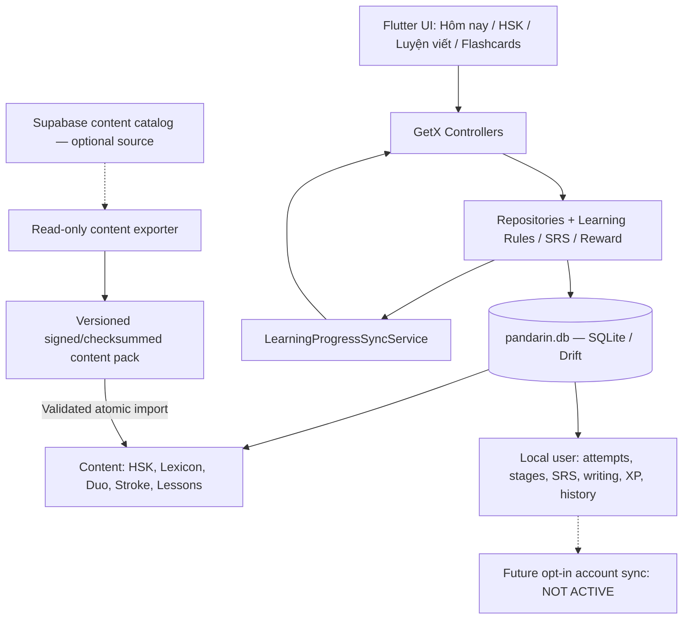
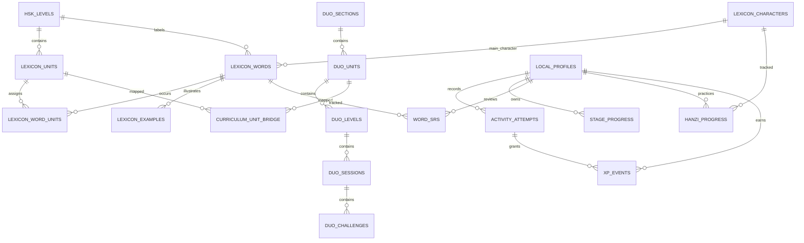
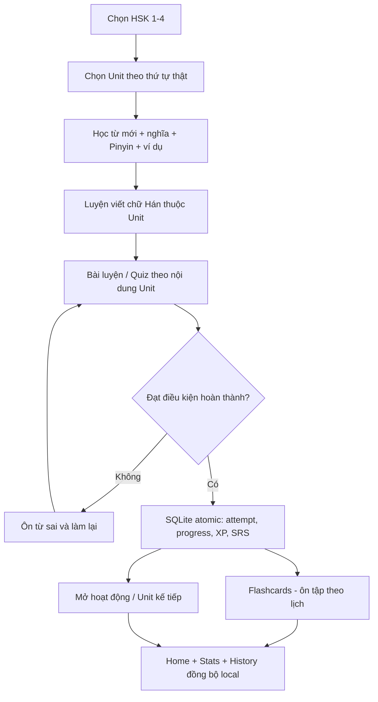

# PANDARIN — LOCAL DATABASE & LEARNING FLOW BLUEPRINT (DRAFT)

> Tài liệu thiết kế đề xuất dựa trên 14 báo cáo audit đã tải lên và kiểm tra **read-only** schema/dữ liệu Supabase project `hrlahralknhijnkypjix` ngày **2026-10-20**. Đây là **thiết kế đích**, **chưa phải schema đã triển khai**. AI lập trình phải xác minh lại repo và ánh xạ cột trước khi tạo migration. Không thay đổi Supabase production.

## I. Kiến trúc đích



- Tệp SQLite trên thiết bị là **nguồn sự thật duy nhất cho dữ liệu người học**.
- Dữ liệu giáo trình là các bảng local được import có version và checksum; có thể xuất từ Supabase bằng quy trình development/admin, hoặc đóng gói trong app.
- Không có `auth.uid()`, `currentUser` hay Guest gate trong đường đi học tập. Hồ sơ local có UUID riêng.
- Duy trì `LearningProgressSyncService` như cơ chế báo thay đổi nội bộ thay vì dùng sự kiện mạng.
- UI không cần cloud để mở hoặc hoàn thành bài. Remote TTS cần cache/asset hoặc fallback OS TTS để hỗ trợ offline có điều kiện.

## II. Cấu trúc bài học cần giữ

| Nguồn cloud đã xác minh | Số bản ghi | Cách sử dụng local |
|---|---:|---|
| `lexicon_hsk_levels` | 4 | HSK 1–4; không tạo nội dung 5–6 giả |
| `lexicon_units` | 130 | Các bài Lexicon theo `hsk_level_id`, `unit_number` |
| `lexicon_words` | 2.205 | Từ Hán, Pinyin, nghĩa, `tts_url`, HSK |
| `lexicon_word_units` | 2.299 | Mối quan hệ từ ↔ bài học |
| `lexicon_examples` | 7.925 | Câu mẫu gắn từ/bài |
| `lexicon_characters` | 935 | Nét viết SVG `stroke_paths` |
| `duo_sections` | 8 | Lộ trình Duo riêng, không mặc định là HSK |
| `duo_units` / `duo_levels` | 310 / 310 | Bộ nội dung game/lesson cũ với ID gốc |
| `duo_sessions` / `duo_challenges` | 1.536 / 64.828 | Câu hỏi hiện có, dùng phân trang/theo unit |
| `duo_flashcards` | 12.101 | Catalog phụ trợ; chỉ liên kết HSK khi xác minh |

**Chất lượng cần xử lý:** Một bản ghi `lexicon_words` thiếu Pinyin; 3.468 Duo flashcard thiếu Pinyin, 643 thiếu nghĩa, 3.320 thiếu URL TTS. Mọi `lexicon_words.tts_url` không rỗng tại thời điểm kiểm tra, nhưng chưa kiểm tra HTTP/file tồn tại. Không mặc định mọi flashcard Duo nằm trong HSK hiện hành.

**Lưu ý đặc biệt:** Không có foreign key trực tiếp `duo_units → lexicon_units`. Mọi bridge phải có bằng chứng (source/curation) và độ tin cậy. `Path Section 0` không có nghĩa là `HSK 1`.

## III. Sơ đồ các quan hệ (đích)



## IV. SQLite DDL gợi ý cho các bảng người học cốt lõi

Các bảng content (lexicon_*, duo_*) phải được generated/imported từ schema thật, với ID/type nguyên bản, PK/FK đúng và `content_pack_id`/`content_version` phù hợp. Dưới đây là **DDL minh họa**, không tự coi là migration production:

```sql
PRAGMA foreign_keys = ON;

CREATE TABLE IF NOT EXISTS local_profiles (
  local_id TEXT PRIMARY KEY, -- random UUID, not Supabase auth.users.id
  created_at TEXT NOT NULL,
  timezone_id TEXT NOT NULL DEFAULT 'Asia/Ho_Chi_Minh'
);

CREATE TABLE IF NOT EXISTS local_activity_attempts (
  attempt_id TEXT PRIMARY KEY,
  local_id TEXT NOT NULL REFERENCES local_profiles(local_id),
  activity_type TEXT NOT NULL,
  source_namespace TEXT NOT NULL, -- duo | lexicon | hanzi | mini_game
  source_id TEXT NOT NULL,
  unit_namespace TEXT,
  unit_id TEXT,
  level_id TEXT,
  started_at_utc TEXT NOT NULL,
  completed_at_utc TEXT,
  status TEXT NOT NULL CHECK(status IN ('started','passed','failed','abandoned')),
  score REAL NOT NULL DEFAULT 0,
  accuracy REAL CHECK(accuracy IS NULL OR (accuracy BETWEEN 0 AND 1)),
  correct_count INTEGER NOT NULL DEFAULT 0 CHECK(correct_count >= 0),
  wrong_count INTEGER NOT NULL DEFAULT 0 CHECK(wrong_count >= 0),
  stars INTEGER NOT NULL DEFAULT 0 CHECK(stars BETWEEN 0 AND 3),
  duration_seconds INTEGER NOT NULL DEFAULT 0 CHECK(duration_seconds >= 0),
  metadata_json TEXT NOT NULL DEFAULT '{}'
);
CREATE INDEX IF NOT EXISTS idx_attempts_by_user_time
  ON local_activity_attempts(local_id, started_at_utc DESC);

CREATE TABLE IF NOT EXISTS local_stage_progress (
  local_id TEXT NOT NULL REFERENCES local_profiles(local_id),
  level_id TEXT NOT NULL, -- FK to imported duo_levels when possible
  status TEXT NOT NULL DEFAULT 'locked' CHECK(status IN ('locked','available','completed')),
  best_score REAL NOT NULL DEFAULT 0,
  best_stars INTEGER NOT NULL DEFAULT 0 CHECK(best_stars BETWEEN 0 AND 3),
  first_completed_at_utc TEXT,
  last_attempt_id TEXT,
  PRIMARY KEY(local_id, level_id)
);

CREATE TABLE IF NOT EXISTS local_word_srs (
  local_id TEXT NOT NULL REFERENCES local_profiles(local_id),
  word_id INTEGER NOT NULL, -- lexicon_words.id; Duo-only cards need separate namespace/model
  srs_stage INTEGER NOT NULL DEFAULT 0 CHECK(srs_stage >= 0),
  ease_factor REAL NOT NULL DEFAULT 2.5,
  interval_days INTEGER NOT NULL DEFAULT 0 CHECK(interval_days >= 0),
  repetition_count INTEGER NOT NULL DEFAULT 0 CHECK(repetition_count >= 0),
  next_review_at_utc TEXT NOT NULL,
  last_reviewed_at_utc TEXT,
  correct_count INTEGER NOT NULL DEFAULT 0,
  wrong_count INTEGER NOT NULL DEFAULT 0,
  PRIMARY KEY(local_id,word_id)
);
CREATE INDEX IF NOT EXISTS idx_due_srs
  ON local_word_srs(local_id,next_review_at_utc);

CREATE TABLE IF NOT EXISTS local_hanzi_progress (
  local_id TEXT NOT NULL REFERENCES local_profiles(local_id),
  character_id INTEGER NOT NULL, -- lexicon_characters.id
  attempts INTEGER NOT NULL DEFAULT 0,
  best_accuracy REAL NOT NULL DEFAULT 0,
  last_practiced_at_utc TEXT,
  is_mastered INTEGER NOT NULL DEFAULT 0 CHECK(is_mastered IN (0,1)),
  PRIMARY KEY(local_id,character_id)
);

CREATE TABLE IF NOT EXISTS local_xp_events (
  event_id TEXT PRIMARY KEY,  -- stable UUID
  event_key TEXT NOT NULL UNIQUE, -- prevents duplicate reward for same logical event
  local_id TEXT NOT NULL REFERENCES local_profiles(local_id),
  attempt_id TEXT REFERENCES local_activity_attempts(attempt_id),
  source_namespace TEXT NOT NULL,
  source_id TEXT NOT NULL,
  base_xp INTEGER NOT NULL DEFAULT 0 CHECK(base_xp >= 0),
  bonus_xp INTEGER NOT NULL DEFAULT 0 CHECK(bonus_xp >= 0),
  xp_amount INTEGER NOT NULL DEFAULT 0 CHECK(xp_amount >= 0),
  earned_at_utc TEXT NOT NULL,
  reward_rule_version INTEGER NOT NULL DEFAULT 1
);
CREATE INDEX IF NOT EXISTS idx_xp_user_date
  ON local_xp_events(local_id,earned_at_utc DESC);

CREATE TABLE IF NOT EXISTS local_study_days (
  local_id TEXT NOT NULL REFERENCES local_profiles(local_id),
  local_date TEXT NOT NULL, -- YYYY-MM-DD in persisted timezone
  first_qualifying_attempt_id TEXT,
  PRIMARY KEY(local_id,local_date)
);

CREATE TABLE IF NOT EXISTS local_active_sessions (
  session_key TEXT PRIMARY KEY,
  local_id TEXT NOT NULL REFERENCES local_profiles(local_id),
  attempt_id TEXT,
  source_namespace TEXT NOT NULL,
  source_id TEXT NOT NULL,
  state_json TEXT NOT NULL,
  session_schema_version INTEGER NOT NULL,
  updated_at_utc TEXT NOT NULL
);

CREATE TABLE IF NOT EXISTS local_migration_log (
  migration_id TEXT PRIMARY KEY,
  source_key TEXT NOT NULL,
  source_checksum TEXT,
  rows_imported INTEGER NOT NULL DEFAULT 0,
  warnings_json TEXT NOT NULL DEFAULT '[]',
  completed_at_utc TEXT NOT NULL
);

CREATE TABLE IF NOT EXISTS unresolved_legacy_progress (
  id TEXT PRIMARY KEY,
  source_key TEXT NOT NULL,
  source_record_json TEXT NOT NULL,
  unresolved_reason TEXT NOT NULL,
  recorded_at_utc TEXT NOT NULL
);

-- Optional future-outbox only. Do NOT send these events to a server in current release.
CREATE TABLE IF NOT EXISTS local_sync_outbox (
  event_id TEXT PRIMARY KEY,
  entity_type TEXT NOT NULL,
  entity_id TEXT NOT NULL,
  payload_json TEXT NOT NULL,
  created_at_utc TEXT NOT NULL,
  local_revision INTEGER NOT NULL,
  status TEXT NOT NULL DEFAULT 'pending'
);
```

### Luật giao dịch tối quan trọng

Một lần hoàn thành hợp lệ chạy **trong một transaction**: ghi/cập nhật attempt → stage progress hoặc writing progress → enroll SRS theo các word ID thực tế → insert XP event theo `event_key` duy nhất → ghi ngày học → commit → phát `LearningDomainEvent` làm mới Home/HSK/Review/Profile/History. Nếu trùng `attempt_id`/`event_key`, trả về kết quả đã xử lý, **không cộng XP hai lần**. Với mini-game hoặc Boss, áp dụng điều kiện đủ thưởng/first clear riêng theo code thật.

`streak`, `total_xp`, `words_mastered`, `unit_percent` nên có quy tắc tính/đối chiếu và nếu cache phải rebuild được từ bảng gốc. Không lấy `DateTime.now()` làm `lastStudyDate` của hồ sơ khi chưa có sự kiện học.

## V. Dòng học đề xuất



**Điểm cần quyết định từ code thực tế:** Các bước Writing có phải bắt buộc mới được mở Unit sau hay chỉ là bài luyện bổ trợ? Boss có phải điều kiện bắt buộc không? Không tự thay đổi quy tắc mở khóa cũ trước khi kiểm tra `LearningRulesService`, `GuestJourneyResolver` và schema RPC cũ. Khuyến nghị: phiên bản học trọng tâm giữ yêu cầu/điều kiện quan trọng theo giáo trình cũ nếu xác minh được, nhưng không khóa Unit vì thiếu nội dung viết/nghe ngoài dữ liệu.

## VI. Kế hoạch chuyển dữ liệu khách cũ

1. Chụp snapshot các key Guest đang có và chuẩn hóa dữ liệu JSON, kiểm tra lỗi/giá trị rỗng.
2. Khởi tạo `local_profiles` UUID một lần, import completed stages và boss, attempt history, `guest_learning_xp_events_v2`, session dở dang.
3. Nhập bằng transaction idempotent; khóa event logic duy nhất; đối chiếu tổng XP trước/sau.
4. Bản ghi tham chiếu đến level đã bị đổi/xóa → lưu `unresolved_legacy_progress`, không bỏ mất.
5. Giữ nguyên SharedPreferences của phiên bản trước sau khi import để có thể rollback; không tự động xóa.
6. Khi xong nhập, chạy integrity check và smoke tests, kiểm tra lại Home/Profile/Flashcards và các Unit đã vượt.

## VII. Quyết định sản phẩm và release gates

- Release v1: Home, HSK 1–4 (đúng với content hiện có), writing, flashcards, local progress. AI login disabled/hidden, Game Hub Boss lỗi disable hoặc sửa ngay trước khi mở.
- Content pack: đo thật số MB khi export 64k challenges; quyết định nội dung đóng gói ban đầu và nội dung tải bổ sung. Không hứa offline đầy đủ HSK4 nếu gói tương ứng chưa cài.
- Bảng `duo_flashcards` không phải bảng SRS của người dùng; SRS là `local_word_srs`. 12.101 thẻ nguồn không đồng nghĩa 12.101 từ HSK hợp lệ.
- Backup: ghi rõ dữ liệu local bị mất khi xóa data hoặc gỡ app nếu không có bản sao lưu; cân nhắc nút export/import dữ liệu thiết bị theo chủ ý người dùng.
- Future cloud: keep stable UUIDs, timestamps, immutable events, content version and outbox; account-linking + secure sync chỉ xây dựng khi user yêu cầu giai đoạn sau.

## VIII. Danh sách test tối thiểu

- Khởi động offline không Auth và không Supabase timeout.
- Offline học 1 bài và tắt/mở app không mất progress/XP.
- Guest trước nâng cấp không mất stage/boss/XP sau migration.
- Double-tap complete / retry cùng `attempt_id` không nhân đôi XP.
- SRS đúng dữ liệu theo Unit, due queue sau ngày mới, không dùng `auth.currentUser`.
- Writing chuyển 10 chữ liên tiếp không tải toàn bộ dictionary; lưu kết quả.
- HSK 5/6 không phải bài giả; Duo và Lexicon không ghép bừa.
- AI không lộ ở giao diện, shortcut, deep link hay request nền.
- App có lỗi content import/corruption phải rollback về data pack trước, giữ nguyên mọi user tables.

**Bàn giao cho AI:** Toàn bộ DDL chính thức do AI sinh từ model đã kiểm chứng, Drift migrations, các repository adapters, quy tắc import legacy và test logs. Không triển khai cloud user sync hay thay đổi Supabase production ở giai đoạn này.
