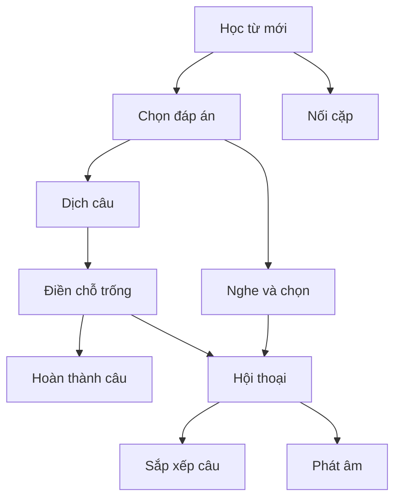
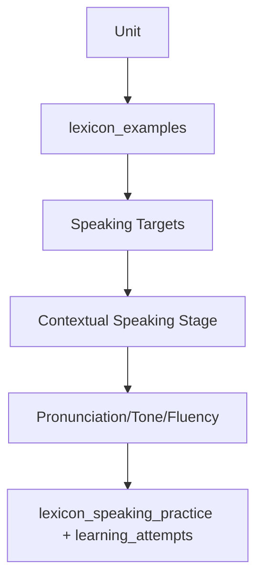
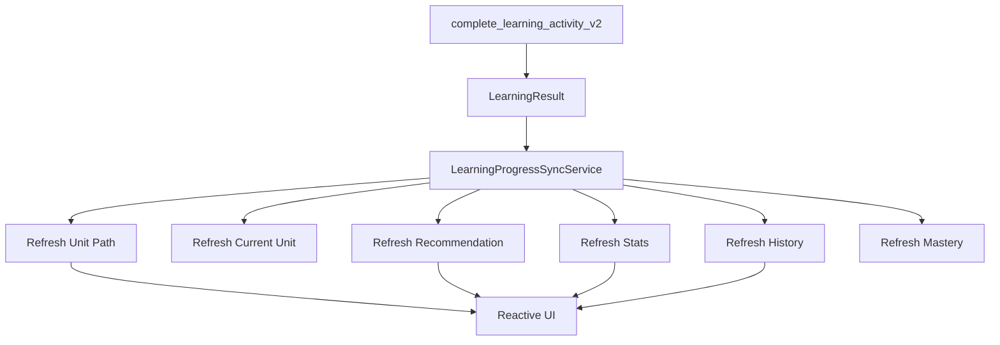
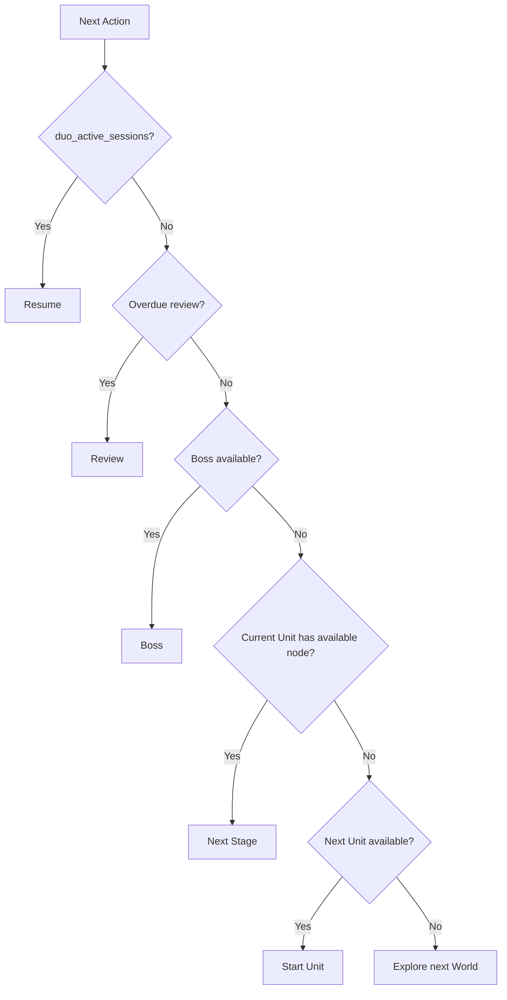

# AI PRODUCT + DATABASE MASTER SPEC
## Chinese Learning Adventure — Database-Grounded Development Plan

### Repository
- Base branch: `hieu`

### Supabase
- Project ref: `hrlahralknhijnkypjix`
- Region: `ap-northeast-2`
- PostgreSQL: 17.6
- Status at inspection time: healthy

---

# 0. NGUYÊN TẮC QUAN TRỌNG NHẤT

Đây KHÔNG phải một prompt thiết kế UI chung chung.

Mọi quyết định trong file này phải dựa vào:

1. schema Supabase thật
2. data thật
3. RPC thật
4. progression thật
5. challenge types thật
6. lexicon thật
7. Boss thật
8. history/reward tables thật

Nếu code/app hiện tại khác với dữ liệu live:
- đọc dữ liệu trước
- xác định source of truth
- sửa app theo dữ liệu thật

Không hard-code curriculum giả.

Không hard-code số ải.

Không hard-code số item mỗi ải.

Không tạo tính năng chỉ vì "trông hay" nếu database chưa support hoặc không có source dữ liệu hợp lý.

Ngược lại, nếu database đang có dữ liệu tốt nhưng app chưa khai thác, hãy chủ động đề xuất và implement feature phù hợp.

---

# 1. DATABASE INVENTORY THỰC TẾ

## 1.1 Curriculum / Duolingo content

Live database hiện có:

- `duo_courses`: 1
- `duo_sections`: 8
- `duo_units`: 310
- `duo_levels`: 310
- `duo_sessions`: 1,536
- `duo_challenges`: 64,828
- `duo_characters`: 10
- `duo_flashcards`: 12,101
- `duo_game_definitions`: 10

Sections thực tế:

- Section 1: 10 Units
- Section 2: 30 Units
- Section 3: 30 Units
- Section 4: 60 Units
- Section 5: 51 Units
- Section 6: 49 Units
- Section 7: 40 Units
- Section 8: 40 Units

Tổng: 310 Units.

Các title raw như `Path Section 0` là backend/import naming, KHÔNG được render trực tiếp cho user.

---

# 2. UNIT DATA THỰC TẾ

Section 1 hiện có curriculum thực:

1. Gọi tên món ăn và đồ uống
2. Nói về quốc tịch
3. Hỏi nghề nghiệp
4. Nói về các môn học
5. Dùng đại từ sở hữu
6. Nói về những nơi bạn ghé thăm
7. Gọi đồ uống
8. Tìm đồ dùng cần thiết khi đi du lịch
9. Giới thiệu bản thân và lớp học
10. Bàn về sở thích thể thao

Ordering chuẩn trong `duo_units`:
- `unit_number`
- `unit_index`

Ví dụ:
`sec_1_unit_1`
- unit_number = 1
- unit_index = 0

Không đảo thứ tự Unit trong UI.

---

# 3. CHALLENGE DATA THỰC TẾ

Distribution toàn database:

- `translate`: ~36,344
- `dialogue`: ~8,091
- `match`: ~6,463
- `listenTap`: ~5,574
- `assist`: ~3,756
- `gapFill`: ~3,180
- `tapComplete`: ~876
- `select`: ~397
- `orderTapComplete`: ~143
- `patternTapComplete`: rất ít

Điều này có nghĩa:

App nên ưu tiên xây UX tốt nhất cho:
1. Translate
2. Dialogue
3. Matching
4. Listening
5. Gap Fill

Không nên dành phần lớn effort cho một challenge type rất hiếm.

---

# 4. GAME DEFINITIONS THỰC TẾ

`duo_game_definitions` hiện có:

1. `learn_words`
2. `select_answer`
3. `listen_select`
4. `translate`
5. `gap_fill`
6. `tap_complete`
7. `match_pairs`
8. `dialogue`
9. `sentence_order`
10. `speaking`

Dependency graph thực tế:



`is_required_for_boss`:
- speaking hiện KHÔNG bắt buộc cho Boss
- phần còn lại phần lớn required nếu supported trong Unit

Không linearize graph này thành một chuỗi cứng nếu dependency hỗ trợ branch.

---

# 5. UNIT PATH THỰC TẾ — UNIT 1

`unit_learning_path_v2('sec_1_unit_1')` hiện trả:

1. Học từ mới — 18 challenge
2. Chọn đáp án — 8
3. Nghe và chọn — 23
4. Dịch câu — 63
5. Hoàn thành câu — 19
6. Nối cặp — 10
7. Boss — 8

Điều cực kỳ quan trọng:

> Database đã tự xác định Unit nào có stage nào dựa trên challenge thật.

Không được hard-code mỗi Unit phải có đủ 10 game.

Không được show stage không có content.

Ví dụ Unit 1 hiện không trả:
- Gap Fill
- Dialogue
- Sentence Order
- Speaking

vì không có supported content tương ứng trong path hiện tại.

App phải render động.

---

# 6. VẤN ĐỀ LỚN: CHALLENGE COUNT KHÔNG NÊN = USER SESSION SIZE

Ví dụ Unit 1:
- Translate có 63 challenge
- Listening có 23
- Learn Words có 18

Không được hiểu:
"Ải Translate = user phải làm 63 câu một lần."

`challenge_count` phản ánh available content pool.

UX cần chọn session subset hợp lý.

Tạo/reuse policy:

`LearningSessionComposer`

Nhiệm vụ:

- đọc content pool
- chọn subset theo difficulty/mastery/history
- tránh câu lặp
- ưu tiên weak items
- giữ session ngắn

Session size không hard-code toàn app.

Có thể derive theo:
- challenge type
- estimated time
- mastery
- first attempt/review
- content diversity

Ví dụ:
Translate có 63 source questions nhưng một run chỉ chọn subset hợp lý.

---

# 7. STAGE NODE SEGMENTS — PHẢI PHẢN ÁNH SESSION, KHÔNG PHẢI TOÀN CONTENT POOL

Nếu node ring hiển thị segment:

Không nên có 63 segment vì DB có 63 translate challenges.

Segment nên represent:
- required micro-objectives
hoặc
- selected session checkpoints

Tạo distinction:

```text
contentPoolCount = toàn content DB
sessionItemCount = item run hiện tại
stageProgress = progression/micro-objectives
```

Không trộn ba khái niệm.

---

# 8. LEXICON DATABASE THỰC TẾ

Hiện có:

- `lexicon_hsk_levels`: 4
- `lexicon_units`: 130
- `lexicon_words`: 2,205
- `lexicon_examples`: 7,925
- `lexicon_characters`: 935
- `lexicon_topics`: 137
- `lexicon_word_units`: 2,299
- `lexicon_word_topics`: 2,299
- `lexicon_word_sources`: 4,052

HSK distribution:

## HSK 1
- 10 Units
- 116 word links
- 313 examples

## HSK 2
- 30 Units
- 645 word links
- 2,289 examples

## HSK 3
- 30 Units
- 558 word links
- 1,995 examples

## HSK 4
- 60 Units
- 943 word links
- 3,328 examples

Lexicon hiện chỉ curated tới 4 sections, trong khi Duo curriculum có 8 sections.

Vì vậy:

- Section 1–4: có thể enrich mạnh bằng lexicon
- Section 5–8: phải fallback chủ yếu vào Duo challenge data

Không giả định toàn bộ 8 sections có lexicon coverage như nhau.

---

# 9. HSK 1 LEXICON THỰC TẾ

Per Unit:

- Unit 1: 10 words, 20 examples, ~10 main characters
- Unit 2: 7 words, 18 examples
- Unit 3: 10 words, 31 examples
- Unit 4: 7 words, 20 examples
- Unit 5: 11 words, 27 examples
- Unit 6: 13 words, 33 examples
- Unit 7: 13 words, 29 examples
- Unit 8: 13 words, 41 examples
- Unit 9: 17 words, 48 examples
- Unit 10: 15 words, 46 examples

Điều này rất phù hợp để tạo:
- vocabulary stage
- speaking practice từ examples
- Hanzi practice từ words/main_character
- review set

Nhưng lexicon unit title raw hiện kiểu:
`Section 1, Unit 1`

Không dùng title này để presentation.

Dùng `duo_units.title` làm product title.

---

# 10. CẦN TẠO UNIT MAPPING CHÍNH THỨC

Hiện tại có hai hệ:

```text
duo_units.id = text
lexicon_units.id = integer
```

Nhưng chúng tương ứng theo:
- section number
- unit number

Không nên phụ thuộc mãi vào implicit matching.

Khuyến nghị tạo mapping canonical, ví dụ:

`learning_unit_content_map`

Columns:

```text
duo_unit_id text primary key references duo_units(id)
lexicon_unit_id integer null references lexicon_units(id)
mapping_source text
created_at timestamptz
```

Hoặc thêm `duo_unit_id` vào `lexicon_units` nếu hợp schema.

Mục tiêu:

Một Unit app có thể query:
- Duo challenge content
- vocab
- examples
- Hanzi
- topics
mà không join bằng assumptions trong Flutter.

Agent phải inspect dữ liệu trước khi migration và backfill mapping bằng section/unit identity.

---

# 11. HANZI DATA THỰC TẾ

- `lexicon_characters`: 935
- stroke data có sẵn
- `lexicon_hanzi_progress` có:
  - practice_count
  - best_score
  - last_score
  - next_review_at

Đây là foundation tốt cho Hanzi mission system.

Nhưng:
- `lexicon_radicals` hiện có 0 rows

Vì vậy:

KHÔNG xây core progression phụ thuộc radicals ngay.

Radical feature:
- disabled/fallback hiện tại
- hoặc populate radical dataset bằng migration/import riêng sau này

Main Hanzi flow hiện nên dựa vào:
- lexicon_words.main_character_id
- lexicon_word_units
- lexicon_characters stroke data

---

# 12. SPEAKING REALITY

`duo_game_definitions` có `speaking`.

Nhưng live `duo_challenges` hiện không có challenge type `speaking` trong distribution.

Do đó:
- `duo_game_supported(level, 'speaking')` hiện thường false
- Speaking không tự xuất hiện trong Unit path từ Duo challenges

Tuy nhiên database có:
- 7,925 lexicon examples
- `lexicon_speaking_practice`
- vocabulary/exemplar context per Unit

Vì vậy nên phát triển Speaking theo hướng:



Không chờ `duo_challenges.type='speaking'`.

Nhưng Speaking vẫn optional cho Boss trừ khi product quyết định thay đổi curriculum.

---

# 13. BOSS DATABASE THỰC TẾ

Có 310 `boss_stages`, tương ứng các Unit.

Ví dụ Section 1:
- Unit 1 Boss: Rồng Lửa, 8 câu, 110 HP
- Unit 2: 6 câu
- Unit 3: 9 câu
- ...
- Unit 8: 16 câu

Boss question count là dynamic theo DB.

Không hard-code 5/8/10.

Boss questions lấy scope theo Unit.

---

# 14. BOSS GATING THỰC TẾ

Current server logic:

Boss available khi:
1. Unit available
2. all required supported game nodes complete
3. overall mastery >= 0.70

Đây là logic tốt, nhưng app phải hiển thị rõ:

```text
Boss chưa mở

Cần:
✓ Học từ mới
✓ Nghe
□ Dịch câu

Thành thạo:
62 / 70%
```

Không chỉ show "Chưa mở".

---

# 15. MASTERY THỰC TẾ

`private.unit_mastery_for_user` hiện tính:

- vocabulary: weight 35%
- listening: 25%
- speaking: 20%
- Hanzi: 20%

Chỉ tính skill có dữ liệu.

Mastery derive từ `learning_attempts`.

Điều này nghĩa là:

`learning_attempts.activity_type` phải được map đúng semantic skill.

Agent PHẢI kiểm tra Flutter callsite:

- learn_words → vocabulary
- select_answer → vocabulary hoặc phù hợp
- match_pairs → vocabulary
- listen_select → listening
- dialogue → dialogue
- speaking → speaking
- Hanzi → hanzi

Nếu mọi Duo game đang gửi `game_mission`, mastery có thể không phản ánh progression đúng.

Đây là P0 audit+fix cụ thể, KHÔNG phải audit toàn project.

---

# 16. UNIFIED COMPLETION PIPELINE ĐÃ CÓ

Database đã có:

`complete_learning_activity_v2`

và private authoritative function.

Nó đã:
- validate activity
- calculate pass/fail
- stars
- XP
- first_clear
- replay cap
- attempt history
- level progress
- Boss progress
- mastery
- streak
- aggregate stats
- XP event
- unlock next node
- unlock next Unit after Boss

Vì vậy:

KHÔNG xây reward system mới trong Flutter.

Flutter phải gọi pipeline này và render result.

---

# 17. LEARNING RESULT THỰC TẾ

Current RPC đã return:

- passed
- failed
- score
- accuracy
- stars
- xp_earned
- base_xp
- bonus_xp
- mastery_before
- mastery_after
- best_combo
- first_clear
- perfect
- attempt_number
- unlocked_next
- next_node_id
- reason
- new_total_xp
- current_streak
- correct_count
- wrong_count
- metadata

App phải dùng response này.

Không tự tính XP/unlock.

Khuyến nghị extend response server nếu cần thêm:

- `boss_ready`
- `boss_stage_id`
- `unit_completed`
- `next_unit_id`
- `current_unit_id`
- `next_action_type`

để UI không parse `next_node_id` quá nhiều.

---

# 18. STALE UI SAU KHI PASS — ROOT PROBLEM CẦN SỬA

Database pipeline đã update progress, nhưng screenshots cho thấy UI có thể giữ state cũ.

Đây chủ yếu là vấn đề app synchronization.

Tạo:

`LearningProgressSyncService`



Sau pass:
- current node complete
- next node available
- Unit CTA đổi
- Home recommendation đổi
- Progress timeline đổi

Không cần restart.

---

# 19. CURRENT LEARNING UNIT RPC ĐÃ CÓ

Database có:

`current_learning_unit_v2()`

Nó ưu tiên:
1. active session
2. unlocked incomplete progress
3. first available unfinished Unit

Home/Learning Hub phải dùng RPC này thay vì tự đoán current Unit từ index/local prefs.

---

# 20. LEARNING SECTIONS / UNITS RPC ĐÃ CÓ

Có:
- `learning_sections_v2()`
- `learning_units_v2(section_id)`
- `unit_learning_path_v2(unit_id)`
- `unit_mastery_v2(unit_id)`

Đây nên là main read API cho Journey UI.

Không query nhiều raw tables trong Flutter nếu RPC đã expose domain state đúng.

---

# 21. SECURITY REALITY

Database advisors hiện báo:

1. `content_sync_manifest`
   - RLS enabled nhưng không có policy

2. `pg_net`
   - extension ở public schema

3. Một số public `SECURITY DEFINER` functions đang executable bởi anon/authenticated

Đặc biệt:
- `current_learning_unit_v2`
- `learning_sections_v2`
- `learning_units_v2`
- `unit_learning_path_v2`

Agent phải review grants.

Không blind revoke nếu app cần call.

Đối với user-state RPC:
- anon access chỉ giữ nếu guest use case thực sự cần và không leak user data
- authenticated RPC phải validate `auth.uid()`
- SECURITY DEFINER exposed functions phải được coi như public API endpoints

Theo Supabase guidance, SECURITY DEFINER trong exposed API phải được review cẩn thận và EXECUTE grants phải intentional.

---

# 22. HISTORY DATABASE THỰC TẾ

`learning_attempts` đã có:

- activity_type
- level_id
- unit_id
- source_id
- status
- score
- accuracy
- correct_count
- wrong_count
- stars
- xp_earned
- metadata
- source_type
- duration_seconds
- best_combo
- mastery_before
- mastery_after
- reason
- first_clear
- perfect

Không cần tạo bảng history mới.

Dùng bảng này cho:
- Recent Activity
- Learning History
- Analytics
- Weakness detection

---

# 23. XP HISTORY DATABASE THỰC TẾ

`learning_xp_events` đã có:

- user_id
- source_type
- source_id
- activity_type
- xp_amount
- base_xp
- bonus_xp
- reason
- score
- accuracy
- stars
- idempotency_key
- metadata
- event_key
- attempt_id
- created_at

Unique index đã đúng:

`UNIQUE(user_id, event_key)`

Không tạo XP ledger mới.

---

# 24. APP USER STATS THỰC TẾ

`app_user_stats` đã có:

- total_exp
- current_streak
- last_study_date
- total_words_mastered
- total_favorites
- total_lessons_completed
- total_bosses_defeated
- total_speaking_attempts
- total_hanzi_practices
- total_minutes_studied
- highest_combo

Đây là source tốt cho Home/Profile summary.

Không recompute lifetime aggregate từ 64k challenges mỗi lần.

---

# 25. TAB ARCHITECTURE DỰA TRÊN DB

## Home
Sources:
- `current_learning_unit_v2`
- `app_user_stats`
- recommendation derived from active session/path/review

Show:
- next action
- current Unit
- streak
- XP today/lifetime summary
- Boss ready
- resume

## Learning
Sources:
- `learning_sections_v2`
- `learning_units_v2`
- `unit_learning_path_v2`
- `unit_mastery_v2`

Show:
- journey
- Unit
- Stage Map
- lock reason
- Boss distance

## Game
Sources:
- game definitions
- current Unit context
- history/mastery for adaptive practice

Role:
- practice/replay
- not duplicate curriculum

## Progress
Sources:
- `learning_attempts`
- `learning_xp_events`
- `app_user_stats`
- mastery RPC

Role:
- analytics center

## Profile
Sources:
- `app_user_stats`
- derived achievements

Role:
- lifetime identity

---

# 26. PROGRESS TAB PHẢI PHÁT TRIỂN TỪ DATA THẬT

Hiện Progress tab chỉ là 3 banners.

Thay bằng dashboard thật.

## Summary
From `app_user_stats`:
- total XP
- streak
- lessons
- Bosses
- minutes

## XP chart
From `learning_xp_events` grouped by local date.

## Study chart
From `learning_attempts.duration_seconds`.

## Skill mastery
From attempts / `unit_mastery_v2`.

## Recent timeline
From attempts + XP events + Boss progress.

## Weak skill
Derived from:
- failed attempts
- low accuracy
- low mastery
- overdue lexicon review

Không fake analytics.

---

# 27. RECOMMENDATION ENGINE — DATABASE-GROUNDED

Build `LearningRecommendationService`.

Priority:



Review due sources:
- `lexicon_user_progress.next_review_at`
- `lexicon_hanzi_progress.next_review_at`

Weak skill:
- `learning_attempts`

---

# 28. NEW FEATURE GỢI Ý DỰA TRÊN DB THẬT

## 28.1 Smart Daily Quest

Database đã đủ để tạo:

Daily Quest:
- 1 curriculum stage
- 1 weak-skill practice
- 1 review task

Reward:
- normal shared XP pipeline

Không cần bảng mới nếu quest derive daily.
Chỉ cần persistence table nếu muốn claim reward/quest completion tracking.

## 28.2 Mistake Notebook

Dựa trên:
- failed attempts
- wrong_count
- source_id
- metadata

UI:
"Sổ lỗi của tôi"

User có thể luyện lại activity lỗi nhiều.

## 28.3 Mastery Heatmap

Dựa trên attempts theo Unit/skill.

Hiển thị:
- mạnh
- đang học
- yếu
- cần ôn

## 28.4 Boss Preparation

Trước Boss:
server đã biết missing required stages + mastery threshold.

UI:
"Chuẩn bị đánh Boss"

Show:
- required nodes
- mastery
- recommended weak skill practice

## 28.5 Adaptive Practice

Use:
- low scores
- recent wrong
- overdue
- challenge pool

Composer chọn câu phù hợp thay vì random.

## 28.6 Contextual Speaking

Generate targets từ `lexicon_examples`.

Đây là feature đặc biệt phù hợp database hiện tại vì speaking challenges raw chưa có.

## 28.7 Hanzi Missions

Generate từ words trong current Unit + `main_character_id`.

Không chọn random toàn character catalog.

---

# 29. KHÔNG PHÁT TRIỂN NGAY NHỮNG FEATURE NÀY

## Radical-heavy progression
Vì `lexicon_radicals` hiện 0 rows.

Có thể chuẩn bị UI fallback nhưng không lấy radical làm core.

## Speaking from duo challenges
Vì không có live speaking challenge type đáng kể.

Dùng lexicon examples trước.

## Generic AI generated curriculum replacing DB
Không cần.
DB curriculum đã rất lớn và đủ structure.

AI chỉ enrich:
- explanation
- feedback
- conversation variation
không thay source curriculum.

---

# 30. UNIT UI DỰA TRÊN PATH THẬT

Không show "7 ải" nếu RPC trả 6 learning nodes + Boss.

Count từ `unit_learning_path_v2`.

Ví dụ Unit 1:

```text
Bài 1
Gọi tên món ăn và đồ uống

6 ải học
1 Boss
```

Path:
- Học từ mới
- Chọn đáp án
- Nghe và chọn
- Dịch câu
- Hoàn thành câu
- Nối cặp
- Boss

Không thêm Dialogue/Hanzi/Speaking như core stage nếu path chưa đưa vào.

Có thể thêm "Luyện thêm" contextual side activities, nhưng phải phân biệt:
- Core path
- Optional practice

---

# 31. CORE PATH VS OPTIONAL PRACTICE

Đây là distinction rất quan trọng.

## Core Path
Source:
`unit_learning_path_v2`

Ảnh hưởng:
- required progression
- Boss gating

## Optional Practice
Source:
- lexicon examples
- Hanzi
- speaking
- review
- game practice

Ảnh hưởng:
- mastery
- XP
- retention
- recommendation

Nhưng không được giả vờ là required Stage nếu DB `is_required_for_boss=false` hoặc path không chứa.

---

# 32. DESIGN: CORE VS OPTIONAL

Core nodes:
- lớn
- nằm trên path
- progress ring
- lock state
- dẫn tới Boss

Optional activities:
- side quests
- scroll/chest/campfire icon
- không làm path dài hơn giả tạo

Điều này sẽ làm app game-like hơn và phản ánh database thật.

---

# 33. WORLD MAPPING GỢI Ý

Duo có 8 sections, trong khi lexicon HSK có 4.

Không map mù:
Section 1 = HSK1...
Section 8 = HSK8

Chinese HSK product structure phải được xác nhận từ curriculum.

Có thể presentation hóa 8 sections thành Worlds/Regions riêng.

Lexicon HSK metadata dùng để enrich Section 1–4.

Section 5–8 dùng curriculum titles/objectives từ Duo.

Tạo presentation config DB nếu muốn custom world names:

`learning_world_presentation`

Ví dụ fields:

```text
section_id
display_name
display_name_vi
theme_code
subtitle
sort_order
hero_asset_key
```

Content progression vẫn dựa `duo_sections`.

Presentation metadata có thể DB-driven để app không hard-code Bamboo Village/etc.

---

# 34. UI DESIGN SYSTEM — DATABASE-AWARE

UI không chỉ khác màu.

Mỗi state phải phản ánh DB state:

- locked
- available
- in_progress
- failed
- completed
- perfect
- boss_ready
- completed_unit

Không dùng visual "available" cho completed node.

Không dùng `0/x` stale sau refresh.

---

# 35. STAGE RESULT

After `complete_learning_activity_v2`:

Render response:

```text
ẢI HOÀN THÀNH

score
accuracy
stars

+XP
mastery delta
combo

Mở khóa:
next node
```

CTA:
- retry
- next node
- Boss
- next Unit
- map

Dựa server result/refreshed path.

---

# 36. LIVE REFRESH ACCEPTANCE

Scenario:

Unit 1 Stage 1 complete.

Immediately after result:

1. `unit_learning_path_v2` refresh
2. Stage 1 = completed
3. newly eligible nodes = available
4. Unit CTA points next best node
5. Home next action changes
6. Progress history shows attempt
7. XP chart/data changes
8. Profile XP changes

No restart.

No manual refresh.

---

# 37. ANALYTICS RPC GỢI Ý

Database hiện chưa có dedicated dashboard RPC.

Agent có thể tạo:

## `learning_dashboard_v1()`

Return one JSON:

```json
{
  "stats": {},
  "current_unit": {},
  "next_action": {},
  "xp_today": 0,
  "xp_week": 0,
  "study_minutes_week": 0,
  "recent_attempts": [],
  "skill_mastery": {},
  "review_due": {},
  "boss_ready": false
}
```

Ưu điểm:
- Home/Progress load nhanh
- giảm nhiều request
- logic server thống nhất

Nhưng chỉ tạo sau khi inspect current Flutter query patterns.

---

# 38. HISTORY RPC GỢI Ý

Có thể tạo:

`learning_history_v1(p_limit, p_offset, p_activity_type)`

Dựa:
- `learning_attempts`
- join duo unit title
- XP event by attempt_id

Output UI-ready nhưng vẫn domain-clean.

---

# 39. SECURITY HARDENING

Không bỏ qua advisors.

P1 security:

- review `SECURITY DEFINER` public RPC grants
- remove anon execute nếu không cần
- authenticated functions phải only read/write current user
- user reward tables nên SELECT own; authoritative mutation qua RPC
- tránh direct mutation aggregate/reward state từ client nếu có thể

Không phá guest content reads.

---

# 40. PERFORMANCE

64,828 challenges là lớn.

Không fetch toàn Unit challenge pool về Flutter.

Query theo:
- level
- game_code
- limit/session composition

Analytics:
- index by user/created already có
- XP and attempts indexes hiện đã tồn tại

Không xóa "unused indexes" chỉ vì advisor nói unused trong project mới; chưa đủ production traffic để kết luận.

---

# 41. IMPLEMENTATION PRIORITY DỰA TRÊN DATABASE THẬT

## P0 — Progression correctness
1. inspect Flutter call to `complete_learning_activity_v2`
2. fix activity_type semantic mapping
3. consume returned `LearningResult`
4. shared refresh after completion
5. Unit CTA transition
6. next node unlock display
7. Boss ready transition
8. Boss win → next Unit

## P0 — Cross-tab state
9. Home uses current_learning_unit/recommendation
10. Progress uses attempts + XP events
11. Profile uses app_user_stats
12. Learning uses v2 Journey RPCs

## P1 — Analytics
13. Progress dashboard
14. XP history
15. Learning history
16. skill mastery
17. weak-area recommendation

## P1 — Content enrichment
18. official duo↔lexicon unit mapping
19. contextual Speaking from examples
20. Hanzi missions from Unit vocabulary
21. SRS/review integration

## P2 — Adventure UX
22. Stage node/path
23. Boss preparation
24. side quests
25. world presentation metadata

## P3 — Future
26. populate radicals
27. richer achievements
28. adaptive daily quests
29. advanced AI feedback

---

# 42. TESTS BẮT BUỘC

## DB integration tests

- first Unit available
- later Unit locked
- completed Stage unlock dependency
- path only returns supported game types
- Boss unavailable before requirements
- Boss requires 70% mastery
- Boss win unlocks next Unit
- idempotent completion does not duplicate XP
- XP event unique per user/event
- attempt history saved
- current_learning_unit changes correctly

## Flutter tests

- Stage Result updates node state
- no stale CTA
- Home recommendation refresh
- Progress history refresh
- returning user resumes
- dynamic path count
- missing optional game does not render empty node

---

# 43. FINAL PRODUCT PRINCIPLE

Do not design app from screenshots alone.

Design app from:

```text
Curriculum data
+ user history
+ mastery
+ unlock graph
+ content availability
+ review state
+ game state
```

Then UI expresses that state beautifully.

The database is not merely storage.

It is the foundation of:
- curriculum
- progression
- adaptation
- analytics
- retention
- recommendations
- game mechanics

---

# 44. AUTONOMOUS PRODUCT DEVELOPMENT RULE

Agent is allowed to suggest and implement product improvements when:

1. live database clearly supports them
2. they improve learning or retention
3. they fit existing architecture
4. they do not duplicate existing state
5. they preserve authoritative server logic

Before creating a new table:
- prove existing tables cannot support it

Before adding a new core stage:
- prove curriculum/content exists for it

Before hard-coding:
- check if presentation/config can be data-driven

---

# 45. TOKEN / CONTEXT HANDOFF

If context/token is running low:

Create/update:

`docs/AI_HANDOFF.md`

Include:

```markdown
# AI HANDOFF

## Repository
## Branch
## Current Goal

## Live Database Facts Used
Tables:
RPCs:
Migrations:
Important row counts:
Current curriculum behavior:

## Completed
## Files Changed
## Migrations Added
## Applied Live
## Tests

## Cross-tab Status
Home:
Learning:
Game:
Progress:
Profile:
Boss:

## Known Bugs

## Git State

## NEXT STEP
Only one highest-priority next step.

## DO NOT REDO
```

Before stopping:
- format
- focused tests
- commit
- push
- record migration state

If does not compile:
`WORK IN PROGRESS - DOES NOT COMPILE`

---

# 46. STARTUP FOR NEXT AGENT

1. read this spec
2. read `docs/AI_HANDOFF.md`
3. git status
4. git log -5
5. inspect latest migrations
6. verify live Supabase state for touched objects
7. continue NEXT STEP

Do not re-audit everything unless live DB/schema changed materially.

---

# 47. FINAL EXECUTION RULE

DO NOT STOP AT PLANNING.

Start with P0.

The most important immediate bug is:

> completion succeeds in database but the application still shows stale progression / old CTA / old next action.

Fix that end-to-end first.

Then use the existing rich database to evolve the app intelligently instead of hard-coding more UI.
