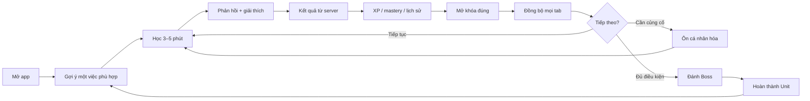
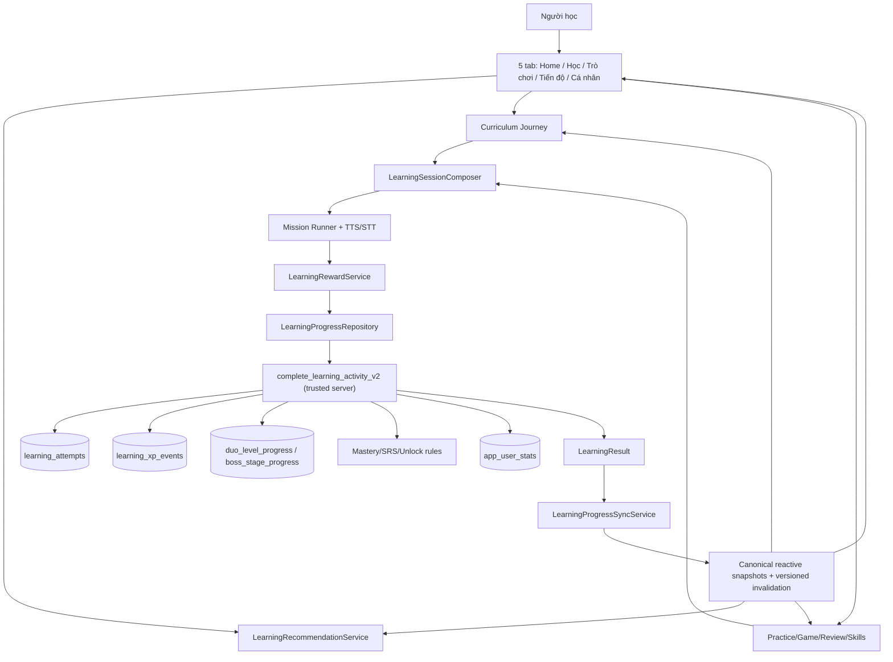
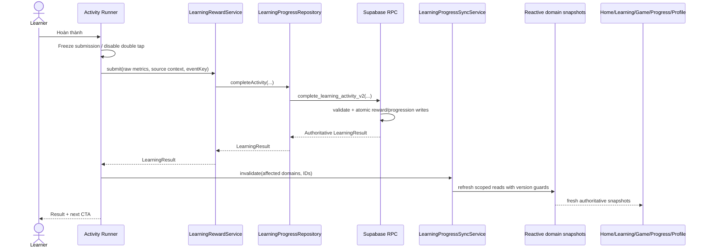
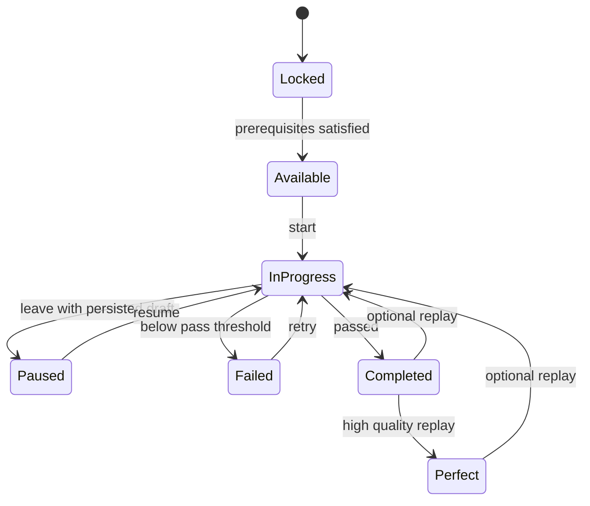
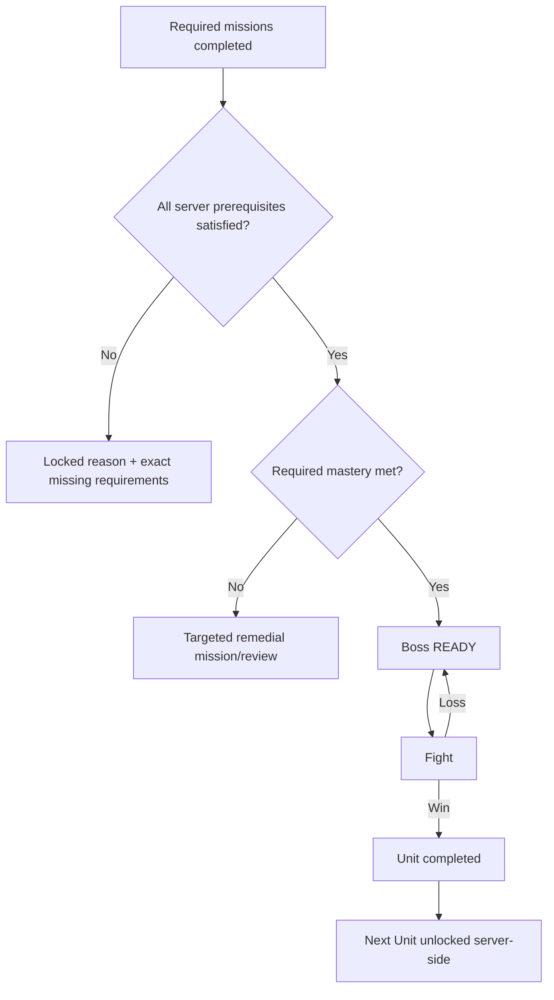
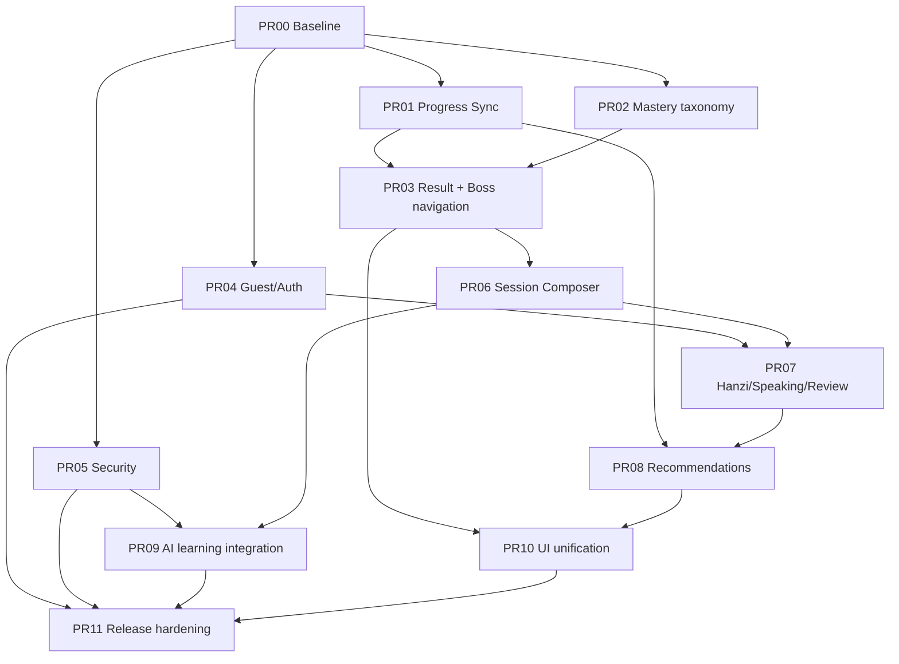
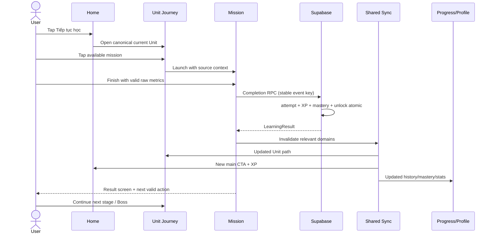

# MASTER IMPLEMENTATION SPEC — HOÀN THIỆN CHINESE LEARNING ADVENTURE
## Tài liệu giao việc trực tiếp cho Codex / Gemini / AI Coding Agent

- **Phiên bản:** 1.0 — 2026-10-11
- **Ứng dụng:** APP Tiếng Trung / Chinese Learning Adventure
- **Repository:** `learnappChinese/learnchinesene`
- **Nhánh tích hợp:** `hieu`
- **Supabase project:** `hrlahralknhijnkypjix`
- **Cơ sở hiện trạng:** `CURRENT_APP_FLOW_ARCHITECTURE.md`, snapshot branch `hieu` ở commit `a618640`
- **Loại tài liệu:** Specification + execution backlog + acceptance criteria + test contracts
**Kỳ vọng:** AI **viết code thực sự**, tích hợp từng PR, kiểm thử, báo cáo bằng chứng — không chỉ phân tích hoặc thay giao diện.

> **Lưu ý quan trọng về bằng chứng:** Tài liệu này tổng hợp báo cáo Deep Research vừa hoàn thành với bản reverse-engineering mới nhất mà người dùng cung cấp. Báo cáo reverse-engineering là bằng chứng kiểm tra code tại snapshot đã nêu; nhiều nhận định Deep Research là **thiết kế mục tiêu**, chưa phải tính năng đã tồn tại. Chẳng hạn Deep Research dùng các route minh họa kiểu `/stage/:id/result` và nói chưa có idempotency, nhưng snapshot thực tế cho biết app dùng `Get.to/Get.off` trực tiếp, RPC đã có cơ chế idempotency. **Không được** triển khai những giả định chưa xác minh hoặc tạo thêm bảng vì một ví dụ trong nghiên cứu.

---

# 00. LỆNH KHỞI ĐỘNG CHO AI

Bạn là **Lead Flutter Engineer + Supabase/PostgreSQL Engineer + EdTech Product Designer + QA Lead** của dự án này.

**Bắt tay vào sửa sản phẩm ngay, theo từng PR nhỏ, có test, sau khi đối chiếu nhanh thực tế code hiện hành. KHÔNG lặp lại audit toàn dự án.**

Ưu tiên nguồn chân lý theo thứ tự:

1. **Live code + HEAD thực tế của nhánh làm việc**.
2. **Live Supabase schema/grants/RPC** nếu tool được cấp quyền; không đoán.
3. SQL migration, test và cấu trúc repository tại HEAD.
4. `docs/CURRENT_APP_FLOW_ARCHITECTURE.md` (bản audit snapshot).
5. Tài liệu này (TARGET, không phải hiện trạng).
6. Nghiên cứu UX/EdTech (nguyên lý, không phải hành vi runtime).

Nếu xung đột: ghi `DIFF_FROM_AUDIT`, nêu file/function/commit và tin vào code/DB được xác nhận mới nhất. Kiểm tra xem PR hoặc branch hiện tại đã sửa lỗi nào; không sửa hai lần.

**Cấm** push trực tiếp `hieu`, rewrite lịch sử, thay mass-refactor, drop table, xóa tiến độ người dùng, cấp quyền client sửa XP hoặc entitlement, tạo dữ liệu học giả để che backend lỗi. Chỉ deploy migration sau khi kiểm tra SQL, grants/RLS, chạy thử trên staging và có quyền/chấp thuận phù hợp. Khi có việc cần xác minh qua Android/iOS thật nhưng không có thiết bị, ghi `BLOCKED_DEVICE_VERIFICATION` với checklist cụ thể.

---

# 01. ĐÍCH ĐẾN SẢN PHẨM

App phải trở thành **một cuộc phiêu lưu học tiếng Trung thống nhất**. Nó không phải năm tab rời nhau, cũng không phải 310 level đứng riêng bên cạnh vài mini-game.

**Lời hứa sản phẩm:** Người dùng mở app lên và luôn hiểu:
- Tôi đang học **điều gì**?
- Tôi vừa **tiến bộ ở đâu**?
- Nên **làm gì tiếp** và mất bao lâu?
- Nếu sai, tôi **sửa điểm yếu nào**?
- Nếu thắng Boss, thế giới mới **mở như thế nào**?

Vòng lặp trải nghiệm chuẩn:



**Nguyên tắc giáo dục:** Ưu tiên học thật (retrieval practice, spaced repetition, immediate corrective feedback, luyện nghe–nói–đọc–viết, kiểm tra chuyển giao kiến thức). XP và hoạt cảnh chỉ giúp người học nhận thấy thành tựu, không thay thế việc hiểu/bền kiến thức. Không tạo cơ chế ép streak hoặc gây lo âu.

**Nguyên tắc UI:** Chinese Fantasy Adventure: Panda/Dragon, giấy cổ, tre, mực, ngọc, vàng, đỏ thẫm, chuyển động tinh tế; giao diện hiện đại, rõ chữ, mượt trên điện thoại yếu. **Không** thay theme bằng dashboard công sở, không xếp chồng thẻ trắng đơn điệu, không để một màn đẹp và màn kế tiếp đen/trắng lạc phong cách.

---

# 02. CÁC PHẦN ĐÃ CÓ — PHẢI GIỮ, KHÔNG XÂY LẠI

Tại snapshot của `CURRENT_APP_FLOW_ARCHITECTURE.md`, đã có:

- Flutter + GetX + `IndexedStack` 5 tab.
- RPC đọc hành trình `current_learning_unit_v2`, `learning_sections_v2`, `learning_units_v2`, `unit_learning_path_v2`.
- Luồng phần thưởng signed-in `LearningRewardService` → `SupabaseLearningProgressRepository` → `complete_learning_activity_v2`.
- Bảng lịch sử `learning_attempts`, ledger `learning_xp_events`, tổng hợp `app_user_stats`.
- Cơ chế signed-in completion RPC có **idempotency**, đánh sao/XP, ghi attempts, mastery/progress/streak/unlock. **Phải kiểm tra implementation/unique constraint**, không được kết luận “chưa idempotent” chỉ vì báo cáo nghiên cứu tổng quát.
- `duo_active_sessions` và guest progress bằng local persistence.
- Boss stage/progress, Hanzi writing stroke data, Speaking STT, từ vựng/lexicon/SRS.
- Bộ mini-game Dragon/Panda, HSK, Dictionary, AI Lessons, Conversation, HSK Quiz/Exam.
- Progress tab có XP ledger, attempts, bảng tiến độ — **không phải màn hoàn toàn giả**.
- TTS/audio và Game Hub hiện hữu.
- Phần lớn completion đã chuyển từ client-computed sang server-authoritative cho signed-in.

**KHÔNG tái tạo:**
`learning_sessions`, `learning_attempts`, `learning_xp_events`, `duo_active_sessions`, `app_user_stats`, `duo_level_progress`, `boss_stage_progress` hoặc `lexicon_user_progress` trước khi chứng minh schema thiếu. Không biến ví dụ SQL trong Deep Research thành migration tự động.

**Cần nhớ giới hạn:** Audit này chỉ là static snapshot; chưa xác nhận live Supabase production. Không gán nhãn runtime-verified khi chỉ đọc migration/code.

---

# 03. BẢNG LỖI CÓ CƠ SỞ TỪ AUDIT

| ID | Mức độ | Tình trạng ở snapshot | Tác động đến người học | Hướng xử lý |
|---|---|---|---|---|
| P0-01 | P0 | Không có `LearningProgressSyncService` chung; nhiều screen tự gọi `HomeController.refreshStats()` | Hoàn thành ải nhưng tab khác vẫn cũ | Typed domain invalidation + shared snapshots |
| P0-02 | P0 | Nhiều Duo gameCode bị map thành `game_mission` | XP/complete đúng nhưng mastery/Boss không phản ánh năng lực | Taxonomy/mapping chuẩn + DB mastery aggregation |
| P0-03 | P0 | Home/Progress cập nhật có điều kiện; Profile/Game/Sections/Units có thể stale | “Đã xong” nhưng màn khác vẫn khóa | Update toàn bộ mounted consumers + on-resume revalidation |
| P0-04 | P0 bảo mật | Premium entitlement từ SharedPreferences/purchase stream, **chưa verify receipt server** | Gian lận premium, khó phục hồi đa thiết bị | Backend entitlement verified + store validation |
| P0-05 | P0 sản phẩm | Không có auth/account lifecycle hiển thị rõ | Guest không biết lưu tiến độ; merge/logout/account switch mơ hồ | Onboarding/identity + guest migration |
| P1-01 | P1 | `LearningResult` model có fields extended nhưng migration RPC chưa thể hiện rõ | CTA next/Boss dễ fallback sai | Contract test RPC–Dart và explicit readback |
| P1-02 | P1 | Boss Unit Complete hiển thị `xpEarned: 50` cứng | XP nhận khác XP hiển thị | Dùng server result |
| P1-03 | P1 | Chuỗi `Get.off` Boss victory/Unit Complete | Caller đôi khi không nhận result để refresh | Navigation outcome typed, deterministic |
| P1-04 | P1 | Guest `_unlockNextGuestLevel()` suy diễn tuyến tính | Guest có thể mở khác signed-in | Guest dựa vào cùng dependency definition |
| P1-05 | P1 | `HomeController.refreshStats` phụ thuộc nhiều Future; failure một nhánh gây fail chung | Mất cả dashboard vì một endpoint lỗi | Slice-wise refresh, graceful partial failure |
| P1-06 | P1 | Profile snapshot, `lastStudyDate` gán hiện tại | Thống kê không đáng tin | Canonical stats + giá trị DB |
| P1-07 | P1 | Hanzi/Speaking stage thiếu context `unitId/levelId` tin cậy | Học được nhưng không liên kết Unit | Typed source context |
| P1-08 | P1 | Review/flashcard/mark learned không invalidate thống nhất | Số từ ôn và Home sai sau action | SRS event + cache invalidation |
| P1-09 | P1 | Một số loaders lấy toàn bộ pool Unit; fallback ngẫu nhiên/hardcode | Nặng, câu hỏi lạc bài, lặp | Server-scoped bounded session composer |
| P1-10 | P1 | HSK Quiz Gemini không có durable attempt/XP/history; Exam lưu AI history có thể mất khi analysis fail | Hệ học và AI tách rời | Canonical activity policy + durable results |
| P1-11 | P1 bảo mật | `GEMINI_API_KEY` client build-time gọi API trực tiếp | Key không thể giữ bí mật; lạm dụng/quota | Backend proxy/Edge Function, rate limit |
| P1-12 | P1 | Nhiều `FlutterTts` instance khác nhau | Chồng giọng, unavailable engine, lifecycle rối | TTS/audio focus coordinator |
| P1-13 | P1 | Nối lexicon integer ID ↔ Duo text ID theo section/unit number | Có thể học nhầm context | Typed ID bridge có xác minh |
| P1-14 | P1 | 2 hệ History: Supabase learning và local AI JSON | “Lịch sử” không thống nhất | UI phân biệt và kế hoạch đồng bộ |
| P2-01 | P2 | Game Center, Legacy HSK/Unit, Chapter, Journey có nhiều đường tiến độ | Người dùng lạc bản đồ | Một canonical journey, game là practice |
| P2-02 | P2 | Session không dựa mastery/history; random/hardcode | Thiếu cá nhân hóa | Retrieval/adaptive selection v1 |
| P2-03 | P2 | Controller bindings và `Get.put` fallback chồng nhau; DI subscription đăng ký trùng | Leak/state bất thường | Route ownership cleanup |
| P2-04 | P2 | Home XP card có fallback Today→Lifetime | Người dùng hiểu sai | No semantic substitution |
| P2-05 | P2 | Silent `catch (_) {}` trả empty | Lỗi backend giống “chưa có dữ liệu” | Typed errors + retry |
| P2-06 | P2 | On-resume refresh tập trung ở Profile | Mở lại thấy progress cũ | App lifecycle invalidation |

**Không kết luận đã xảy ra ngoài thực tế:** “pass nhưng level tiếp vẫn locked” là **triệu chứng cần test trực tiếp với live RPC**; audit cho thấy khả năng mismatch từ taxonomy/sync, không chứng minh mọi Unit bị khóa.

---

# 04. CÁC GIẢ ĐỊNH TRONG BÁO CÁO NGHIÊN CỨU PHẢI HIỆU CHỈNH

1. Nghiên cứu vẽ named routes `/home`, `/world/:id`, `/stage/:id/result` như thể đang triển khai. **Code snapshot dùng `Get.to/Get.off` trực tiếp và không có named GetPage table.** Treat các route vẽ trong research là **TARGET/ILLUSTRATION**, không là file/API hiện hữu.
2. Nghiên cứu đề xuất tạo `learning_sessions` nhưng **đã có `duo_active_sessions`**. Chỉ mở rộng schema nếu chứng minh cần, không tạo trùng.
3. Nghiên cứu nói completion chưa idempotent; snapshot mô tả v2 RPC **đã xử lý idempotency**. Thực hiện duplicate/replay/concurrency tests để tìm thiếu sót thực tế.
4. Nghiên cứu dùng `notifyListeners` cho GetX; phải dùng cơ chế Rx/Obx/update/stream đúng hiện trạng hoặc chọn kiến trúc reactive phù hợp, không chắp vá Flutter ChangeNotifier tùy tiện.
5. Ví dụ `CREATE VIEW recent_xp ... auth.uid()` chưa chứng minh đúng field/table/grants trong schema. Không copy SQL minh họa lên production.
6. Nghiên cứu mô tả `LearningRecommendationService` hoàn chỉnh; audit lại ghi các recommendation facades đang trùng/overlap. Phải xác định cái đang có, hợp nhất, test.
7. Không tự áp đặt thứ tự “review luôn trước Boss”: priority phải tôn trọng active session và trạng thái hiện tại, có khả năng cho user chọn.
8. Nghiên cứu gợi ý Boss XP cố định và state machine tiêu chuẩn; **chính xác XP/threshold là cấu hình backend**, không hard-code con số từ nghiên cứu.
9. Các ngưỡng pass/mastery/score viết bên dưới là **giá trị thiết kế ví dụ**; đọc `LearningRulesConfig`, RPC và tests hiện hữu trước khi đổi.
10. Bảo mật không thể hoàn tất chỉ bằng UI; IAP verify và API-key proxy phải được xử lý server-side rồi mới được công bố hoàn thành.

---

# 05. KIẾN TRÚC ĐÍCH — MỘT NGUỒN CHÂN LÝ, NHIỀU MÀN HÌNH

## 05.1 Domain model

```text
Course / HSK World
  └── Section / Region
        └── Unit / Bài học
              ├── Mission / Stage (skill objective)
              │     └── Challenge / câu hỏi
              └── Boss checkpoint (nếu có)
```

**Curriculum progression** khác **optional practice**:
- Unit Journey: xác định unlock, required mission, Boss gate.
- Game Center: luyện tập nhanh/replay/daily/challenge; không tự mở Unit nếu thiếu hợp đồng server.
- SRS/Review: ôn tập theo độ nhớ/điểm yếu; thay đổi mastery khi metadata đúng.
- AI Lessons/Conversation: hỗ trợ học; đánh giá/ghi nhận chỉ khi có objective/metrics hợp lệ và policy rõ.

Không gọi mỗi `duo_level` là “Chương”. Không hiển thị `section_0`, `PATH SECTION 0`, game_code hoặc `1/310` cho learner.

## 05.2 Sơ đồ hệ thống đích



## 05.3 Source of truth contract

| Data | Authoritative storage | Read facade | Invalidation |
|---|---|---|---|
| current unit / next stage | v2 journey RPCs + progression table | JourneyRepository | completion, auth change, app resume |
| stage completion/unlock | `unit_learning_path_v2` / `duo_level_progress` | UnitPathRepository | completion, guest merge |
| XP ledger | `learning_xp_events` | HistoryRepository | reward event |
| lifetime XP/streak | `app_user_stats` / stats RPC | StatsRepository | reward event, auth change, day boundary |
| skill mastery | server mastery computation | MasteryRepository | appropriate skill activity |
| Boss readiness | server gate/path | JourneyRepository | relevant mission/mastery activity |
| review due | lexicon progress + SRS rules | ReviewRepository | word review/flashcard/speaking/Hanzi |
| session resume | `duo_active_sessions` or validated guest local | SessionRepository | start/save/finish/abandon |
| premium access | **verified server entitlement** (target) | EntitlementRepository | IAP verification, restore, auth change |

Không cho widget đọc Supabase trực tiếp nếu dữ liệu đã có domain repository. Không copy server state làm canonical ở nhiều controller.

---

# 06. THIẾT KẾ `LearningProgressSyncService` (PRIORITY P0)

## 06.1 Yêu cầu

Sau bất kỳ **thay đổi đã commit thành công** (mission, Boss, review, flashcard/SRS, speaking, Hanzi, mini-game, guest migration), mọi nơi sử dụng dữ liệu đó phải nhận invalidation tương ứng.

Không phải “đợi HomeController còn sống rồi refresh”. Không phải refresh tất cả dữ liệu mỗi khi bấm tab. Không gọi network ở mỗi frame.

Đề xuất lớp:
- `LearningDomainEvent`: event typed (activityCompleted, lexiconReviewed, bossCompleted, sessionChanged, profileChanged, identityChanged).
- `LearningProgressSyncService`: phát invalidation; thông báo `generation`/`version` tăng.
- `LearningSnapshotStore` hoặc các repository reactive cache có key `(userId, domain, entityId)`.
- `SyncCoordinator`: refetch theo domain, coalesce duplicate refresh, chống stale response ghi đè state mới, retry có kiểm soát.

**Tên class/file chỉ là đề xuất**, AI chọn vị trí tương thích code hiện tại; không tạo global singleton cồng kềnh ôm business logic.

## 06.2 `LearningResult` + transaction contract

Response tối thiểu có:
- `attemptId`, `eventKey` (hoặc idempotency key)
- `status` (`passed`/`failed`/`abandoned` hợp lệ theo backend)
- `xpEarned`, `totalXp` nếu server trả
- `stars`, `score`, `accuracy`
- `unitId`, `stageId`, `gameCode`, `skillDimensions`
- `masteryBefore`, `masteryAfter` khi có
- `unlockedNodes`, `nextNodeId`, `bossReady`, `unitCompleted`, `nextUnitId`
- `serverTimestamp`/`revision` nếu hỗ trợ

**Không bắt buộc phải thêm hết field vào DB**. Có thể derive read-only những field chưa có bằng `unit_learning_path_v2` sau completion; UI không được đoán nextNodeId bằng `index+1`.

Data contract rule:
- `LearningActivitySubmission` gửi **raw metrics và IDs nguồn**, không gửi XP/first-clear/won mà server tin mù quáng.
- Server recompute, validate ownership, expected Unit/Stage/level relation, allowed game code, anti-cheat và write atomically.
- Response contract được test bằng real RPC fixture.
- Authenticated signed-in app không tính lại XP ở Dart.
- Retry trên cùng `eventKey` trả cùng kết quả; duplicate không tạo thêm ledger event.

## 06.3 Sequence diagram



## 06.4 Atomicity và lỗi mạng

- **DB transaction đã thành công nhưng refresh UI fail:** giữ result hợp lệ, đánh dấu snapshot stale, retry nền khi về tab/resume; **không submit completion lần hai**.
- **Timeout không biết RPC có commit chưa:** retry với cùng idempotency key, không tạo key mới.
- **Refresh A cũ trả sau refresh B mới:** discard generation cũ.
- **User logout/chuyển tài khoản:** clear cache theo user, hủy update pending, không hiển thị dữ liệu người dùng trước.
- **Guest merge:** dedup attempts, merge max/highest valid progress và XP theo unique event, không cộng tổng guest mù quáng.

## 06.5 Acceptance

- Sau Mission pass: ngay lần render tiếp theo/sau khi readback hoàn tất, Unit path + Home CTA + Progress XP/history + Profile stats thấy cùng backend truth.
- Không restart hay manual pull-to-refresh.
- Chỉ 1 XP event cho double-click/network retry.
- Partial failure không làm các slice thành công biến thành 0.
- Mounted tabs trong `IndexedStack` nhận đúng invalidation.
- Có tests cho race/unmount/login-switch/offline retry.

---

# 07. TAXONOMY NĂNG LỰC VÀ MASTERY (P0)

Đừng để hàng loạt game `game_mission` khiến mastery không đổi. Thiết kế **một mapping nguồn** theo gameCode, activityType và skill dimensions; dùng cả server và Flutter theo cùng contract.

Đề xuất skill dimensions:
- `vocabulary_recognition`
- `vocabulary_recall`
- `listening`
- `reading`
- `sentence_construction`
- `speaking`
- `hanzi`

Nếu DB hiện chỉ có 4 bucket lớn `vocabulary/listening/speaking/hanzi`, sử dụng bảng quy đổi tạm **có xác nhận product policy**, tránh tự thêm mọi dimension như migration mới ngay.

| game code / hoạt động | Skill gợi ý | Quy tắc |
|---|---|---|
| `learn_words` | vocabulary recognition | đóng góp recognition; không thay mastery bằng 1 lần đọc thẻ |
| `select_answer` | vocabulary recognition / reading | tùy nội dung challenge, xác định đúng mapping |
| `word_connect`, `match_pairs` | vocabulary association | đúng Unit + đủ dữ liệu |
| `listen_select` | listening | cần phân biệt nghe thật với nhìn chữ |
| `translate` | reading/sentence/vocab recall | map theo chiều dịch và challenge |
| `gap_fill`, `tap_complete`, `sentence_order` | sentence construction | có thể quy đổi vào bucket hiện hữu |
| `dialogue` | listening/speaking/context | chỉ tính speaking nếu thực sự thu âm, không mặc định |
| `speaking` | speaking | điểm phát âm dựa STT/assessment có giới hạn |
| Hanzi trace/write | hanzi | stroke/shape metrics từ engine thực |
| review quiz | đúng skill + SRS | không tính như core mission nếu không liên kết node |
| Boss | summative checkpoint | không tự nâng tất cả skill lên 100% |

**Quan trọng:** Không map `select_answer` thành speaking hoặc nghe nếu người dùng chỉ đọc chữ. Skill mastery nên dựa **bằng chứng đúng loại**, không chỉ “vừa chơi trò đó”.

Check:
- first clear khác replay;
- failed attempts được lưu nhưng không mở khóa;
- duplicate không tăng XP/mastery;
- mastery có thể tăng nhờ review đúng logic nhưng stage completion riêng;
- Boss gate đọc chính xác skill thresholds hiện hành, không chết vì bucket bỏ sót.

---

# 08. PROGRESSION, DEPENDENCIES, BOSS VÀ NAVIGATION

## 08.1 State machine đích



**Invariant:** `Failed` không tự trở lại `Locked` nếu prerequisites vẫn đạt. `Completed` không biến mất sau replay fail.

## 08.2 Server Boss gate



Boss `won` phải tính từ battle metrics đáng tin, không chỉ từ client boolean. Không đổi Boss gate nếu chưa xác minh rule và cách nhập dữ liệu hiện có.

## 08.3 NextAction resolver (một service)

Priorities **đề xuất và dễ thay đổi**:
1. Active session → Resume.
2. Vừa hoàn thành Unit → Next Unit.
3. Boss ready → Boss (trừ khi user chọn ôn).
4. Overdue review quan trọng → Review (không khóa user khỏi Unit).
5. Mission đang mở/đang học → Continue.
6. Skill yếu → targeted practice.
7. Khám phá world/Unit tiếp theo.

Dùng context của action hiện tại; **không nhảy sang Unit khác** vì có review ở nơi khác.

## 08.4 Navigation outcome

Dùng typed outcome thay vì bool result mơ hồ:

```text
ActivityExit =
  completed(LearningResult)
  | failed(LearningResult)
  | paused(sessionId)
  | abandoned
  | cancelled
```

Boss flow cần một owner cho navigation và trả outcome tới Unit Overview. Không dùng chuỗi `Get.off` làm mất result. Đảm bảo Android system Back hoạt động đúng, pop đúng một tầng.

## 08.5 CTA Result quyết định từ server

| Outcome | CTA chính | CTA phụ |
|---|---|---|
| Fail | Thử lại | Xem lời giải / Về ải |
| Pass còn mission | Tiếp tục ải kế | Xem tiến độ |
| Pass nhưng mastery thiếu | Luyện kỹ năng yếu | Về ải |
| Boss ready | Chiến đấu Boss | Ôn thêm |
| Boss loss | Thử lại Boss | Luyện điểm yếu |
| Boss win & next Unit | Sang bài học tiếp | Về bản đồ |
| Unit cuối/chưa có next | Khám phá thế giới | Xem thành tích |
| Network commit unclear | Kiểm tra kết quả | Thử đồng bộ (cùng key) |

Không hard-code XP trên màn Boss. Lấy `result.xpEarned`.

---

# 09. LỘ TRÌNH NGƯỜI DÙNG: 5 PHÚT ĐẦU → 7 NGÀY → 30 NGÀY

## First 5 minutes (onboarding)

- Mở app nhanh, không ép tạo tài khoản trước khi được trải nghiệm.
- Hỏi tối đa 1–2 ý nghĩa: mức HSK/kinh nghiệm và mục tiêu (giao tiếp/thi/luyện phát âm); có Skip.
- Mời vào **Làng Tre**/World đầu, tự highlight Unit đầu phù hợp.
- Mission ~3 phút có từ, âm thanh, chọn/nhớ, phản hồi mỗi câu.
- Học xong: thấy từ vừa thuộc, 1 sao/XP thực, next ải khả dụng; giới thiệu Panda/Dragon.
- Gợi ý lưu tiến độ bằng đăng nhập **sau quick win**, không đánh mất guest progress.
- Bắt đầu không hiển thị toàn bộ 310 cấp/khóa.

**Metrical acceptance:** Mẫu thủ công/tích hợp cho user mới phải hoàn thành một mission hợp lệ trong <5 phút với mạng ổn định và nội dung có sẵn; không có luồng chết hoặc popup paywall cản trở.

## Day 1–7

- Mỗi ngày có một “quest” nhỏ 3–7 phút, kèm ôn đúng hạn.
- Mix retrieval + listening + 1 speaking/Hanzi micro-task khi phù hợp.
- Học theo Unit tuần tự với nhiều hoạt động ngắn; Boss là tổng hợp kiến thức Unit.
- Streak khuyến khích, không trừng phạt; thông báo opt-in, có chế độ yên tĩnh.
- Người học được phép chọn “Hôm nay tôi chỉ có 3 phút”.
- Sau sai: giải thích và practice đúng skill, không ép xem animation dài.

## Day 8–30

- Adaptive review: ưu tiên nhớ lại trước khi quên, tăng khoảng cách khi làm đúng, giảm khi sai.
- Ôn ngữ cảnh qua mini-dialogue; Speaking có feedback trung thực về engine.
- Weekly report: **từ nhớ được**, kỹ năng cải thiện, thời gian, tiến độ Unit; không chỉ XP.
- Boss tăng độ đa dạng (nghe, hiểu, cấu trúc, từ) theo Unit; không tăng độ khó chỉ bằng speed.
- Personalized challenge dựa điểm yếu, đa dạng dạng câu hỏi.
- Không dùng AI-generated content làm nguồn chuẩn nếu không có validate/cache/guardrail.

---

# 10. THIẾT KẾ BUỔI HỌC THỰC SỰ HIỆU QUẢ

## 10.1 `LearningSessionComposer`

Đề xuất service tạo bounded session:
- Input: user, canonical unitId/stageId, skill objective, allowed content IDs, recent attempts, mastery, due review, max duration/question budget.
- Output: ordered challenge IDs + content provenance + session key + expected rewards policy reference.
- Không lấy toàn bộ 64k challenge lên client rồi lọc.
- Không lấy flashcard random ngoài Unit thay vì báo thiếu content.
- Budget gợi ý: 5–10 câu, 3–5 phút; **thử nghiệm/đo thực tế** trước khi cố định.
- Trộn học mới / nhắc lại / câu khó theo mục tiêu, tránh quá nhiều thất bại liên tiếp.
- Dùng `duo_active_sessions` để resume; không tạo bảng session trùng.

## 10.2 Retrieval và feedback

- Giới thiệu chữ–âm–nghĩa → kiểm tra nhận diện → tự nhớ lại → ngữ cảnh.
- Lần sai: cho biết đáp án, pinyin, phát âm chuẩn, ví dụ **đúng Unit** và cách phân biệt.
- Lần đúng: khen ngắn và chuyển tiếp, không popup quá nhiều.
- Cho phép nghe chậm/lặp, bật/tắt pinyin theo trình độ; không giả điểm speaking.
- Từ vựng SRS dùng dữ liệu `lexicon_user_progress`: accuracy/interval/ease/last-review/next-review; xác minh server rule trước khi sửa.

## 10.3 Speaking

- Phân biệt speech recognition (đo từ được nhận) với phát âm/tone assessment thật.
- Nếu không có acoustic model tin cậy, không tuyên bố “tone 97/100” suy diễn từ text similarity.
- Có mic permission, retry, fallback khi OS STT unavailable, rõ quyền riêng tư.
- Ràng `LearningSourceContext` gồm `unitId`, `stageId`, `wordId`, `exampleId` tùy nguồn.

## 10.4 Hanzi

- Hub theo Unit/theme thay vì 935 chữ trống trải.
- Flow: Quan sát → Tô theo nét → Viết từ trí nhớ → Nhận diện/nhớ nghĩa → Result.
- Tận dụng `lexicon_characters.stroke_paths`, `lexicon_hanzi_progress`, không suy đoán radical database đã đầy.
- Không cho một lần vẽ thành “mastered” nếu quy tắc yêu cầu nhiều lần.
- Giữ “Thư viện chữ Hán” như chế độ tham khảo và tìm kiếm.

## 10.5 Review

- Home review badge không fake “0”.
- Due queue: vocabulary SRS + listening weakness + speaking/Hanzi theo dữ liệu hỗ trợ.
- Empty state: “Hôm nay bạn đã ôn đủ — thử một ải mới” nếu thực sự không có due.
- Dùng event invalidate khi `mark_word_learned`/flashcard/review/skill practice thành công.

---

# 11. 5 TAB — MỖI TAB CÓ MỘT VAI TRÒ RÕ

| Tab | Vai trò | Thành phần chủ chốt | CTA chính |
|---|---|---|---|
| Home | Bắt đầu phiên học ngay | Panda, current Unit, recommendation, daily quest, XP hôm nay, ôn tập | Tiếp tục |
| Học (Learning) | Lộ trình và hiểu mình học gì | World → Section → Unit, objective, mission path, Boss | Vào Unit/Ải |
| Trò chơi (Game) | Practice vui/replay/đổi nhịp | game cards theo mục tiêu, challenge nhanh, Boss replay | Luyện nhanh |
| Tiến độ (Progress) | Phản ánh học thật | XP chart, mastery skill, review, lịch sử attempt, milestone | Ôn điểm yếu |
| Cá nhân (Personal) | Tài khoản/thiết lập | hồ sơ, HSK target, âm thanh, dữ liệu, quyền riêng tư, subscription | Quản lý tài khoản |

Tránh cả Home, Game, Learning đều giới thiệu “cấp độ 1/310” như ba lộ trình cạnh tranh.

**Navigation:** Mỗi CTA bắt buộc có destination + origin + unitId/stageId + back contract. Chuyển tab không được reset lịch sử navigation không mong muốn.

---

# 12. DESIGN SYSTEM — CHINESE FANTASY ADVENTURE

## Token quy ước

- Background: warm parchment / cream.
- Brand jade: primary progression, success/action.
- Gold: XP/stars/rare reward.
- Deep red: Boss, danger, strong emphasis.
- Ink black: primary text, outline.
- Bamboo/lantern/cloud/scroll: motif rất nhẹ, không cản đọc.
- Typography: dễ đọc tiếng Việt, Trung, pinyin có tone.
- Status bar / AppBar sáng hoặc transparent, icon tối; không đen nặng mỗi khi chuyển screen.

**Component reuse** (ưu tiên tận dụng widget đã tồn tại trước khi tạo):
`LearningScaffold`, `LearningAppBar`, `LearningHero`, `ChapterBanner`, `MissionProgressHeader`, `AdventureMissionNode`, `LockedMissionSheet`, `LearningGameCard`, `LearningPrimaryButton`, `LearningProgressBar`, `LearningStars`, `PandaCompanion`, `MissionCompleteOverlay`.

**Screens phải đồng bộ:**
- Home hero: Panda + CTA bám current learning state.
- World: phần chưa mở gợi cảm giác khám phá, không phủ 100 khóa.
- Unit: mục tiêu, số ải, số từ mới, mastery, Boss, đường đi rõ.
- Mission Runner: nội dung chiếm spotlight, text lớn, sound button dễ chạm, tiến độ đúng item count.
- Result: feedback có giá trị học, phần thưởng server, CTA đúng.
- Boss: nhân vật/HP/âm thanh/feedback, không hard-coded fake damage/XP.
- Review/Hanzi/Speaking: cùng token, nhưng mỗi skill có visual riêng.
- Progress: đo việc học, không dashboard doanh nghiệp khô cứng.

**Accessibility:**
- Responsive width 320/360/390/440, tablet reasonable.
- Dynamic text scale, accessibility contrast, high visibility for disabled/locked.
- Hit target ≥44 logical pixels (khuyến nghị), semantic labels cho TTS/mic/Boss.
- Reduce Motion, không chỉ dựa màu để phân biệt trạng thái.
- Voice-over/talkback đọc thứ tự nút và nội dung hợp lý.
- Không animation chớp mạnh hoặc phát âm thanh tự động gây bất ngờ.

**Không dùng** hằng số visual rải rác 40 màn. Có design tokens và golden/widget tests cho các screen quan trọng.

---

# 13. AUTH, GUEST, PRIVACY — KHÔNG THỂ THIẾU

Audit ghi có Supabase Auth session persistence nhưng **không thấy UI login/logout/account management hoàn chỉnh**.

Phải triển khai hoặc hoàn chỉnh:
- Welcome (guest allowed), Sign in/Sign up, sign out, password recovery hoặc method đăng nhập phù hợp với backend.
- Guest mode có badge “Tiến độ lưu trên thiết bị” rõ ràng; không hù dọa.
- Sau quick win, mời đăng nhập để lưu qua thiết bị.
- Merge guest → signed-in **được chứng minh an toàn/idempotent**; preserve high score/best mastery, không nhân đôi XP/events.
- Đổi tài khoản phải clear GetX per-user cache, local guest scoped data và in-flight requests; tránh lộ dữ liệu giữa accounts.
- Delete/export data flow, thông báo quyền mic và AI privacy minh bạch; không log transcript nhạy cảm vô tội vạ.

**Acceptance:** guest chơi 3 ải → login → không mất progress, không cộng XP hai lần; sign out → profile/XP người cũ biến mất; sign in account B → không lẫn dữ liệu A.

---

# 14. PREMIUM / IAP / GEMINI — BẢO MẬT VÀ ĐỘ TIN CẬY

## IAP

Hiện entitlement ở snapshot dựa client stream + SharedPreferences, không có receipt verification. **Không gọi đây là “gần xong” về bảo mật.**

TARGET:
1. Store purchase/restore.
2. Backend verify transaction với Apple/Google theo phương pháp chính thức.
3. Server lưu entitlement theo account/device-appropriate key, expiry, status, product, renew/cancel/revoke.
4. Entitlement read qua backend (cached với TTL hợp lý).
5. Premium gate validate trên backend nơi cần thiết, không chỉ khóa UI.
6. Refund/revoke/expired/restore/offline grace được test.
7. Remove accidental duplicate `IAPService`/`SubscriptionController` registrations.

Không tự giả invoice/trạng thái verified. Nếu thiếu store credentials/ID, đánh `BLOCKED_STORE_CREDENTIALS`; vẫn làm interface/mock test, không bật production claim.

## Gemini/AI

Snapshot dùng client-side `GEMINI_API_KEY` để gọi Gemini trực tiếp. TARGET:
- Move secrets vào Supabase Edge Function hoặc backend proxy.
- Auth/context verification, per-user quota, abuse limit, caching, logging redacted, cost caps.
- Schema validate JSON response, content filtering, timeout/retry/circuit-breaker.
- AI Lessons lấy lexicon/examples từ DB làm base; AI enrich grammar như bổ sung.
- HSK Quiz/Exam: content grounded vào HSK/Unit DB; AI chỉ sinh distractor/explanation khi validate được.
- HSK Exam raw score lưu **trước khi gọi AI explanation**; lỗi explanation không được làm mất history.
- Không mặc định mọi AI chat/từ điển đem cộng XP. Chỉ tạo `learning_attempt` khi có mục tiêu học, thang điểm, provenance và policy nhất quán; phân biệt ActivityHistory (learning) với UtilityHistory (AI).
- Protect PII/transcripts và rõ retention.

---

# 15. HISTORY, PROFILE, ANALYTICS VÀ STREAK

- `learning_attempts`: bảng record học authoritative.
- `learning_xp_events`: ledger XP authoritative.
- `app_user_stats`: tổng hợp.
- `history_logs.json`: lịch sử **utility AI cục bộ**, không gộp giả vào learning event list.

UI nên chia:
**Lịch sử học tập** (có XP, accuracy, skill, Unit) và **Lịch sử công cụ AI** (tra từ, hội thoại, exam local nếu chưa sync).

- Profile dùng `last_study_date` thật, không `DateTime.now()` cho dữ liệu này.
- XP Today = thật của ngày; Lifetime XP là chỉ số khác, không thay thế một chỉ số `0` bằng chỉ số khác.
- Streak tính theo timezone policy đã kiểm chứng, không tăng streak ngoài quy tắc.
- Chart 7 ngày xử lý 0 đúng, không chồng dự phòng làm mất sự thật.
- Error từng section: stats lỗi thì history vẫn hiện.
- Analytics outcome > engagement: số từ nhớ sau 7 ngày, completion quality, accuracy theo skill, review adherence; so sánh minh bạch chứ không tuyên bố “đã thành thạo” chỉ vì nhận XP.

---

# 16. TTS, AUDIO, PERFORMANCE, ERROR HANDLING

## Central audio orchestration

- Ưu tiên audio URL chuẩn khi hợp lệ; fallback `zh-CN` device TTS có kiểm tra availability.
- Một `TtsService` singleton/AudioFocusCoordinator được injection qua DI, không tạo `FlutterTts()` rải rác.
- Stop trước speak mới; serialize requests, dispose/lifecycle đúng, không đọc chồng.
- Khi engine TTS unavailable, show fallback/retry và cho người dùng tiếp tục phần không bắt buộc.
- Khi vào mic/STT, pause TTS; khi background, stop/release appropriately.
- Cache audio hợp lệ trong giới hạn privacy/copyright; timeout và unavailable UX rõ.

## Performance

- Không fetch toàn bộ `duo_challenges` hoặc lexicon catalog ở mỗi lần render.
- Bounded reads/pagination; indexes phù hợp query thật; batch only relevant Unit.
- Image local assets: preload thận trọng; tránh tải bundle quá nặng.
- Obx granular để tránh rebuild cả world; avoid nested scroll/flex layout exceptions.
- Cold start, memory, navigation latency, session load measured trên thiết bị tầm trung.
- Retry policy exponential bounded; offline browse allowed cho cached data, không fake completed state.

## Error states

Tách rõ:
- `empty`: thật sự không có nội dung;
- `loading`: đang tải;
- `offline`: không thể fetch;
- `schema_mismatch`: backend cần cập nhật;
- `unauthorized`: login/permissions;
- `content_unavailable`: không có challenge hợp lệ.

Tránh `catch (_) { return [] }` trong đường nghiệp vụ quan trọng. Người dùng phải luôn có nút Retry/Back an toàn.

---

# 17. PLAN TRIỂN KHAI THỰC THI — 12 PR THEO THỨ TỰ

> Mỗi PR nhỏ, build/test xanh, migration riêng nếu có, cập nhật CHANGELOG + handoff. Không bắt buộc mỗi PR đúng một ngày. AI tiếp tục PR sau **chỉ khi** PR trước pass acceptance; không đẩy refactor ồ ạt.

## PR 00 — Baseline & contract freeze (không audit lại toàn dự án)

**Task:**
- Xác nhận branch/HEAD hiện hành, dirty worktree, migration version, connected Supabase tools.
- Đọc `CURRENT_APP_FLOW_ARCHITECTURE.md` và spec này; diff code mới so với snapshot; đánh dấu fixed/open.
- Chạy `dart format --output=none --set-exit-if-changed` cho files thay đổi khi phù hợp, `flutter analyze`, focused tests.
- Tạo `docs/IMPLEMENTATION_STATUS.md` với matrix issue IDs → confirmed/fixed/not-applicable/unknown.
- Snapshot/test fixtures của RPC response `complete_learning_activity_v2`, path, Boss.
- Không sửa phát sinh chưa cần thiết.

**Done:** biết version làm việc, những lỗi còn sống, test baseline, không claim live verification khi không có access.

## PR 01 — P0 LearningProgressSyncService

**Code:**
- Typed `LearningDomainEvent`, invalidation scope, reactive repository owners.
- Single `syncAfterCompletion` called from `LearningRewardService` success boundary hoặc coordinator chung.
- Replace direct calls to `HomeController.refreshStats` từng caller; không rebind gesture logic.
- Home, journey, Progress, Profile, Game, sections/units, review observe đúng data.
- App-resume/auth-change invalidation.
- Race protection/coalesce/partial failure + retry.

**Tests:**
- Pass ải: path + XP + history + CTA sync.
- Failure of one endpoint doesn't hide other updates.
- Rapid two completions no stale overwrite.
- Tab switch mounted state reacts.
- Auth switch clears caches.

**Done:** refresh không phụ thuộc HomeController còn registered, không double-submit.

## PR 02 — P0 Skill taxonomy / Unit mastery

**Code:**
- Explicit `gameCode → skill evidence` contract.
- Fix `_duoActivityType` only where truly wrong; sync server mastery aggregator and thresholds.
- Verify `private.unit_mastery_for_user` and `unit_mastery_v2` against realistic attempts.
- Keep backward compatibility for past `game_mission` attempts: migration/backfill **only with safe provenance and proven semantics**; never mutate XP totals as a side effect.
- Add declarative tests for every supported Duo game code.

**Done:** correct activity improves right skill; Boss readiness matches prerequisites and server truth.

## PR 03 — P0 Completion/Unlock/Result/Navigation

**Code:**
- Align Dart `LearningResult` and server v2 response; no guessed fields.
- After completion authoritative path readback when needed; use `nextNodeId` or explicit path.
- Remove Boss fixed XP 50 and chain of fragile `Get.off`.
- Introduce typed `ActivityExit`, unify Result CTA with `NextActionResolver`.
- Lock reason from DB/policy; failure retry remains available.

**Tests:** fail → retry; pass → unlock; Boss loss/win; Back; duplicate submit; RPC timeout with same key.

**Done:** no user stuck “đã hoàn thành nhưng tiếp tục bị khóa” in tested fixtures, no wrong XP display.

## PR 04 — P0 Identity/Guest merge lifecycle

**Code:**
- Account entry/exit and guest save messaging.
- Namespace local state by identity; clean per-user Rx/cache on logout.
- Reconcile guest progress to cloud with event dedup + high-score semantics.
- Guest dependency graph uses same path/prerequisite policy or clearly marks offline-limited capability.
- OAuth/password/email UI consistent with actual Supabase Auth configuration.

**Tests:** guest pass → login; merge retry; account A→B; sign out; relaunch; no double XP.

**Done:** no accidental data leak or progress loss.

## PR 05 — P0 Security: IAP verification + AI API protection

**Code:**
- Server verified entitlement and robust subscription state machine.
- Move Gemini API key out of client to backend.
- Add quotas/rate limiting/validation; remove silent client-only trust.
- Keep purchase flow in sandbox until store configuration verified.
- Review RLS/GRANTS for rewards, attempts, entitlement, personal AI history.

**Tests:** forged local premium flag cannot grant backend resource; expired/refunded entitlement rejected; restore works; AI 429 timeout handled; no key in APK/environment logs.

**Done:** security review passes; remaining external credential blockers explicitly recorded.

## PR 06 — P1 Curriculum, Session Composer, Content Quality

**Code:**
- Canonical ID mapping (Duo unit text vs Lexicon unit int).
- Unit-grounded bounded challenge selection, session replay/resume.
- Remove hard-coded unrelated fallback where it affects teaching correctness.
- Build `LearningSessionComposer` and deterministic seed/test fixtures.
- Standard loading/empty states if content missing.

**Tests:** only words/challenges for selected Unit; no invalid pool; 5–10 question cap configurable; resume same exact sequence; no duplicate item within short session unless deliberate review.

**Done:** learners never receive unrelated fallback data as if it came from their current Unit.

## PR 07 — P1 Review, Hanzi, Speaking unified context

**Code:**
- All skill/review entries pass `LearningSourceContext`.
- Hanzi: Unit-focused practice, catalog as library.
- Speaking: honest scoring + OS capability state + correct context.
- SRS review events invalidate Home/Review/Progress.
- `lexicon_user_progress` / Hanzi/Speaking data respected; no fake tone scores.

**Tests:** word learning→review due changes; Hanzi stage maps to Unit; recording permission denied; TTS unavailable; SRS due refresh; stage reward included only once.

**Done:** skills are part of one learner history, not disconnected screens.

## PR 08 — P1 Personalization & Recommendation

**Code:**
- One recommendation resolver (no two divergent implementations).
- Priority active session→Boss/current unfinished/review/weakness context-aware.
- Small daily quest; per learner level and time budget.
- Adaptive session input from recent attempts/mastery with safe cold-start fallback.
- No compulsion mechanic; user can skip review and continue.

**Tests:** resume priority, review due, boss ready, unit completed, fresh user; all produce correct CTA/source ID.

**Done:** every Home entry leads to a meaningful valid next action.

## PR 09 — P1 AI Features & Unified Learning Outcomes

**Code:**
- HSK Quiz grounded in Supabase curriculum; reliable question validation.
- Exam save raw result regardless of AI explanation availability.
- Distinguish learning activities vs dictionary utility; record only legitimate graded activities.
- Separate AI utility history vs learning history; optional sync with consent.
- Conversation/Lessons skill practice optional with clear metrics/provenance.

**Tests:** Gemini timeout preserves score/history; invalid LLM JSON safely rejected; no bogus XP, no out-of-HSK Unit question.

**Done:** AI enhances lessons without corrupting learning truth.

## PR 10 — P2 Unified Fantasy Design System and UX

**Code:**
- Reuse/extract tokens + core components.
- Redesign navigation top-level, Home, World, Unit, Stage, Result, Boss, Review, Hanzi/Speaking, Progress/Profile consistently.
- Responsive/accessible animations with reduced-motion.
- Locked bottom sheet shows reason + target action.
- No raw backend label/310-level overload.
- Test actual screenshots 320/360/390/440 and dark/system overlay behavior.

**Tests:** golden/widgets, no overflow/render exceptions, semantics, correct colors for state, all CTAs functional.

**Done:** cohesive art direction from first tap to Boss victory without breaking logic.

## PR 11 — Release hardening, analytics, monitoring, store QA

**Code:**
- Instrument stable typed product events with non-PII IDs.
- Basic monitoring/crash reporting and session errors with consent.
- Query/performance profiling, guards for SQL grants and API keys, accessibility.
- End-to-end regression suite on Android/iOS/staging.
- Privacy/store policy check, IAP sandbox test, network loss, cold start, guest merge.
- CI gates: analyze, tests, migrations smoke, APK build; iOS build if CI/Apple environment supports.

**Done:** release checklist green or blocked with explicit items; no “ready production” claim without external verifications.

---

# 18. DEPENDENCY GRAPH CỦA CÁC PR



**Parallel:** PR02 có thể làm song song PR01 trong hai branch riêng nếu không conflict. PR04/PR05 thuộc các tuyến nền tảng, có thể làm song song với UX nhưng phải merge trước release.

---

# 19. TEST MATRIX BẮT BUỘC

| Scenario | Guest | Signed in | Multi-device | Offline/retry | Assertion |
|---|---:|---:|---:|---:|---|
| New User → first mission | ✓ | ✓ | — | partial | First valid result + next CTA |
| Mission fail → retry | ✓ | ✓ | — | ✓ | No false unlock |
| Mission pass → next mission | ✓ | ✓ | ✓ | ✓ | Next unlocked by server policy |
| Double-click completion | ✓ | ✓ | ✓ | ✓ | One logical attempt/reward for same event key |
| Complete RPC timeout then retry | — | ✓ | ✓ | ✓ | Idempotent same result |
| XP Today vs Lifetime | ✓ | ✓ | ✓ | — | No semantic substitution |
| Tabs stay mounted after completion | ✓ | ✓ | — | ✓ | All refreshed scoped consumers |
| Boss ready/loss/win | ✓ | ✓ | ✓ | ✓ | Exact gate, score, reward, next Unit |
| Boss replay from Game Hub | ✓ | ✓ | — | — | Does not bypass prerequisites/regrant first-clear |
| Guest → signed in merge | ✓ | ✓ | ✓ | ✓ | No loss or duplicated ledger |
| Account A → B → A | — | ✓ | ✓ | — | No cross-user state leakage |
| SRS flashcard rate | ✓ | ✓ | — | ✓ | Due queue + Home badge changes |
| Hanzi stroke session | ✓ | ✓ | — | ✓ | Real stroke metrics + progress |
| Speaking STT permission denied | ✓ | ✓ | — | ✓ | Graceful block/no fake score |
| No TTS engine | ✓ | ✓ | — | ✓ | App usable/fallback |
| Gemini invalid JSON/timeout | ✓ | ✓ | — | ✓ | Exam raw score saved, no fake content |
| Premium expiry/refund | — | ✓ | ✓ | ✓ | Server gate reflects entitlement |
| Profile last-study date | ✓ | ✓ | ✓ | — | DB/local actual date |
| Cold start/relaunch/resume | ✓ | ✓ | ✓ | ✓ | Correct current Unit/session |
| Responsive 320/360/390/440 | ✓ | ✓ | — | — | No overflow, touch targets |
| DB schema mismatch / network 500 | ✓ | ✓ | — | ✓ | Actionable error, no bogus empty |

**Database integration tests bắt buộc** (Supabase staging with transaction rollback/test accounts):
- same `(user_id,event_key)` invoked twice/concurrently;
- first clear vs replay XP;
- failed attempt vs passed attempt and mastery;
- forged `p_won`/score/XP attempt rejected or recomputed according to actual contract;
- user A cannot read/write user B progress;
- direct SQL inserts/updates reward tables forbidden to client where appropriate;
- Unit mapping and Boss gate transitions;
- guest merge idempotency;
- entitlement verification and revoked status.

Đừng tự đánh “PASS” khi test chưa chạy; report `PASS/FAIL/NOT_RUN/BLOCKED` có command/log.

---

# 20. TELEMETRY VÀ KPI VỪA HỌC TẬP VỪA SẢN PHẨM

## Events đề xuất (không log đáp án thô hoặc audio của user)

`app_opened`, `onboarding_completed`, `world_opened`, `unit_opened`,
`mission_started`, `challenge_answered` (loại/đúng sai, không nội dung nhạy cảm),
`mission_completed`, `mission_failed`, `mission_resumed`, `boss_ready`,
`boss_started`, `boss_won`, `boss_lost`, `review_due_seen`, `review_completed`,
`progress_sync_failed`, `route_dead_end`, `premium_paywall_shown`,
`purchase_verified`, `ai_request_failed`, `tts_unavailable`.

Dedupe per event ID; attach anonymous/consented identifiers; limit retention.

## KPI

- **Activation**: % new users hoàn tất 1 mission trong 5 phút.
- **Continuity**: % pass→CTA next stage executed, count of locked-after-pass discrepancies.
- **Learning**: D7 word recall, skill accuracy, review retention, time-to-mastery.
- **Engagement**: D1/D7/D30 retention, study days, repeat learning completion.
- **Reliability**: completion sync success, RPC error rate, TTS/STT failures.
- **Trust**: support reports “mất XP”, “mất tiến độ”, duplicate reward rate.
- **Business**: verified purchase/restore/renewal success and refund handling.

Không tối ưu chỉ số streak bằng cách tạo áp lực tâm lý. Mọi KPI phải định nghĩa mẫu số và nguồn dữ liệu thực.

---

# 21. TIÊU CHÍ CHẤP NHẬN END-TO-END ĐẦU CUỐI



**Golden journey:**
1. Guest first-launch enters first available Unit and completes stage.
2. Server-signed-in account completes same curriculum with correct XP/mastery and next node.
3. User switches Home → Game → Progress → Profile → Unit with no contradictory state.
4. After required stages, Boss becomes ready; win unlocks next Unit.
5. Close/reopen app; current Unit/session resume accurate.
6. Optional review/flashcard updates due counts and charts appropriately.
7. No plaintext backend labels, no dead-end, no wrong navigation and no UI overflow.

Không tuyên bố hoàn thành app nếu có P0 open.

---

# 22. QUY TẮC GIT, SQL, CODE QUALITY

1. `git fetch` và kiểm tra branch hiện tại. Branch integration luôn `hieu`; thực hiện PR trên feature branch từ `hieu` mới nhất. Không chỉnh `master` và không force push `hieu`.
2. Trước sửa: `git status --short`, `git log -5 --oneline`, `git diff origin/hieu...HEAD --stat`.
3. Giữ Dart style / GetX / repository/domain boundaries, DI single ownership.
4. Nếu cần SQL migration: file timestamp, idempotent schema change có điều kiện khi phù hợp, plan backfill, index/grant/RLS tests, rollback strategy; apply trên **staging** trước. Không chạy trực tiếp production mà không có explicit authorization.
5. Không để `service_role` trong Flutter, không plaintext GEMINI key, không trust client score/XP/IAP status.
6. Screens gọi domain layer, không tự update bảng XP.
7. Chạy `dart format`, `flutter analyze`, focused tests rồi full tests và APK smoke nếu environment hỗ trợ.
8. Mỗi PR có: issue IDs, changed files, migrations, screenshots trước/sau, tests thực chạy, known risks, follow-up blockers.
9. Không “sửa lỗi” bằng cách xóa test hoặc bọc mọi code trong `try/catch` nuốt lỗi.
10. Preserve Panda/Dragon assets, existing curriculum, Supabase user data, previous correct achievements.

---

# 23. HANDOFF PROTOCOL CHỐNG HẾT CONTEXT

**File trong repo**: `docs/AI_HANDOFF.md` và `docs/IMPLEMENTATION_STATUS.md`.

Khi context gần hết, ngay lập tức ghi:

```markdown
# AI Handoff

## Timestamp + repo + branch + HEAD
...

## Phase / PR hiện tại
...

## Issue IDs đã xong
...

## Files changed / migrations
...

## Commands actually run + PASS/FAIL
...

## Live Supabase verified?
NO / YES with explicit RPC/table/grants

## Pending blockers
...

## Next exact 3 coding steps
1. ...
2. ...
3. ...

## Git status / PR URL
...
```

Commit tài liệu và push lên **feature branch** nếu an toàn. AI phiên sau bắt đầu từ handoff, **không audit lại toàn repo**, không mở PR mới cho cùng nội dung nếu PR cũ chưa hoàn thành.

---

# 24. OUTPUT FORMAT BẮT BUỘC SAU MỖI PR

```markdown
# Implementation Report — PR XX

- Branch:
- Base commit:
- Issue IDs:
- Implementation summary:
- Changed files:
- SQL migrations:
- Verified current database objects:
- UI before/after screenshots:
- Tests:
  - dart format:
  - flutter analyze:
  - focused flutter test:
  - full flutter test:
  - backend SQL integration:
  - Android/iOS smoke:
- Acceptance criteria passed:
- Remaining known issues:
- Blockers + precise needed human action:
- PR URL:
- Next PR:
```

Nếu chưa chạy thì ghi `NOT_RUN`, không viết “đã test ổn” chung chung.

---

# 25. LỆNH TIẾP TỤC NGAY (KHÔNG TRẢ LỜI BẰNG KẾ HOẠCH)

**Vào repository và thực thi**:

1. Đọc `docs/CURRENT_APP_FLOW_ARCHITECTURE.md` (hoặc dùng file này nếu tên chưa nằm trong repo), `docs/AI_HANDOFF.md`, rồi file Master Spec này.
2. Xác nhận branch thực tế, HEAD, worktree, diff so với audit.
3. Kiểm tra thực sự lỗi **P0-01/P0-02/P0-03** có còn trên HEAD; nếu đã fixed thì chuyển issue tiếp theo, không viết lại.
4. Thực hiện **PR 01 `LearningProgressSyncService`**: typed completion event → canonical invalidation → unit/path + Home/Progress/Profile/Game/Review được cập nhật đúng.
5. Đồng thời chuẩn bị mapping tests cho PR02, nhưng tránh sửa database vô kiểm soát.
6. Chạy test, tạo PR vào `hieu`; update `docs/AI_HANDOFF.md`.
7. Sau khi PR01 được chứng minh pass, tiếp tục PR02/03 theo dependency graph.
8. Tiếp tục cho tới release gates của PR11; dừng ở blockers đòi tài khoản store, secrets, live environment hay phê duyệt thay đổi dữ liệu sản xuất.

**Mục tiêu cuối cùng:** Người học hoàn thành một hoạt động thấy đúng thưởng, đúng tiến độ, đúng ải tiếp theo ở mọi màn hình; app hấp dẫn, mạch lạc, hiệu quả về học tập, an toàn cho dữ liệu người dùng và đủ bằng chứng để phát hành.
