# CODEX MASTER SPEC — Unified Chinese Learning Adventure

## Repository

- **Repository:** `learnappChinese/learnchinesene`
- **Base branch:** `hieu`
- **Current development branch:** `feature/learning-pro-ui-flow`

---

# 0. MỤC TIÊU TỔNG THỂ

Bạn đang nâng cấp trực tiếp app Flutter học tiếng Trung thành một hệ thống **Chinese Learning Adventure** thống nhất.

Điểm quan trọng nhất:

> **Mọi tab, mọi màn hình, mọi reward, mọi progress, mọi lịch sử đều phải dùng CHUNG một logic học tập và CHUNG một nguồn dữ liệu.**

Không được để:
- Home tính progress một kiểu
- Learning tính một kiểu
- Game tính một kiểu
- Progress tab tính một kiểu
- Profile hiển thị XP một kiểu khác
- Boss tự cộng reward riêng
- Hanzi tự có mastery riêng nhưng không phản ánh vào tổng thể
- Speaking có score nhưng Progress tab không biết
- XP history tồn tại nhưng các tab không đọc cùng nguồn

Mục tiêu cuối:

- User làm một hoạt động ở bất kỳ đâu
- Hệ thống ghi nhận đúng một lần
- XP/mastery/progress/streak/history/unlock cập nhật đồng bộ
- Mọi tab phản ánh lại cùng một trạng thái
- UI từng khu vực có cá tính riêng nhưng vẫn cùng một design system
- User luôn hiểu mình đang ở đâu, vừa làm gì, nhận gì và nên làm gì tiếp

---

# 1. EXECUTION MODE

KHÔNG audit rồi dừng.

KHÔNG chỉ viết kế hoạch.

Hãy:
1. đọc code thật
2. đọc schema/RPC thật
3. xác định các nguồn progress/reward hiện tại
4. hợp nhất logic
5. sửa code thật
6. sửa RPC/migration nếu cần
7. thêm tests
8. chạy analyze/test
9. commit/push

Chỉ báo cáo sau khi có implementation thực tế.

---

# 2. SOURCE OF TRUTH TOÀN APP

Signed-in user:

```text
Supabase = authoritative source of truth
```

Guest:

```text
Local storage = fallback source
```

Sau login:

```text
Guest local progress
→ merge
→ cloud authoritative state
```

Không để từng tab tự suy luận riêng.

---

# 3. DOMAIN HIERARCHY CHUNG

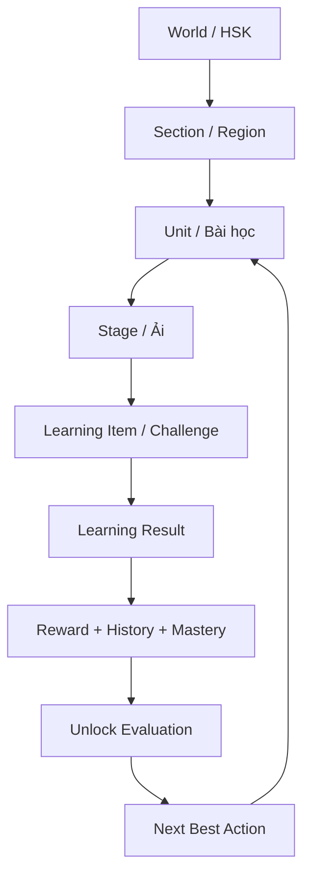

Mapping DB:

- Course / HSK → World
- `duo_sections` → Section
- `duo_units` / `lexicon_units` → Unit
- `duo_levels` + `duo_sessions` → source build Stage
- `duo_challenges` → Item
- `boss_stages` → Boss checkpoint
- `duo_level_progress` → progression
- `duo_active_sessions` → resume
- `learning_attempts` → attempt history
- `learning_xp_events` → XP ledger/history
- `app_user_stats` → aggregates
- `lexicon_user_progress` → vocabulary mastery/review
- `lexicon_speaking_practice` → speaking detail
- `lexicon_hanzi_progress` → Hanzi detail
- `boss_stage_progress` → Boss history/progress

---

# 4. MỘT LEARNING EVENT PHẢI CẬP NHẬT TOÀN HỆ THỐNG

Bất kỳ activity nào hoàn thành:

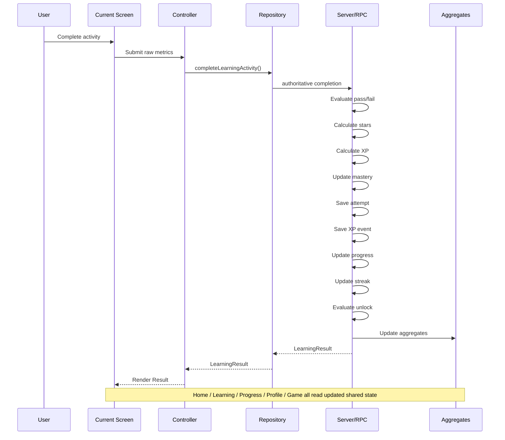

Không activity nào được tự cộng XP riêng ngoài pipeline này.

---

# 5. XP LEDGER LÀ NGUỒN LỊCH SỬ KINH NGHIỆM DUY NHẤT

Dùng `learning_xp_events` làm XP ledger canonical.

Không tạo nhiều "XP history" khác nhau.

Mỗi XP event cần đủ metadata nếu schema chưa có thì extend hợp lý:

- user_id
- event_key / idempotency key
- activity_type
- world_id
- section_id
- unit_id
- stage_id
- item_id nếu phù hợp
- boss_stage_id nếu phù hợp
- xp_amount
- base_xp
- bonus_xp
- reason
- first_clear
- perfect
- created_at

Idempotency phải scoped theo user:

```text
(user_id, event_key)
```

Không global-only nếu gây collision.

---

# 6. LỊCH SỬ XP PHẢI DÙNG ĐƯỢC Ở NHIỀU TAB

## Home

Hiển thị:
- XP hôm nay
- streak
- next reward
- recent achievement nếu phù hợp

## Learning Hub

Hiển thị:
- XP từ bài hiện tại
- progress hiện tại
- mastery
- next action

## Progress Tab

Hiển thị:
- XP today
- XP 7 days
- XP 30 days
- total XP
- history chart
- XP breakdown theo activity

## Profile

Hiển thị:
- lifetime XP
- current streak
- longest streak nếu có
- completed Units/Bosses
- achievements

## Game Hub

Không có "game XP riêng".
Game reward cũng đổ vào cùng ledger.

## Boss

Boss reward cũng đổ vào cùng ledger.

Tất cả chỉ khác presentation, không khác nguồn dữ liệu.

---

# 7. XP HISTORY FLOW

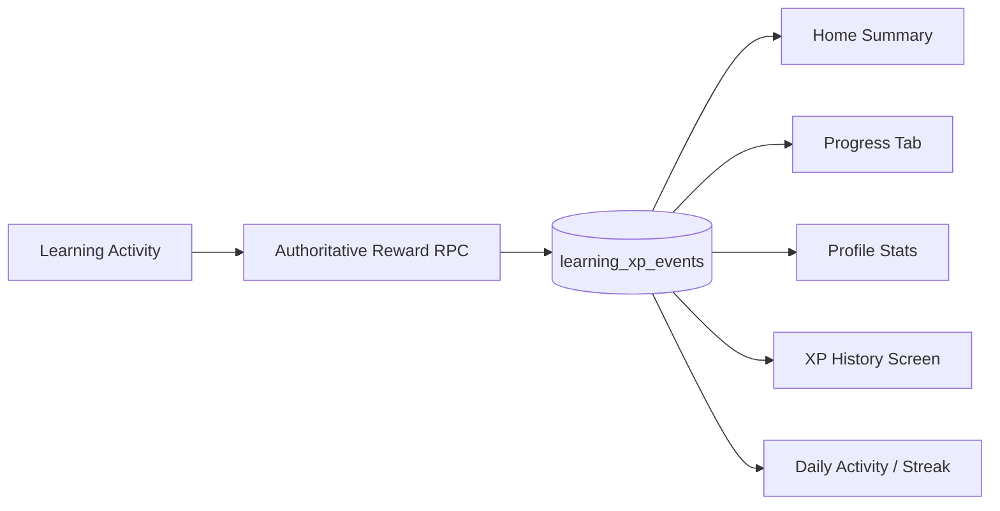

Không được để mỗi màn tự cộng XP bằng cách sum progress fields khác nhau.

---

# 8. ATTEMPT HISTORY LÀ NGUỒN LỊCH SỬ HỌC

`learning_attempts` là canonical attempt history.

Nếu thiếu fields, extend để đủ:

- user_id
- activity_type
- world_id
- section_id
- unit_id
- level_id
- stage_id
- item_id
- boss_stage_id
- score
- accuracy
- passed
- stars
- best_combo
- duration_ms
- mastery_before
- mastery_after
- started_at
- completed_at
- metadata jsonb nếu cần

Progress tab, Unit detail, skill detail, history screen đều phải lấy từ đây hoặc aggregate derived từ đây.

---

# 9. MASTERY PHẢI LIÊN KẾT CHÉO

Mastery không chỉ nằm trong một màn.

Ví dụ:

Speaking practice có score thấp
→ cập nhật speaking mastery
→ Progress tab phản ánh skill thấp
→ LearningRecommendationService có thể đề xuất Speaking
→ Home có thể recommend luyện phát âm
→ Unit stage có thể hiện "cần luyện thêm"

Hanzi tương tự.

Vocabulary/listening/speaking/Hanzi phải liên kết toàn app.

---

# 10. SKILL MASTERY MODEL

Tạo/reuse aggregate layer:

`LearningMasteryService`

Output ví dụ:

```text
overallMastery
vocabularyMastery
listeningMastery
speakingMastery
hanziMastery
sentenceMastery
```

Không nhất thiết lưu tất cả thành duplicate columns nếu có thể derive hợp lý.

Nếu cần performance:
tạo server aggregate/RPC/view.

---

# 11. CROSS-TAB STATE ARCHITECTURE

Không để mỗi tab fetch rồi tự map business logic khác nhau.

Tạo/reuse shared services:

- `LearningJourneyRepository`
- `LearningRecommendationService`
- `LearningProgressService`
- `LearningMasteryService`
- `LearningHistoryRepository`
- `LearningRewardService` hoặc server wrapper
- `LearningPresentationMapper`

Tabs chỉ consume domain/view models.

---

# 12. CROSS-TAB CONSISTENCY DIAGRAM

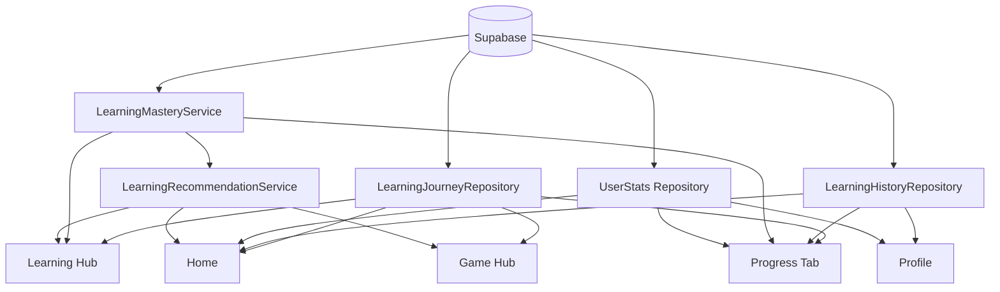

Không duplicate business rules trong screen/controller.

---

# 13. HOME — VAI TRÒ

Home không phải một màn trang trí.

Home là:

> **Daily command center**

Nó phải trả lời:
- hôm nay học gì?
- đang ở đâu?
- còn gì cần làm?
- XP/streak ra sao?
- reward gần nhất là gì?

UI:

- Hero recommendation
- current journey
- XP today
- streak
- quick resume
- recent reward/achievement

Không nhồi quá nhiều card.

Design:
- giàu illustration
- cinematic
- Panda companion
- warm/jade/gold
- ít thông tin nhưng rất đúng

---

# 14. LEARNING TAB — VAI TRÒ

Learning Tab là:

> **Curriculum + practice hub**

Không phải Home clone.

Nó tập trung:
- World/Unit progression
- current Unit
- recommended activity
- review
- Hanzi/Speaking/Flashcard quick practice

Design:
- parchment/cream
- journey-oriented
- rõ path
- Stage Map là trung tâm

---

# 15. GAME TAB — VAI TRÒ

Game Hub là:

> **Fun practice layer**

Không tạo progression curriculum riêng.

Tập trung:
- quick play
- replay
- daily challenge
- endless
- Boss replay
- skill mini-games

Reward vẫn vào chung:
- XP ledger
- mastery nếu activity thực sự đo learning competence
- attempt history

Design:
- saturated hơn Learning
- arcade/adventure
- dynamic cards
- stronger motion

Nhưng vẫn dùng chung palette/tokens.

---

# 16. PROGRESS TAB — VAI TRÒ

Progress Tab là:

> **Learning analytics + history**

Đây là nơi phải tập trung mạnh vào lịch sử.

Không chỉ là menu card.

Top summary:
- total XP
- XP today
- streak
- overall mastery
- current World/Unit

Charts:
- XP 7 days
- study activity
- mastery by skill

History:
- recent attempts
- recent XP events
- Boss victories
- Units completed
- weak skills
- review due

Design:
- thông tin rõ hơn Home
- ít illustration hơn Home
- vẫn fantasy parchment/jade/gold
- chart phải clean, không enterprise dashboard lạnh lẽo

---

# 17. PROFILE TAB — VAI TRÒ

Profile là:

> **Identity + lifetime achievements**

Tập trung:
- avatar/user identity
- total XP
- streak
- achievements
- Worlds completed
- Bosses defeated
- Words mastered
- Hanzi mastered
- Speaking milestones

Không biến Profile thành Progress clone.

---

# 18. TAB RESPONSIBILITY MATRIX

| Data / Feature | Home | Learning | Game | Progress | Profile |
|---|---|---|---|---|---|
| Current Unit | ✓ summary | ✓ primary | contextual | ✓ | optional |
| Current Stage | ✓ CTA | ✓ primary | contextual | history | optional |
| XP today | ✓ | reward context | reward context | ✓ detailed | optional |
| Lifetime XP | optional | no | no | ✓ | ✓ |
| Streak | ✓ | small | no | ✓ | ✓ |
| Mastery | summary | Unit/skill context | contextual | ✓ detailed | achievement |
| XP history | recent only | no | no | ✓ primary | no |
| Attempt history | recent | contextual | no | ✓ primary | no |
| Boss progress | current | Unit gate | replay | history | achievement |
| Recommendation | ✓ primary | ✓ primary | contextual | no | no |

Giữ matrix này để tránh duplicated UX.

---

# 19. NEW USER FLOW

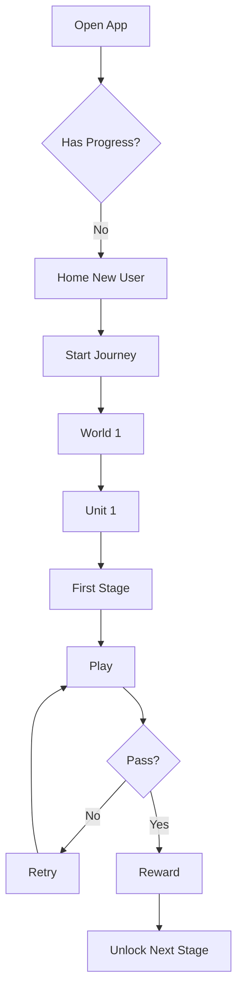

Không show complexity sớm.

---

# 20. RETURNING USER FLOW

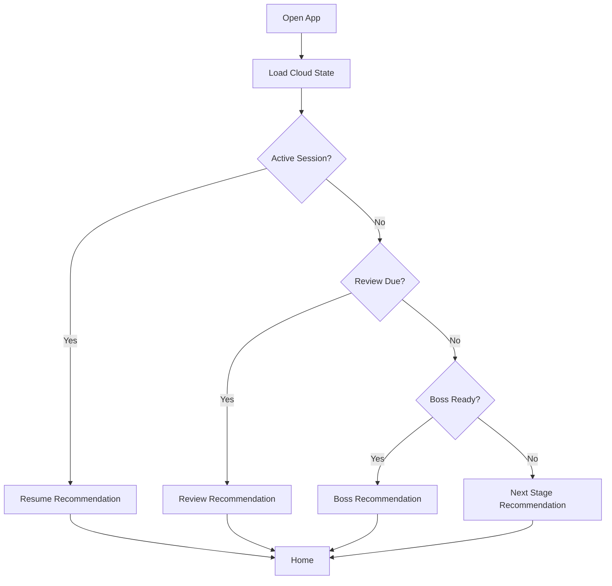

---

# 21. STAGE STATE MACHINE

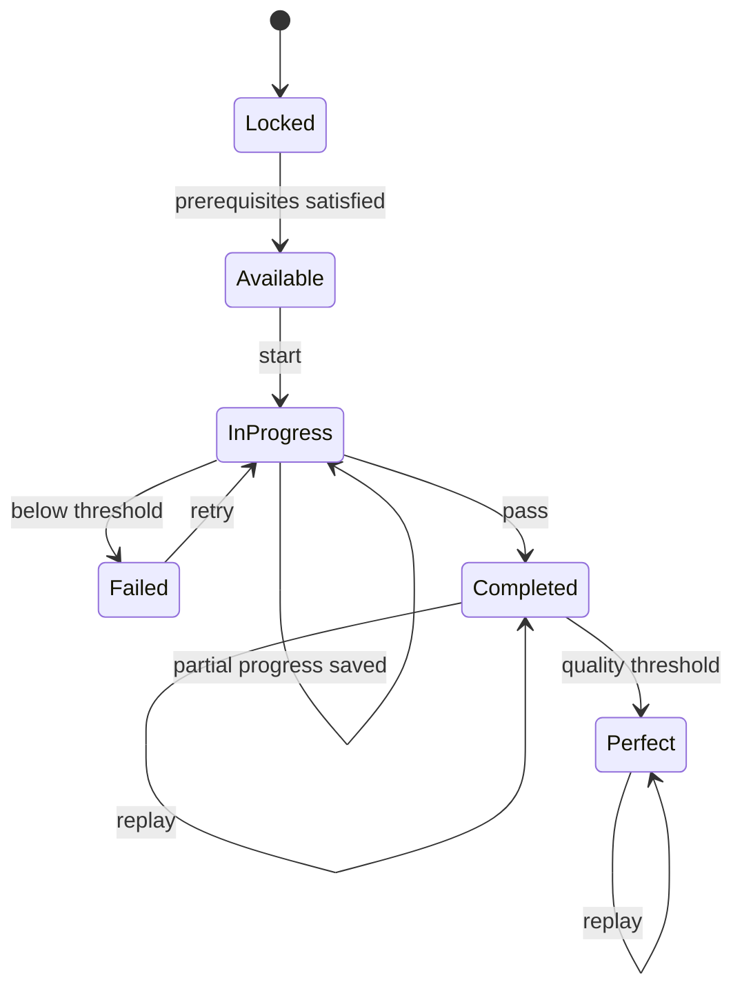

Canonical only:
- locked
- available
- in_progress
- failed
- completed
- perfect

---

# 22. UNIT STATE MACHINE

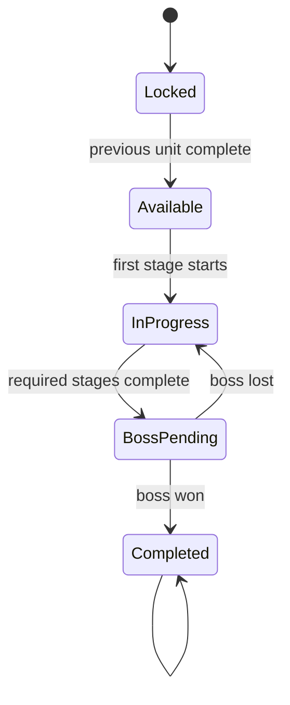

Nếu Unit không có Boss:
required stages complete → Completed.

---

# 23. STAGE GROUPING

Không fixed item count.

Không:
- `take(4)`
- `chunkSize = 4`
- `totalSegments = 4`

Grouping:

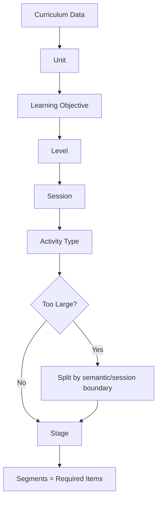

---

# 24. DYNAMIC SEGMENTED NODE

`SegmentedProgressNode`

Input:
- totalSegments
- completedSegments
- state
- icon
- title
- stars
- rewardPreview
- isCurrent

`totalSegments = requiredItems.length`

Nếu quá nhiều:
- split semantic stage, hoặc
- continuous progress ring

Không cố vẽ hàng chục segment nhỏ.

---

# 25. RESULT / REWARD LOOP

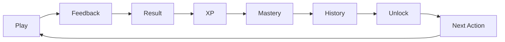

---

# 26. LEARNING RESULT CONTRACT

`LearningResult` cần đủ:

- passed
- score
- accuracy
- stars
- xpEarned
- baseXp
- bonusXp
- masteryBefore
- masteryAfter
- bestCombo
- firstClear
- perfect
- unlockedNext
- nextStageId
- bossReady
- unitCompleted
- nextUnitId
- reason

UI chỉ render result.

Không UI tự tính next action.

---

# 27. RESULT CTA

- fail → `THỬ LẠI`
- next stage → `ẢI TIẾP THEO`
- boss ready → `ĐẾN CỔNG BOSS`
- unit complete → `BÀI TIẾP THEO`
- no next → `VỀ BẢN ĐỒ`

Không auto-pop ngay sau câu cuối.

---

# 28. BOSS FLOW

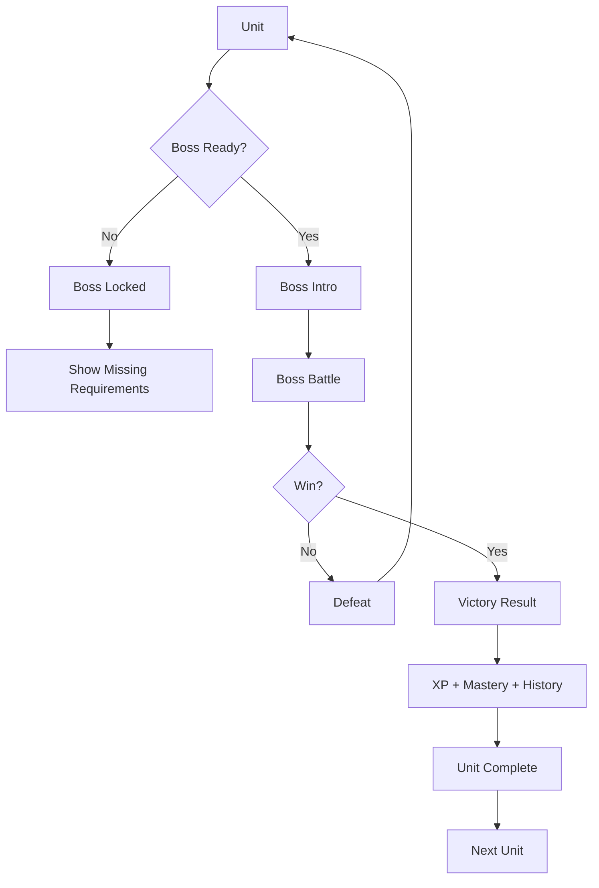

Boss reward đi vào cùng XP ledger.

Boss attempt đi vào cùng attempt history.

Boss không có reward pipeline riêng biệt.

---

# 29. HANZI FLOW

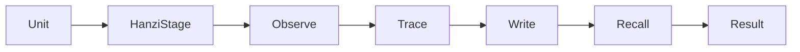

Main progression không phải catalog từng chữ.

Character library là secondary.

Hanzi score/mastery phải phản ánh:
- Unit
- Progress tab
- recommendations
- history

---

# 30. SPEAKING FLOW

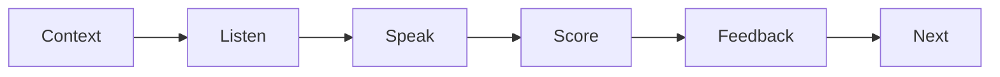

Scores:
- accuracy
- pronunciation
- tone
- fluency

Speaking weakness phải phản ánh sang:
- mastery
- progress tab
- recommendation
- review

---

# 31. LISTENING FLOW

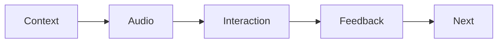

Support:
- replay
- slow audio
- contextual visual
- combo
- answer feedback

---

# 32. REVIEW FLOW

Review queue dựa trên:
- next_review_at
- wrong_count
- mastery
- recent fail
- speaking weakness
- Hanzi weakness

Review result cũng đi qua shared completion pipeline nếu có reward.

Không random meaningless review.

---

# 33. BACK NAVIGATION

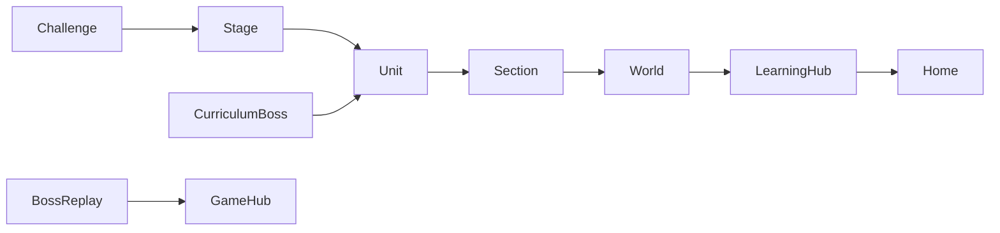

Không chỉ pop stack máy móc.

---

# 34. APP RELAUNCH

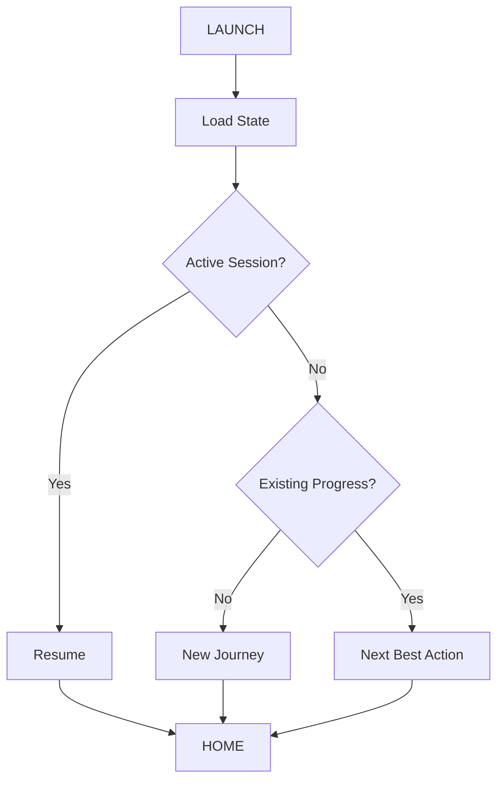

---

# 35. DESIGN SYSTEM — CHUNG NHƯNG KHÔNG ĐỒNG NHẤT MỘT CÁCH NHÀM CHÁN

Mọi phần dùng chung:
- spacing
- radius
- typography
- elevation
- token colors
- icon style
- motion language

Nhưng mỗi khu vực có "visual role" khác nhau.

---

# 36. VISUAL ROLE THEO TỪNG PHẦN

## Home
Mood:
- cinematic
- welcoming
- premium
- character-led

Use:
- rich illustration
- Panda
- large hero
- minimal cards

## Learning
Mood:
- adventure map
- progress
- discovery

Use:
- parchment
- jade
- path nodes
- World/Unit illustration

## Gameplay
Mood:
- focused
- responsive

Use:
- less decoration
- large interaction targets
- clear feedback

## Game Hub
Mood:
- energetic
- arcade

Use:
- stronger color
- animated cards
- game iconography

## Progress
Mood:
- reflective
- rewarding
- analytical

Use:
- clean charts
- history timeline
- mastery visualization
- fewer decorative elements

## Profile
Mood:
- identity
- achievement

Use:
- avatar
- badges
- trophy visuals

## Boss
Mood:
- intense
- dramatic

Use:
- darker environment
- large HP bars
- stronger VFX

Tất cả vẫn phải nhìn như cùng một app.

---

# 37. COLOR SYSTEM

Shared base:

- warm cream
- jade
- gold
- deep red
- ink
- soft orange

Không random gradient per screen.

Không glassmorphism tràn lan.

Không black AppBar ở màn Learning bình thường.

---

# 38. LEARNING SCAFFOLD

Tạo/reuse:

`LearningScaffold`

Handle:
- SafeArea
- status bar
- background
- app bar
- loading
- error
- bottom navigation spacing

Learning:
- cream/transparent status bar
- dark icons

Game/Boss:
- theme-specific overlay

---

# 39. WORLD MAP UX

World states:
- available
- in_progress
- completed
- locked

Locked:
- desaturate nhẹ
- preview vẫn đẹp
- có reason
- tap được để xem điều kiện

Không phủ gray chết toàn card.

---

# 40. UNIT OVERVIEW

Chỉ một canonical Unit screen.

Header:
- Section
- Unit title
- objective
- stage progress
- mastery
- Boss distance

Main:
- Stage Map

Không có nhiều Unit screens competing.

---

# 41. STAGE MAP

Adventure/zig-zag path.

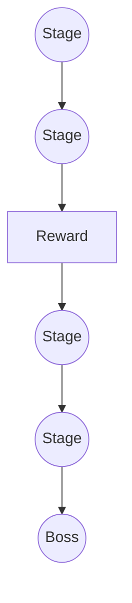

Current Panda position nếu hợp lý.

---

# 42. PROGRESSIVE DISCLOSURE

Không show:
- 310 levels
- 30/60 chapters
- hàng chục locks

Mỗi màn chỉ show scope hiện tại.

---

# 43. PROGRESS TAB — BẮT BUỘC NÂNG CẤP MẠNH

Progress tab phải trở thành màn có giá trị cao.

Top:

```text
TỔNG QUAN
XP hôm nay
Streak
Mastery
Thời gian học
```

Chart:
- XP 7 ngày
- học theo ngày

Skill cards:
- Vocabulary
- Listening
- Speaking
- Hanzi

History timeline:
- Stage completed
- Boss defeated
- XP earned
- Unit completed
- new mastery milestone

User có thể tap vào:
- XP history
- attempt history
- skill detail

Không làm kiểu menu card chung chung.

---

# 44. XP HISTORY SCREEN

Tạo nếu chưa có.

Sections:
- Today
- This week
- This month
- Lifetime

Timeline:
- +XP
- activity type
- stage/unit
- time
- reason

Filters:
- Learning
- Game
- Boss
- Review

Đọc chung `learning_xp_events`.

---

# 45. LEARNING HISTORY SCREEN

Tạo nếu cần.

Timeline:
- Unit
- Stage
- score
- stars
- duration
- mastery delta
- date

Data từ `learning_attempts`.

Không fake.

---

# 46. PROFILE ACHIEVEMENTS

Achievements derive từ data thật:
- First Stage
- 7-day streak
- 1000 XP
- First Boss
- Hanzi milestones
- Speaking milestones
- World complete

Không chỉ static badge list.

---

# 47. EMPTY / ERROR / LOADING

Loading:
- themed skeleton

Error:
- Panda + retry

Empty:
- next action

Không text vô cảm kiểu:
`Không có dữ liệu`.

---

# 48. UX PSYCHOLOGY

Dùng:
- Goal Gradient
- Chunking
- Zeigarnik
- Immediate Feedback
- Competence
- Mastery progress
- Variable but fair rewards

Không guilt/shame.

Không dark patterns.

---

# 49. TEST MATRIX — CROSS TAB

Bắt buộc test cross-tab consistency.

## XP

Complete Stage:
- Result +XP đúng
- Home XP cập nhật
- Progress XP cập nhật
- Profile total XP cập nhật
- XP history có event
- không duplicate

## Boss

Boss win:
- Boss progress cập nhật
- XP history có event
- Unit completes
- Next Unit unlock
- Profile Boss count cập nhật
- Progress history cập nhật

## Speaking

Speaking result:
- attempt saved
- mastery updated
- Progress skill card updated
- recommendation có thể thay đổi

## Hanzi

Hanzi practice:
- progress saved
- mastery updated
- Progress card updated
- review eligibility updated

## Streak

Activity hợp lệ:
- streak update một lần
- Home/Progress/Profile cùng giá trị

---

# 50. TEST MATRIX — NAVIGATION

1. New user → Stage 1.
2. Pass → Result → next Stage.
3. Fail → retry.
4. Quit → resume.
5. Final required Stage → Boss.
6. Boss lose → Unit.
7. Boss win → next Unit.
8. Challenge back → Unit context.
9. Boss replay back → Game Hub.
10. Relaunch → correct recommendation.

---

# 51. RESPONSIVE

Test:
- 320
- 360
- 390
- 440

Không overflow.

Không truncate stage title vô nghĩa.

Chart không bị cắt.

---

# 52. PERFORMANCE

Target 60fps.

Avoid:
- giant `Obx`
- redundant network fetch per tab
- duplicate queries for same aggregate
- heavy blur
- uncontrolled particles

Use caching/shared repository where appropriate.

---

# 53. IMPLEMENTATION ORDER

## P0 — Shared Logic

1. unify authoritative completion/reward pipeline
2. unify XP ledger
3. unify attempt history
4. unify mastery aggregation
5. unify streak/user stats

## P0 — Core Flow

6. Stage complete → Result → next
7. Boss ready
8. Boss win → next Unit
9. Resume/relaunch
10. navigation

## P1 — Cross-tab State

11. Home
12. Learning Hub
13. Progress
14. Profile
15. Game Hub

Tất cả đọc shared services.

## P1 — Main UX

16. canonical Unit
17. Stage map
18. segmented nodes
19. World lock states

## P2 — Skill Modes

20. Hanzi
21. Speaking
22. Listening
23. Review

## P3 — Polish

24. motion
25. illustration refinement
26. reward animations
27. micro-interactions

---

# 54. DO NOT REDESIGN BEFORE LOGIC IS SHARED

Không polish từng tab riêng trước khi:
- XP
- mastery
- history
- streak
- progress
- unlock

đã dùng chung nguồn.

Nếu không sẽ tạo UI đẹp nhưng dữ liệu mâu thuẫn.

---

# 55. FINAL QUALITY BAR

Sau bất kỳ activity nào:

1. User thấy Result.
2. User thấy reward.
3. Shared history được ghi.
4. XP/mastery/streak cập nhật.
5. Unlock được đánh giá.
6. Recommendation cập nhật.
7. Mọi tab phản ánh cùng state.

Ví dụ:

User hoàn thành Speaking Stage.

Sau đó:
- Result: +25 XP
- Home: XP hôm nay tăng
- Learning: Stage complete
- Progress: speaking mastery tăng
- XP history: có event
- learning history: có attempt
- Profile: lifetime XP tăng
- Recommendation: có thể chuyển sang Listening hoặc Boss

Nếu một trong các phần trên lệch nhau thì implementation chưa hoàn thành.

---

# 56. TOKEN / CONTEXT HANDOFF PROTOCOL

Nếu context/token sắp hết:

Không mở feature mới.

Create/update:

`docs/AI_HANDOFF.md`

Bắt buộc có:

```markdown
# AI HANDOFF

## Repository
Repository:
Base branch:
Current branch:

## Current Goal

## Completed

## Shared Logic Completed
XP:
Attempts:
Mastery:
Streak:
Unlock:
Recommendation:

## Cross-tab Integration Status
Home:
Learning:
Game:
Progress:
Profile:
Boss:

## Current User Flow

## Files Changed

## Supabase Changes
Migration:
RPC:
Tables:
RLS:
Applied live: YES/NO

## Tests
Format:
Analyze:
Focused tests:
Full tests:
Build:
CI:

## Known Bugs

## Git State
Latest commit:
Working tree:
Pushed:
PR:

## NEXT STEP
Chỉ MỘT bước tiếp theo.

## DO NOT REDO
```

---

# 57. BEFORE TOKEN RUNS OUT

Nếu gần hết context:

1. stop new work
2. finish smallest safe unit
3. format
4. focused test/analyze
5. commit
6. push
7. update `docs/AI_HANDOFF.md`
8. record live migration state

Nếu không compile:

```text
WORK IN PROGRESS - DOES NOT COMPILE
```

Ghi exact lỗi/file.

---

# 58. NEXT SESSION PROTOCOL

Agent mới:

1. đọc `docs/AI_HANDOFF.md`
2. `git status`
3. `git log -5`
4. check branch
5. check CI
6. check Supabase migrations
7. continue `NEXT STEP`

Không re-audit toàn project.

Không reset branch.

Không redo phần completed nếu không có regression.

---

# 59. FINAL EXECUTION RULE

**DO NOT STOP AT PLANNING. IMPLEMENT.**

Source of truth gồm:
- Mermaid flow trong file này
- live Supabase schema/data
- current Git state

Nếu current code trái đặc tả:
refactor cho khớp.

Nếu UI đẹp nhưng logic giữa các tab không đồng bộ:
chưa đạt.

Nếu logic đúng nhưng design từng khu vực không phản ánh vai trò của nó:
chưa đạt.

Mục tiêu cuối cùng là:

> **Một hệ thống học duy nhất, nhiều góc nhìn khác nhau.**

Home, Learning, Game, Progress, Profile, Boss không phải sáu hệ thống.

Chúng là sáu cách nhìn vào cùng một hành trình học của user.
