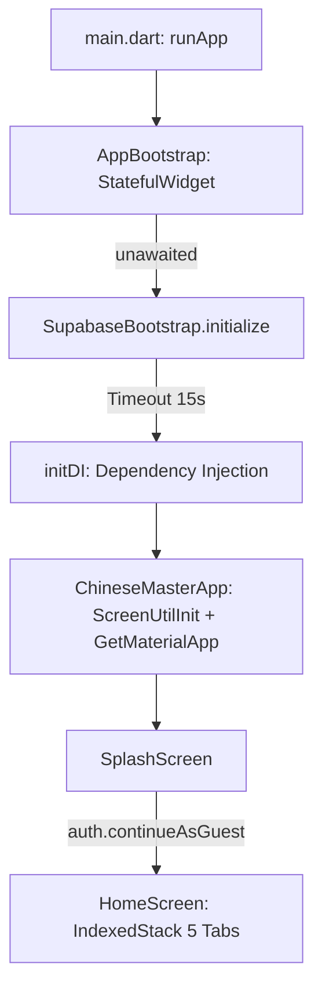

# BÁO CÁO KIỂM TOÁN KIẾN TRÚC & DỮ LIỆU TOÀN DIỆN (FULL APPLICATION LOGIC & DATA AUDIT)
## 01. CẤU TRÚC PROJECT VÀ CHỨC NĂNG TỪNG MODULE (PROJECT STRUCTURE)

> **Repository Path**: `d:\Projects\Flutter_Project\learnchinesene`  
> **Cấu trúc kiến trúc**: Feature-First & Layered Clean Architecture kết hợp State Management GetX.

---

### 1. Phân tích File cấu hình dự án (`pubspec.yaml`)

```yaml
name: pandarin
description: "A cloud-first HSK Chinese learning app powered by Supabase."
version: 1.0.0+1
environment:
  sdk: ^3.6.2
```

#### Bảng kiểm toán Thư viện phụ thuộc (Dependencies Audit)

| Tên Package | Phiên bản | Vai trò trong hệ thống | Đánh giá hiện trạng sử dụng |
| :--- | :--- | :--- | :--- |
| `flutter` | sdk: flutter | Flutter UI framework | Sử dụng toàn bộ Material 3 & widget tree |
| `get` | ^4.6.6 | Quản lý trạng thái (State), Điều hướng (Navigation), Dependency Injection | Sử dụng làm xương sống quản lý trạng thái (`GetxController`, `Rx`, `Obx`, `Get.to`, `Get.lazyPut`) |
| `flutter_screenutil` | ^5.9.3 | Responsive scale UI theo kích thước chuẩn (440x956) | Áp dụng trên toàn bộ kích thước chữ, padding, icon và container |
| `supabase_flutter` | ^2.0.0 | Supabase Client SDK (Auth, Database, Storage, RPC, Realtime) | Nguồn dữ liệu đám mây chính thức cho giáo trình, tiến độ và phần thưởng |
| `shared_preferences` | ^2.5.5 | Bộ nhớ cục bộ key-value trên thiết bị | Lưu trữ tiến trình học tập của khách (`GuestLearningProgressStore`), session dở dang |
| `flutter_tts` | ^4.1.0 | Công cụ chuyển văn bản thành giọng nói (Text-to-Speech) | Đọc chữ Hán, phiên âm Pinyin, câu thoại và câu hỏi ôn tập |
| `audioplayers` | ^6.7.1 | Phát luồng âm thanh trực tuyến (Audio streaming) | Phát các file âm thanh bản địa từ URL (`tts_url`, `tokens_tts`) |
| `speech_to_text` | ^7.4.0 | Nhận dạng giọng nói qua Microphone | Dùng trong màn hình luyện phát âm (`SpeakingScreen`) và tra từ điển bằng giọng nói |
| `permission_handler`| ^11.3.1 | Xin cấp quyền hệ điều hành (Microphone, Speech) | Kiểm tra và yêu cầu cấp quyền thu âm trước khi luyện phát âm |
| `rive` | ^0.14.11 | Render vector animations tương tác cao | Hiển thị hoạt họa linh vật Panda và rồng Boss trong các trận chiến |
| `path_drawing` | ^1.0.1 | Phân tích và render SVG path | Phục vụ canvas vẽ chữ Hán theo nét bút thuận (`HanziWritingScreen`) |
| `http` | ^1.2.2 | Gọi HTTP request tiêu chuẩn | Gửi payload tới Supabase Edge Function `gemini-ai-gateway` |
| `path_provider`, `path` | ^2.1.4, ^1.9.0 | Truy cập hệ thống tệp cục bộ | Đọc/ghi tệp lịch sử AI `history_logs.json` trong thư mục tài liệu |
| `flutter_keyboard_visibility` | ^6.0.0 | Theo dõi trạng thái bàn phím ảo | Tối ưu hóa UI khi nhập liệu tra từ điển |

#### Tài nguyên hệ thống (Assets & Fonts)
- **Hình ảnh & Hoạt họa**:
  - `assets/logo/logo.png`: Biểu tượng ứng dụng gấu trúc Pandarin.
  - `assets/images/backgrounds/`: Phông nền cảnh quan kỳ ảo (`shared_landscape.png`, `boss_battle_bg.png`, `home_garden.png`, `tone_ninja_bg.png`, v.v.).
  - `assets/images/characters/`: Hình ảnh linh vật Panda và đối thủ Rồng theo nhiều trạng thái (idle, attack, dizzy, victory, peek).
  - `assets/images/foods/`: Đạo cụ cho mini-game Nhà hàng Trung hoa (`dumplings.png`, `noodles.png`, `rice.png`, `tea.png`).
  - `assets/rive/`: File hoạt họa Rive cho nhân vật tương tác.
- **Phông chữ phiên âm (Pinyin Fonts)**:
  - `PinyinFont`, `FZKaiTiPinyin`, `FZKaiTiPinyin_1`, `PinyinOk`: Phục vụ việc hiển thị chữ Hán kèm phiên âm thanh điệu chuẩn xác trên giao diện học tập.

---

### 2. Điểm nhập ứng dụng & Khởi tạo (Entrypoint & Bootstrap)

Hệ thống được khởi động qua quy trình 3 giai đoạn chặt chẽ:



1. **`lib/main.dart` (`AppBootstrap`)**:
   - `WidgetsFlutterBinding.ensureInitialized()` được gọi đầu tiên.
   - Chạy ngay `runApp(const AppBootstrap())` để frame đầu tiên của Flutter được hiển thị ngay lập tức, không để Android bị giữ ở pre-draw listener.
   - Khởi tạo Supabase bằng `SupabaseBootstrap.initialize()` với thời gian chờ tối đa 15 giây (`timeout: Duration(seconds: 15)`). Nếu mất mạng, hiển thị giao diện thông báo lỗi thân thiện kèm nút bấm Thử lại (`onRetry`).
2. **`lib/app.dart` (`ChineseMasterApp`)**:
   - Bao bọc toàn bộ ứng dụng bằng `ScreenUtilInit` với kích thước thiết kế tiêu chuẩn `Size(440, 956)`.
   - Cấu hình theme hệ thống qua `AppTheme.light` và `AppTheme.dark`.
   - Màn hình khởi đầu (`home`) là `SplashScreen`.
3. **`lib/di.dart` (`initDI()`)**:
   - Khởi tạo và đăng ký các dịch vụ cốt lõi vào GetX service locator với cờ `fenix: true` (cho phép tái tạo nếu bộ nhớ bị giải phóng):
     - `SupabaseClient`: Trực tiếp từ `Supabase.instance.client`.
     - `UnitBridgeResolver`: Ánh xạ qua lại giữa mã Unit của Duo (`duo_unit_id`) và mã Unit của từ điển (`lexicon_unit_id`).
     - `LearningSessionComposer`: Bộ soạn thảo cấu trúc phiên học có giới hạn, loại trừ câu hỏi ngẫu nhiên ngoài ngữ cảnh.
     - `LearningProgressSyncService`: Dịch vụ điều phối đồng bộ tiến trình học tập đa miền.
     - `AuthRepository` & `AuthController`: Quản lý danh tính người dùng và phiên đăng nhập.
     - `GuestProgressMigrationService`: Đồng bộ dữ liệu cục bộ của khách lên máy chủ khi người dùng đăng nhập.
     - `GeminiService`: Cổng giao tiếp an toàn với Edge Function AI.
     - `HistoryService`: Dịch vụ lưu trữ lịch sử tương tác AI cục bộ.
     - `TtsService`: Dịch vụ phát âm giọng nói tập trung.
     - `HomeController` & `HomeJourneyRepository`: Bộ điều khiển trang chủ và dữ liệu hành trình học.

---

### 3. Cấu trúc thư mục Lõi (`lib/core/`)

Thư mục `lib/core/` chứa toàn bộ cơ sở hạ tầng dùng chung, định nghĩa miền, dịch vụ dùng chung và cơ sở dữ liệu:

```
lib/core/
├── ai/                      # Mô hình ngoại lệ cho AI Gateway (ai_gateway_exception.dart)
├── auth/                    # Xác thực, danh tính, chuyển đổi tiến trình khách (Guest Migration)
│   ├── controller/          # AuthController
│   ├── data/                # AuthRepository, SupabaseAuthRepository
│   ├── model/               # AuthState, AppAuthUser, UserAuthStatus
│   └── service/             # GuestProgressMigrationService
├── backend/                 # Khởi tạo Supabase & cấu hình URL/Publishable Key
├── config/                  # AppConfigVer1Ne (tên function, timeout, quotas)
├── database/                # Lớp truy xuất cơ sở dữ liệu
│   ├── db_helper.dart       # Truy vấn dữ liệu từ vựng HSK, chủ đề, ví dụ, nét viết Hán tự
│   └── duo_db_helper.dart   # Truy vấn màn chơi Duo, phiên làm bài dở dang, đường dẫn bài học
├── game/                    # Hằng số nghệ thuật game (game_art.dart)
├── gameplay/                # Trình phân giải dạng câu hỏi (ChallengeGameplayResolver)
├── helper/                  # AppToast, PermissionHelper
├── learning/                # KIẾN TRÚC HỌC TẬP CỐT LÕI (Core Learning Engine)
│   ├── data/                # GuestLearningProgressStore, LearningJourneyRepository, LearningProgressRepository, LearningHistoryRepository
│   ├── model/               # Submission, Result, Taxonomy, Journey, Recommendation, Mastery
│   └── service/             # SyncService, RewardService, RulesService, SessionComposer, GuestResolver
├── models/                  # Domain Models (Word, Topic, UnitModel, DuoChallenge, HanziCharacter, SpeakingItem, ...)
├── presentation/            # Mapper biểu diễn dữ liệu giao diện (LearningPresentationMapper)
├── responsive/              # ResponsiveLayout, ResponsiveHelper (mobile, tablet, desktop)
├── services/                # AudioService, GeminiService, HistoryService, ProgressService, QuizService, SpeechService, TtsService, VocabularyService
├── theme/                   # AppColors, AppTheme, GameVisualTokens, LearningTheme
└── widgets/                 # Widget UI tái sử dụng (Buttons, Scaffold, Cards, Node, Companion)
```

---

### 4. Cấu trúc thư mục Tính năng (`lib/features/`)

Hệ thống được chia nhỏ thành 29 thư mục tính năng độc lập, mỗi thư mục tuân thủ mô hình phân lớp rõ ràng (Binding, Controller, Data/Repository, Page/Screen, Widget):

```
lib/features/
├── boss_battle/             # Trận chiến Boss theo bài học (BossBattleScreen, Animation, Repository, Models)
├── chapter_adventure/       # Bản đồ phiêu lưu theo chương (ChapterAdventureScreen)
├── conversations/           # Giao tiếp AI theo ngữ cảnh (ConversationsScreen, Controller)
├── dictionary/              # Từ điển thông minh tra cứu bằng AI và Giọng nói (DictionaryScreen)
├── dragon_panda/            # Phân hệ mini-game Rồng & Gấu trúc (Tone Ninja, Restaurant, Radical, Quick Answer, Boss Hub)
├── duolingo/                # Trình chạy ải học Duo 11 dạng thử thách (DuoGameRunnerScreen, Controller, Widgets)
├── flashcards/              # Lật thẻ từ vựng HSK ôn tập (FlashcardsScreen, Controller)
├── game_hub/                # Trung tâm trò chơi (GameHubScreen, GameHubView)
├── hanzi_writing/           # Tập viết chữ Hán theo nét chuẩn (HanziWritingScreen, Canvas Painters, Controller)
├── history/                 # Lịch sử học tập & Lịch sử AI (HistoryScreen, Controller)
├── home/                    # Màn hình chính 5 Tab (HomeScreen, HomeController, Dashboard, Widgets)
├── hsk/                     # Bản đồ cấp độ HSK 1-6 (HskScreen, HskController)
├── hsk_exam/                # Thi thử HSK có AI phân tích (HskExamScreen, Controller)
├── hsk_quiz/                # Trắc nghiệm HSK nhanh dựa trên từ vựng DB (HskQuizScreen, Controller)
├── learning_overview/       # [Legacy / Orphaned] Tổng quan bài học cũ
├── lessons/                 # Bài học Ngữ pháp & Hội thoại (LessonsScreen, Controller)
├── quiz/                    # [Legacy / Review] Trắc nghiệm kiểm tra từ cần ôn (QuizScreen, Controller)
├── review/                  # Trung tâm ôn tập Spaced Repetition (ReviewScreen, Controller)
├── sections/                # Danh sách Phần học (Sections) và Bài học (Units)
├── speaking/                # Luyện phát âm chấm điểm thanh điệu (SpeakingScreen, Controller)
├── splash/                  # Màn hình Splash khởi động (SplashScreen, SplashController)
├── stats/                   # Thống kê chi tiết & Lịch sử XP (StatsScreen, XpHistoryScreen)
├── system/                  # Hồ sơ cá nhân & Thành tích (ProfilePage)
├── unit/                    # Danh sách Unit theo cấp HSK (UnitScreen, Controller)
├── unit_overview/           # Giao diện tổng quan bài học, cây tiến trình ải và cổng Boss
├── vocabulary/              # [Boilerplate] Mô hình Progress & UserStats chưa dùng
├── vocabulary_adventure/    # Chặng đường phiêu lưu 4 bước học từ vựng (VocabularyAdventureScreen)
├── word_detail/             # Chi tiết từ vựng, ví dụ và ngữ cảnh
└── word_list/               # [Legacy / Orphaned] Danh sách từ vựng theo bài cũ
```

---

### 5. Khảo sát Công cụ & Scripts gốc (`root/`)

Tại thư mục gốc dự án tồn tại các script phân tích và tệp schema phụ trợ:
- `schema.txt`: Bản sao cấu trúc SQL SQLite ban đầu (`duo.db`) chứa 7 bảng: `courses`, `sections`, `units`, `levels`, `sessions`, `characters`, `challenges`. Toàn bộ dữ liệu này hiện đã được di chuyển (migrated) lên Supabase.
- `dump_schema.py`: Script Python dùng để xuất cấu trúc bảng từ SQLite sang `schema.txt`.
- `check_challenge.py` & `test_db.py`: Scripts kiểm tra cấu trúc dữ liệu thử thách của các session.
- `test_db.txt`: Kết quả truy vấn mẫu xác nhận ID của section, unit và level.
