# BÁO CÁO KIỂM TOÁN KIẾN TRÚC & DỮ LIỆU TOÀN DIỆN (FULL APPLICATION LOGIC & DATA AUDIT)
## 02. SƠ ĐỒ ĐIỀU HƯỚNG VÀ CÁC MÀN HÌNH (SCREEN NAVIGATION TREE)

> **Mô hình điều hướng**: GetX Navigation không sử dụng Named Routes cố định (`GetPage`), mà sử dụng trực tiếp các phương thức điều hướng động (`Get.to()`, `Get.off()`, `Get.back()`).  
> **Khung màn hình chính**: `HomeScreen` duy trì 5 tab nền tảng thông qua widget `IndexedStack`.

---

### 1. Cây điều hướng tổng thể (Master Navigation Tree)

```mermaid
flowchart TD
    AppStart([Khởi động ứng dụng]) --> AppBootstrap[AppBootstrap: lib/main.dart]
    AppBootstrap -->|Supabase OK| Splash[SplashScreen: lib/features/splash/splash_screen.dart]
    Splash -->|Get.off / auth.continueAsGuest| Home[HomeScreen: lib/features/home/home_screen.dart]

    subgraph HomeTabs [HomeScreen IndexedStack: 5 Persistent Tabs]
        T0[Tab 0: Trang chủ - HomeDashboard]
        T1[Tab 1: Học tập - HomeLearningTab]
        T2[Tab 2: Trò chơi - GameHubScreen embedded]
        T3[Tab 3: Tiến trình - HomeProgressTab]
        T4[Tab 4: Cá nhân - HomePersonalTab]
    end

    Home --> T0
    Home --> T1
    Home --> T2
    Home --> T3
    Home --> T4

    %% TAB 0 ACTIONS
    T0 -->|Học bài tiếp theo / CTA| UnitOverview[UnitOverviewScreen: lib/features/unit_overview/page/unit_overview_screen.dart]
    T0 -->|Ngữ pháp| Lessons[LessonsScreen: lib/features/lessons/lessons_screen.dart]
    T0 -->|Luyện nghe| Conv[ConversationsScreen: lib/features/conversations/conversations_screen.dart]
    T0 -->|Luyện nói| Speak[SpeakingScreen: lib/features/speaking/speaking_screen.dart]
    T0 -->|Thử thách| HskQuiz[HskQuizScreen: lib/features/hsk_quiz/hsk_quiz_screen.dart]
    T0 -->|Ôn tập| Review[ReviewScreen: lib/features/review/review_screen.dart]
    T0 -->|Tiến trình| T3
    T0 -->|Xem tất cả| T1

    %% TAB 1 ACTIONS
    T1 -->|Hành trình học| UnitOverview
    T1 -->|Phần học / Lộ trình| Sections[LearningSectionsScreen: lib/features/sections/learning_sections_screen.dart]
    T1 -->|Bản đồ HSK| HskMap[HskScreen: lib/features/hsk/hsk_screen.dart]
    T1 -->|Ôn tập SRS| Review
    T1 -->|Luyện viết Hán tự| HanziHome[HanziWritingHomeScreen: lib/features/hanzi_writing/screens/hanzi_writing_home_screen.dart]
    T1 -->|Luyện phát âm| Speak
    T1 -->|Flashcards| Flashcards[FlashcardsScreen: lib/features/flashcards/flashcards_screen.dart]
    T1 -->|Luyện tập tổng hợp| PracticeHub[Practice Hub: _buildPracticePage]
    T1 -->|Ngữ pháp| Lessons
    T1 -->|Giao tiếp AI| Conv

    %% TAB 2 ACTIONS (GAME HUB)
    T2 -->|Boss Đại Chiến| BossIntro[BossBattleIntroScreen]
    BossIntro -->|Get.off| BossGame[BossBattleGameplayScreen: lib/features/dragon_panda/screens/boss_battle/boss_battle_gameplay_screen.dart]
    BossGame -->|Chiến thắng / Get.off| BossVic[BossBattleVictoryScreen]
    BossGame -->|Thất bại / Get.off| BossDef[BossBattleDefeatScreen]
    T2 -->|Ninja Trọng Âm| ToneNinja[ToneNinjaScreen: lib/features/dragon_panda/screens/tone_ninja/tone_ninja_screen.dart]
    T2 -->|Nhà Hàng Trung Hoa| Restaurant[ChineseRestaurantScreen: lib/features/dragon_panda/screens/chinese_restaurant/chinese_restaurant_screen.dart]
    T2 -->|Ghép Bộ Thủ| Radical[RadicalBuilderScreen: lib/features/dragon_panda/screens/radical_builder/radical_builder_screen.dart]
    T2 -->|Đố Vui Thần Tốc| QuickAnswer[QuickAnswerScreen: lib/features/dragon_panda/screens/quick_answer/quick_answer_screen.dart]

    %% TAB 3 ACTIONS
    T3 -->|Thống kê chi tiết| Stats[StatsScreen: lib/features/stats/stats_screen.dart]
    T3 -->|Thi thử HSK| HskExam[HskExamScreen: lib/features/hsk_exam/hsk_exam_screen.dart]
    T3 -->|Lịch sử học tập & AI| History[HistoryScreen: lib/features/history/history_screen.dart]
    Stats -->|Xem sổ cái XP| XpHistory[XpHistoryScreen: lib/features/stats/page/xp_history_screen.dart]

    %% TAB 4 ACTIONS
    T4 -->|Hồ sơ & Thành tích| Profile[ProfilePage: lib/features/system/profile_page.dart]
    T4 -->|Từ điển thông minh| Dict[DictionaryScreen: lib/features/dictionary/dictionary_screen.dart]

    %% SUB-FLOW: SECTIONS -> UNITS -> UNIT OVERVIEW
    Sections -->|Chọn phần học| SectionUnits[SectionUnitsScreen: lib/features/sections/section_units_screen.dart]
    SectionUnits -->|Chọn bài học| UnitOverview

    %% SUB-FLOW: HSK MAP -> UNIT
    HskMap -->|Chọn cấp HSK| UnitScreen[UnitScreen: lib/features/unit/unit_screen.dart]
    UnitScreen -->|Chọn bài học| UnitOverview

    %% SUB-FLOW: UNIT OVERVIEW -> STAGES
    UnitOverview -->|Ải từ vựng| VocabAdv[VocabularyAdventureScreen: lib/features/vocabulary_adventure/page/vocabulary_adventure_screen.dart]
    UnitOverview -->|Ải nghe/ghép câu/hội thoại/trắc nghiệm| DuoRunner[DuoGameRunnerScreen: lib/features/duolingo/page/duo_game_runner_screen.dart]
    UnitOverview -->|Ải viết chữ Hán| HanziDraw[HanziWritingScreen: lib/features/hanzi_writing/screens/hanzi_writing_screen.dart]
    UnitOverview -->|Ải phát âm| Speak
    UnitOverview -->|Cổng Boss / Khiêu chiến Boss| UnitBoss[BossBattleScreen: lib/features/boss_battle/boss_battle_screen.dart]
    UnitOverview -->|Bản đồ chương| ChapterAdv[ChapterAdventureScreen: lib/features/chapter_adventure/page/chapter_adventure_screen.dart]

    %% UNIT BOSS COMPLETION FLOW
    UnitBoss -->|Get.off| UnitBossVic[BossBattleVictoryScreen]
    UnitBossVic -->|Tiếp tục / Get.off| UnitComplete[UnitCompleteScreen: lib/features/unit_overview/page/unit_complete_screen.dart]
    UnitComplete -->|Bài tiếp theo / Get.off| UnitOverviewNext[UnitOverviewScreen: Next Unit]
    UnitComplete -->|Quay lại / Get.back| UnitOverview

    %% REVIEW SUB-FLOW
    Review -->|Chi tiết từ| WordDetail[WordDetailScreen: lib/features/word_detail/word_detail_screen.dart]
    Review -->|Làm bài kiểm tra từ cần ôn| Quiz[QuizScreen: lib/features/quiz/quiz_screen.dart]
```



---

### 2. Danh mục màn hình & Cơ chế truyền tham số

#### A. Màn hình Cốt lõi & Khung trang chủ
1. **`SplashScreen`** (`lib/features/splash/splash_screen.dart`):
   - **Cách truy cập**: Màn hình gốc (`ChineseMasterApp.home`).
   - **Tham số nhận**: Không.
   - **Xử lý điều hướng**: Kiểm tra `DbHelper.instance.database`, chờ 900ms. Luôn kích hoạt `auth.continueAsGuest()`, sau đó gọi `Get.off(() => const HomeScreen())`.
2. **`HomeScreen`** (`lib/features/home/home_screen.dart`):
   - **Cách truy cập**: Từ Splash qua `Get.off()`.
   - **Tham số nhận**: Không.
   - **Vòng đời**: Duy trì 5 widget tab thông qua `IndexedStack`. Khi người dùng chuyển tab bằng `controller.setIndex(index)`, trạng thái bên trong từng tab (vị trí cuộn, input) được giữ nguyên vẹn.

#### B. Phân hệ Hành trình học tập (Curriculum & Unit Overview)
3. **`LearningSectionsScreen`** (`lib/features/sections/learning_sections_screen.dart`):
   - **Cách truy cập**: Từ Tab 1 (nút "Lộ trình học tập") hoặc Tab 0 (khi chưa có bài học khả dụng).
   - **Tham số nhận**: Không.
   - **Hành động**: `Get.to(() => SectionUnitsScreen(section: section))`.
4. **`SectionUnitsScreen`** (`lib/features/sections/section_units_screen.dart`):
   - **Cách truy cập**: Từ `LearningSectionsScreen`.
   - **Tham số nhận**: `required LearningSectionViewModel section`.
   - **Hành động**: Bấm vào bài học mở khóa -> `Get.to(() => const UnitOverviewScreen(), binding: UnitOverviewBinding(...))`.
5. **`UnitOverviewScreen`** (`lib/features/unit_overview/page/unit_overview_screen.dart`):
   - **Cách truy cập**: Từ Home CTA (`_openCurrentJourney`), từ `SectionUnitsScreen`, hoặc từ `UnitScreen`.
   - **Tham số nhận qua Binding**: `UnitOverviewBinding(unitId, unitTitle, sectionNumber, unitNumber)`.
   - **Dự phòng (Fallback)**: Nếu không có Binding, tự động gọi `Get.put(UnitOverviewController())`.
   - **Điều hướng con**:
     - Ải `vocabulary` -> `Get.to(() => const VocabularyAdventureScreen(), binding: VocabularyAdventureBinding(...))`.
     - Ải `listening`, `sentence`, `dialogue`, `quiz` -> `Get.to(() => DuoGameRunnerScreen(...))`.
     - Ải `hanzi` -> `Get.to(() => HanziWritingScreen(characterId, sourceContext))`.
     - Ải `speaking` -> `Get.to(() => SpeakingScreen(unitId, sourceContext))`.
     - Ải `boss` hoặc Cổng Boss -> `Get.to(() => BossBattleScreen(stage: bossStage))`.
     - Icon bản đồ AppBar -> `Get.to(() => const ChapterAdventureScreen(), binding: ChapterAdventureBinding(...))`.

#### C. Phân hệ Trò chơi (Game Hub & Mini-Games)
6. **`GameHubScreen`** (`lib/features/game_hub/game_hub_screen.dart`):
   - **Cách truy cập**: Tab số 2 trên thanh điều hướng chính (`embedded: true`).
   - **Điều hướng con**:
     - Nút "Khiêu chiến Boss" -> `Get.to(() => BossBattleIntroScreen(...))`.
     - `BossBattleIntroScreen` bấm "Bắt đầu" -> `Get.off(() => BossBattleGameplayScreen(...))`.
     - Thắng Boss -> `Get.off(() => BossBattleVictoryScreen(...))`.
     - Thua Boss -> `Get.off(() => BossBattleDefeatScreen(...))`.
     - 4 thẻ mini-game -> `Get.to()` tới `ToneNinjaScreen`, `ChineseRestaurantScreen`, `RadicalBuilderScreen`, `QuickAnswerScreen`.

#### D. Phân hệ Luyện tập & Đánh giá (Practice & Assessment)
7. **`ReviewScreen`** (`lib/features/review/review_screen.dart`):
   - **Cách truy cập**: Từ Tab 0 hoặc Tab 1.
   - **Điều hướng con**: Bấm vào từng từ -> `Get.to(() => const WordDetailScreen(), arguments: {'word': word})`. Bấm "Bắt đầu ôn tập" -> `Get.to(() => const QuizScreen(), arguments: {'reviewWords': list})`.
8. **`HskExamScreen`** (`lib/features/hsk_exam/hsk_exam_screen.dart`):
   - **Cách truy cập**: Từ Tab 3 (Tiến trình).
   - **Điều hướng con**: Không có điều hướng sâu; kết quả thi và phân tích AI hiển thị trực tiếp tại chỗ.
9. **`HistoryScreen`** (`lib/features/history/history_screen.dart`):
   - **Cách truy cập**: Từ Tab 3 (Tiến trình).
   - **Tham số nhận**: Tùy chọn `HistoryController`. Chuyển đổi giữa 2 tab: "Lịch sử học tập" và "Lịch sử công cụ AI".

---

### 3. Phát hiện lỗi ngăn xếp điều hướng (Navigation Stack Defect)

Tại luồng hoàn thành bài học sau khi đánh bại Boss trong `UnitOverviewScreen`:

1. Ban đầu: Ngăn xếp là `[HomeScreen, UnitOverviewScreen(Unit 1)]`.
2. Mở Boss: `Get.to(() => BossBattleScreen)`. Stack: `[HomeScreen, UnitOverviewScreen(Unit 1), BossBattleScreen]`.
3. Thắng Boss: Trong `boss_battle_screen.dart` (dòng 1150):
   ```dart
   Get.off(() => BossBattleVictoryScreen(...));
   ```
   `BossBattleScreen` bị gỡ khỏi stack và thay bằng `BossBattleVictoryScreen`. Stack: `[HomeScreen, UnitOverviewScreen(Unit 1), BossBattleVictoryScreen]`.
4. Bấm "Tiếp tục": Trong `BossBattleVictoryScreen`, gọi:
   ```dart
   Get.off(() => UnitCompleteScreen(...));
   ```
   `BossBattleVictoryScreen` bị gỡ và thay bằng `UnitCompleteScreen`. Stack: `[HomeScreen, UnitOverviewScreen(Unit 1), UnitCompleteScreen]`.
5. Tại `UnitCompleteScreen`, người dùng bấm nút **"BÀI HỌC TIẾP THEO"** (`_onGoToNextUnit()`, dòng 75):
   ```dart
   void _onGoToNextUnit() {
     if (_nextUnit != null) {
       Get.off(
         () => const UnitOverviewScreen(),
         binding: UnitOverviewBinding(
           unitId: _nextUnit!.id,
           unitTitle: _nextUnit!.title,
           sectionNumber: _nextUnit!.sectionNumber,
           unitNumber: _nextUnit!.unitNumber,
         ),
       );
     }
   }
   ```
6. **HẬU QUẢ NGHIÊM TRỌNG**:
   - Lệnh `Get.off()` chỉ thay thế `UnitCompleteScreen` bằng `UnitOverviewScreen(Unit 2)`.
   - Màn hình `UnitOverviewScreen(Unit 1)` ban đầu **vẫn nằm nguyên trong ngăn xếp** bên dưới!
   - Ngăn xếp lúc này trở thành: `[HomeScreen, UnitOverviewScreen(Unit 1), UnitOverviewScreen(Unit 2)]`.
   - Khi người dùng ở Unit 2 bấm nút Back (trên AppBar hoặc nút Back vật lý của Android), họ **không quay về HomeScreen** mà bị quay ngược lại `UnitOverviewScreen(Unit 1)`.

---

### 4. Danh mục màn hình không thể tiếp cận (Orphaned / Dead Screens)

Quá trình quét tĩnh toàn bộ codebase xác định các màn hình sau hiện không có bất kỳ nút bấm hoặc route nào kích hoạt tới trong luồng ứng dụng thực tế:

| Tên màn hình | Đường dẫn file | Tình trạng | Nguyên nhân kỹ thuật |
| :--- | :--- | :--- | :--- |
| **`BossStageMapScreen`** | `lib/features/boss_battle/boss_stage_map_screen.dart` | **DEAD CODE** | File tồn tại, định nghĩa bản đồ ải Boss độc lập kèm `BossStageMapController`, nhưng không có bất kỳ file nào trong `lib/` import hay gọi `Get.to(() => BossStageMapScreen())`. |
| **`LearningOverviewScreen`** | `lib/features/learning_overview/learning_overview_screen.dart` | **DEAD CODE** | Giao diện tổng quan bài học HSK phiên bản cũ. Bị thay thế hoàn toàn bởi `UnitOverviewScreen`. |
| **`WordListScreen`** | `lib/features/word_list/word_list_screen.dart` | **ORPHANED** | Chỉ được gọi duy nhất từ dòng 115 của `LearningOverviewScreen`. Do `LearningOverviewScreen` đã chết, `WordListScreen` cũng trở nên không thể tiếp cận từ UI chính. |
