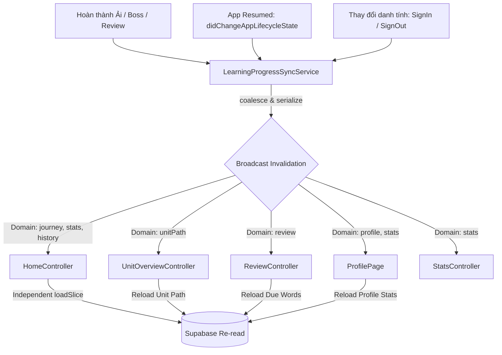

# BÁO CÁO KIỂM TOÁN KIẾN TRÚC & DỮ LIỆU TOÀN DIỆN (FULL APPLICATION LOGIC & DATA AUDIT)
## 04. QUẢN LÝ TRẠNG THÁI VÀ VÒNG ĐỜI (STATE MANAGEMENT & LIFECYCLE)

> **Công nghệ quản lý trạng thái**: `GetX` (`package:get: ^4.6.6`).  
> **Các cơ chế áp dụng**: Reactive State (`Rx`, `Rxn`, `Obx`, `ever`), Dependency Injection (`Get.lazyPut`, `Get.put`, `Get.find`, `Get.delete`), và Route Bindings (`Bindings`).

---

### 1. Phân cấp vòng đời và Đăng ký phụ thuộc (DI Strategy)

Dự án áp dụng mô hình tiêm phụ thuộc 3 tầng:

1. **Tầng Toàn cục (Global Singletons via `initDI()`)**:
   - Khởi tạo tại `lib/di.dart` ngay sau khi Supabase Bootstrap thành công.
   - Toàn bộ service và controller tầng này sử dụng `Get.lazyPut(..., fenix: true)`. Cờ `fenix: true` đảm bảo nếu hệ thống thiếu bộ nhớ và giải phóng instance, GetX sẽ tự động gọi lại factory để tái tạo instance khi có lời gọi `Get.find()` tiếp theo.
   - Các thực thể: `SupabaseClient`, `UnitBridgeResolver`, `LearningSessionComposer`, `LearningProgressSyncService`, `AuthRepository`, `GuestProgressMigrationService`, `AuthController`, `SupabaseService`, `http.Client`, `GeminiService`, `HistoryService`, `TtsService`, `SplashController`, `HomeJourneyRepository`, `HomeController`.
2. **Tầng Route-Bound (Scoped via `Bindings`)**:
   - Được gắn vào màn hình khi thực hiện điều hướng `Get.to(..., binding: CustomBinding())`.
   - Các màn hình áp dụng:
     - `UnitOverviewScreen` -> `UnitOverviewBinding`: Khởi tạo `UnitOverviewController` với các tham số định danh bài học (`unitId`, `unitTitle`, `sectionNumber`, `unitNumber`).
     - `VocabularyAdventureScreen` -> `VocabularyAdventureBinding`: Khởi tạo `VocabularyAdventureController` và tiêm `VocabularyAudioService`.
     - `ChapterAdventureScreen` -> `ChapterAdventureBinding`: Khởi tạo `ChapterAdventureController`.
3. **Tầng Tự quản lý theo Vòng đời Widget (Widget Lifecycle Scoped via `_ownsController`)**:
   - Áp dụng trên 15 màn hình sau đợt tái cấu trúc PR 10 để chống rò rỉ bộ nhớ (Memory Leak) và đảm bảo tính độc lập khi mở nhiều màn hình liên tiếp.
   - Cơ chế: Màn hình kiểm tra xem controller có được truyền từ ngoài vào qua constructor hay không. Nếu không, tạo tag duy nhất (`_controllerTag = 'screen-${_nextControllerId++}'`), gọi `Get.put(Controller(), tag: _controllerTag)` với cờ `_ownsController = true`. Khi widget bị `dispose()`, nó gọi tường minh `Get.delete<Controller>(tag: _controllerTag)`.
   - Các màn hình áp dụng: `FlashcardsScreen`, `HskQuizScreen`, `DictionaryScreen`, `ReviewScreen`, `HistoryScreen`, `HskScreen`, `UnitScreen`, `WordListScreen`, `WordDetailScreen`, `StatsScreen`.

---

### 2. Danh mục chi tiết các GetxController

| Tên Controller | Vị trí file | Phương thức đăng ký | Observables (`Rx`) quản lý | Cơ chế giải phóng (`onClose`) |
| :--- | :--- | :--- | :--- | :--- |
| **`HomeController`** | `lib/features/home/controller/home_controller.dart` | `initDI()`: `Get.lazyPut(fenix: true)` | `currentIndex`, `stats`, `journey`, `reviewSummary`, `isJourneyLoading`, `journeyError`, `todayXp`, `lifetimeXp`, `streak`, `masteryProfile`, `sevenDayXp`, `recentTimeline` | Không bị dispose (sống cùng app). Lắng nghe 9 miền của `LearningProgressSyncService`. |
| **`UnitOverviewController`** | `lib/features/unit_overview/controller/unit_overview_controller.dart` | `UnitOverviewBinding` (hoặc fallback `Get.put`) | `chapter`, `stages`, `nextUnit`, `isLoading`, `errorMessage`, `activeSession` | Huỷ đăng ký sync `_syncRegistration?.dispose()`. Xóa dữ liệu ải trong bộ nhớ. |
| **`DuoGameRunnerController`** | `lib/features/duolingo/controller/duo_game_runner_controller.dart` | Gắn trong `StatefulWidget` với tag duy nhất | `challenges`, `currentIndex`, `isAnsweredCorrectly`, `correctCount`, `wrongCount`, `score`, `currentCombo`, `bestCombo`, `isCompleted`, `calculatedStars`, `rewardResult` | **Quan trọng**: Nếu chưa hoàn thành mà thoát màn hình, `onClose()` tự động gọi `abandonAttempt()` để đánh dấu huỷ trên DB. |
| **`VocabularyAdventureController`** | `lib/features/vocabulary_adventure/controller/vocabulary_adventure_controller.dart` | `VocabularyAdventureBinding` | `mission`, `isIntroVisible`, `isCompleted`, `isFinishing`, `currentIndex`, `selectedAnswer`, `feedback`, `score`, `xpEarned`, `combo`, `masteredWords`, `learningResult` | Giải phóng audio `_audioService.dispose()`. Gọi `abandonMission()` nếu thoát giữa chừng. |
| **`SpeakingController`** | `lib/features/speaking/controller/speaking_controller.dart` | Màn hình khởi tạo hoặc `Get.put` | `items`, `currentIndex`, `isLoading`, `errorMessage`, `busy`, `recognized`, `score`, `correct`, `learningResult` | Giải phóng AnimationController `pulse.dispose()`, `audioService.dispose()`. Bỏ attempt dở dang. |
| **`HanziWritingController`** | `lib/features/hanzi_writing/controller/hanzi_writing_controller.dart` | Khởi tạo trong màn hình | `learningResult` | Bỏ attempt dở dang nếu chuyển chữ Hán khác. |
| **`ReviewController`** | `lib/features/review/controller/review_controller.dart` | `Get.put` có tag + `_ownsController` | `summary`, `reviewWords`, `isLoading`, `errorMessage` | Huỷ đăng ký sync `_syncRegistration?.dispose()`. |
| **`FlashcardsController`** | `lib/features/flashcards/controller/flashcards_controller.dart` | `Get.put` có tag + `_ownsController` | `deck`, `isLoading` | Huỷ an toàn qua `Get.delete`. |
| **`HskExamController`** | `lib/features/hsk_exam/controller/hsk_exam_controller.dart` | `Get.put` trong màn hình | `selectedLevel`, `examState`, `questions`, `userAnswers`, `score`, `analysisLoading`, `overallAssessment`, `strengths`, `weaknesses` | Reset đề thi và answers khi đóng. |
| **`ConversationsController`** | `lib/features/conversations/controller/conversations_controller.dart` | `Get.put` trong màn hình | `selectedLevel`, `isLoading`, `isMoreLoading`, `lines`, `currentTopic` | Dừng âm thanh TTS khi đóng. |
| **`DictionaryController`** | `lib/features/dictionary/controller/dictionary_controller.dart` | `Get.put` có tag + `_ownsController` | `isLoading`, `isAiProcessing`, `entry`, `error` | Huỷ controller có tag. |
| **`HskQuizController`** | `lib/features/hsk_quiz/controller/hsk_quiz_controller.dart` | `Get.put` có tag + `_ownsController` | `questions`, `currentIndex`, `score`, `selectedAnswer`, `isAnswerChecked`, `isCompleted`, `loading`, `error` | Dừng audio, xoá Worker `_errorWorker`. |
| **`HistoryController`** | `lib/features/history/controller/history_controller.dart` | `Get.put` có tag + `_ownsController` | `selectedTab`, `isLoading`, `learningItems`, `aiHistoryItems` | Huỷ an toàn qua `Get.delete`. |
| **`StatsController`** | `lib/features/stats/controller/stats_controller.dart` | `Get.put` có tag + `_ownsController` | `stats`, `isLoading` | Huỷ đăng ký sync refresher. |
| **`BossBattleController`** | `lib/features/boss_battle/controller/boss_battle_controller.dart` | **KHÔNG ĐƯỢC ĐĂNG KÝ (ORPHANED)** | `phase`, `questions`, `currentIndex`, `bossHp`, `playerHp`, `combo`, `score`, `rewardResult` | Chỉ tồn tại trong các file Unit Test. |

---

### 3. Trung tâm điều phối đồng bộ (`LearningProgressSyncService`)

Đây là trung tâm điều phối trạng thái (State Synchronization Hub) giải quyết bài toán đồng bộ chéo giữa các tab mà không cần gọi trực tiếp hàm của nhau:



#### Các quy tắc cốt lõi của SyncCoordinator:
1. **Lọc phạm vi (Scoped Domain Filtering)**: 10 miền định kiểu (`journey`, `unitPath`, `stats`, `history`, `mastery`, `review`, `profile`, `game`, `session`, `identity`). Chỉ những controller đăng ký đúng miền bị ảnh hưởng mới kích hoạt làm mới.
2. **Gộp sự kiện nhanh (Event Coalescing)**: Nếu nhiều sự kiện phát ra liên tiếp trong cùng một khung thời gian (ví dụ hoàn thành ải vừa cộng XP vừa đổi mastery), chúng được gộp lại để chỉ thực hiện một lượt gọi làm mới duy nhất.
3. **Tuần tự hóa (Serialization)**: Không cho phép hai lượt làm mới của cùng một chủ sở hữu chạy chồng chéo nhau.
4. **Bảo vệ phản hồi cũ (Stale Response Guard)**: Sử dụng số thế hệ yêu cầu (`_refreshRequest` / `generation`). Nếu phản hồi mạng của yêu cầu cũ về sau yêu cầu mới, phản hồi cũ sẽ bị hủy bỏ, ngăn ngừa tình trạng dữ liệu mới bị ghi đè bởi dữ liệu cũ (Lost Update).

---

### 4. Phát hiện bất thường kiến trúc quản lý trạng thái

1. **Bộ điều khiển mồ côi (`BossBattleController`)**:
   - File `lib/features/boss_battle/controller/boss_battle_controller.dart` được viết rất bài bản với State Machine rõ ràng (`BossBattlePhase.loading`, `intro`, `question`, `resolving`, `playerAttack`, `bossAttack`, `won`, `lost`, `reward`).
   - Tuy nhiên, màn hình thực tế `BossBattleScreen` (`boss_battle_screen.dart`, 1181 dòng) hoàn toàn **không sử dụng `BossBattleController`**. Màn hình này tự dùng `StatefulWidget` với hàng chục biến cục bộ (`bossHp`, `playerHp`, `combo`, `Timer`, `_ticker`). Điều này tạo ra sự lãng phí mã nguồn lớn và khó bảo trì.
2. **Hai đường dẫn khởi tạo controller trong `UnitOverviewScreen`**:
   - Màn hình hỗ trợ nhận controller qua `UnitOverviewBinding`, nhưng trong `initState()` lại có dòng dự phòng:
     ```dart
     controller = Get.isRegistered<UnitOverviewController>()
         ? Get.find<UnitOverviewController>()
         : Get.put(UnitOverviewController());
     ```
   - Nếu người dùng mở màn hình mà không qua Binding, `UnitOverviewController` được tạo với các giá trị rỗng (`unitId = ''`), dẫn đến màn hình phải tự suy luận ID bài học từ API tiếp theo.
