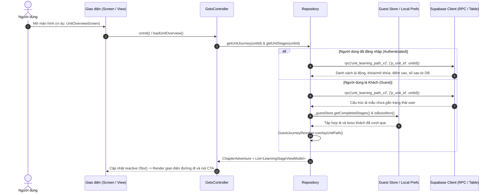
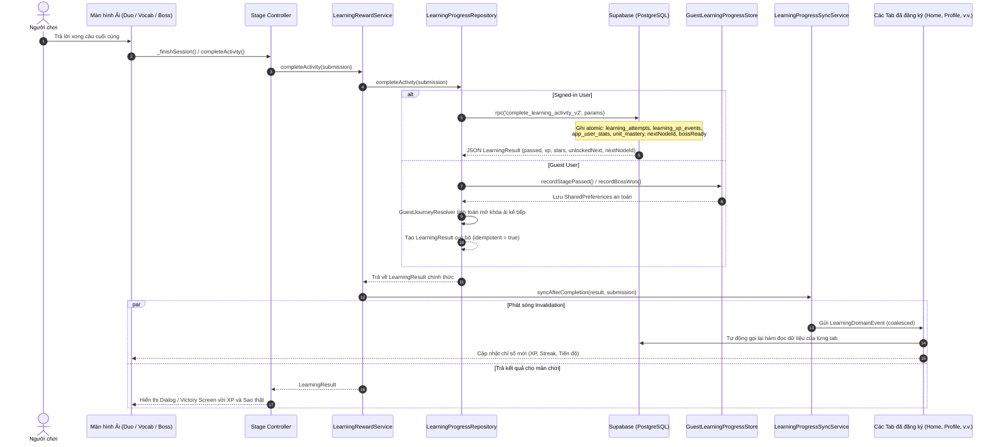

# BÁO CÁO KIỂM TOÁN KIẾN TRÚC & DỮ LIỆU TOÀN DIỆN (FULL APPLICATION LOGIC & DATA AUDIT)
## 06. LUỒNG DỮ LIỆU, ĐỒNG BỘ VÀ LƯU TRỮ BỀN VỮNG (DATA FLOW & PERSISTENCE)

> **Mô hình kiến trúc dữ liệu**: Song song hai cơ chế lưu trữ (Dual-Persistence Architecture):  
> 1. **Người dùng đăng nhập (Authenticated)**: Server-Authoritative trên PostgreSQL Supabase qua RPC nguyên tử.  
> 2. **Khách vãng lai (Guest)**: Client-Authoritative trên SharedPreferences kết hợp Local Store & Engine tính toán cục bộ.

---

### 1. Bản đồ Phân loại Lưu trữ Dữ liệu (Persistence Classification Map)

Dữ liệu trong ứng dụng Pandarin được chia làm 4 cấp độ tồn tại:

| Cấp độ lưu trữ | Định danh dữ liệu | Cơ chế kỹ thuật | Tính bền vững khi thoát app / khởi động lại |
| :--- | :--- | :--- | :--- |
| **Cấp 1: Cơ sở dữ liệu Đám mây (Supabase PostgreSQL)** | - Giáo trình tĩnh (HSK, Units, Words, Challenges)<br>- Sổ cái XP (`learning_xp_events`)<br>- Lịch sử làm bài (`learning_attempts`)<br>- Thống kê trọn đời (`app_user_stats`)<br>- Trạng thái mở khóa & Tiến độ bài học signed-in (`duo_level_progress`)<br>- Phiên làm bài dở dang signed-in (`duo_active_sessions`) | PostgreSQL Tables, RLS, Indexes, Stored Procedures | **BỀN VỮNG TUYỆT ĐỐI**. Đồng bộ đa thiết bị khi đăng nhập cùng tài khoản. |
| **Cấp 2: Bộ nhớ cục bộ thiết bị (SharedPreferences)** | - Danh sách ải khách đã vượt qua (`guest_learning_completed_stages_v1`)<br>- Danh sách Boss khách đã hạ (`guest_learning_completed_bosses_v1`)<br>- Sổ cái XP cục bộ của khách (`guest_learning_xp_events_v2`)<br>- Lịch sử attempt của khách (`guest_learning_attempts_v2`)<br>- Phiên dở dang của khách (`duo_game_session_v2_*`)<br>- Cờ di chuyển dữ liệu (`duo_cloud_migrated_v1_*`) | `SharedPreferences` (XML trên Android, Plist trên iOS) | **BỀN VỮNG CỤC BỘ**. Còn nguyên vẹn khi tắt app, khởi động lại máy. Mất khi xoá dữ liệu ứng dụng hoặc gỡ cài đặt. |
| **Cấp 3: Tệp tài liệu cục bộ (Local Documents File)** | - Nhật ký tương tác công cụ AI: Tra từ điển, sinh hội thoại, bài thi thử HSK (`history_logs.json`) | `File.writeAsString()` JSON format qua `path_provider` | **BỀN VỮNG CỤC BỘ**. Lưu trữ danh sách JSON đảo ngược (mới nhất lên đầu). Người dùng có thể chủ động xoá bằng nút "Xóa lịch sử AI". |
| **Cấp 4: Bộ nhớ tạm thời (Volatile RAM State)** | - Cấp độ Boss Game Hub: `GameHubScreen.currentBossStageLevel = 1`<br>- Animation controllers, ticker, camera shake offset<br>- Bộ đệm từ điển tạm thời `_fetchWordCatalog()` trong `DbHelper`<br>- Danh sách câu sai làm lại tức thời trong phiên: `incorrectChallenges` | Biến static, biến State trong GetxController hoặc StatefulWidget | **MẤT HOÀN TOÀN KHI THOÁT APP**. Reset về giá trị mặc định ban đầu. |

---

### 2. Luồng Đọc Dữ liệu (Read Pipeline)



- **Nguyên tắc đọc dữ liệu an toàn**:
  - Không bao giờ sử dụng `SELECT *` không giới hạn trên các bảng lớn; luôn sử dụng `.select('id, title, ...')` chỉ định đúng các trường cần thiết kèm `.range(from, to)` hoặc `.limit()`.
  - Mọi lời gọi đọc dữ liệu trong `HomeController` đều được bọc trong hàm `loadSlice<T>()` với biến đếm thế hệ `_refreshRequest`. Nếu người dùng thao tác nhanh hoặc mạng chập chờn, kết quả của yêu cầu mạng cũ về chậm sẽ bị loại bỏ, bảo vệ UI không bị giật lùi về trạng thái cũ.

---

### 3. Luồng Ghi Dữ liệu & Hoàn thành Hoạt động (Write Pipeline)



---

### 4. Cơ chế Điều phối Đồng bộ Đa miền (Event Invalidation Loop)

Mỗi khi có biến động dữ liệu (hoàn thành ải học, hạ boss, ôn từ vựng, hoặc app được bật lại từ background), hệ thống phát một sự kiện miền định kiểu:

```dart
// Định nghĩa sự kiện miền đồng bộ
LearningDomainEvent.afterCompletion(result, submission)
```

Sự kiện này kích hoạt danh sách các chủ sở hữu đã đăng ký (`LearningSyncRegistration`):
1. **`HomeController`**: Nhận sự kiện thuộc miền `journey`, `stats`, `history`, `mastery`, `review`. Kích hoạt chạy lại 7 luồng tải độc lập:
   - `DbHelper.getStats()`
   - `HomeJourneyRepository.getCurrentJourney()`
   - `ReviewRepository.getSummary()`
   - `LearningHistoryRepository.fetchTodayXp()`
   - `LearningHistoryRepository.fetchLifetimeXp()`
   - `LearningHistoryRepository.fetchStreak()`
   - `LearningMasteryService.getAggregatedProfile()`
2. **`UnitOverviewController`**: Nhận sự kiện thuộc miền `unitPath`. Kích hoạt `loadUnitOverview()` để đọc lại cây ải học từ máy chủ.
3. **`ReviewController`**: Nhận sự kiện thuộc miền `review`. Tải lại danh sách từ đến hạn ôn tập (`lexicon_user_progress`).
4. **`ProfilePage`**: Nhận sự kiện thuộc miền `profile`, `stats`. Tải lại thành tích người dùng.

---

### 5. Phân tích Các điểm nghẽn và Lỗi gãy luồng dữ liệu (Data Disconnects)

#### A. Đứt gãy luồng dữ liệu tại Boss Game Hub
- **Thực tế**: Tại `BossBattleGameplayScreen` (`lib/features/dragon_panda/screens/boss_battle/boss_battle_gameplay_screen.dart`), sự kiện chiến thắng gọi `widget.onVictory()`.
- **Hậu quả**: Không có bất kỳ lệnh gọi nào tới `LearningRewardService`, không gọi `complete_learning_activity_v2`, không gọi `GuestLearningProgressStore`. Toàn bộ thời gian và nỗ lực đánh thắng Boss ở Game Hub không đem lại bất kỳ điểm XP nào, không được ghi vào lịch sử và mất sạch khi đóng app.

#### B. Đứt gãy luồng Spaced Repetition (SRS) với Khách
- **Thực tế**: Tại `DbHelper.dart`:
  ```dart
  Future<List<Word>> getReviewWords() async {
    final userId = _client.auth.currentUser?.id;
    if (userId == null) return <Word>[]; // LUÔN TRẢ VỀ RỖNG NẾU LÀ GUEST!
  ```
  ```dart
  Future<void> upsertProgress({required int wordId, required bool isCorrect, int level = 1}) async {
    if (_client.auth.currentUser == null) return; // KHÔNG LƯU GÌ NẾU LÀ GUEST!
  ```
- **Hậu quả**: Khi người dùng là Khách (chế độ mặc định), tính năng Flashcards, Review và Quiz hoàn toàn không lưu lại được từ nào đã học, từ nào nhớ sai, và tab Review luôn hiển thị 0 từ cần ôn.

#### C. Đứt gãy luồng Thống kê Hồ sơ (Profile) với Khách
- **Thực tế**: `ProfilePage._loadStats()` gọi `DbHelper.instance.getStats()`. Hàm này có câu lệnh ngắt `if (userId == null) return {'learned': 0, 'mastered': 0, 'streak': 0, 'totalExp': 0};`.
- **Hậu quả**: Khách vào màn hình Profile luôn thấy số 0 EXP và 0 Streak, dù trên trang chủ Home vẫn hiển thị số XP thực tế mà khách đã tích lũy trong SharedPreferences.
