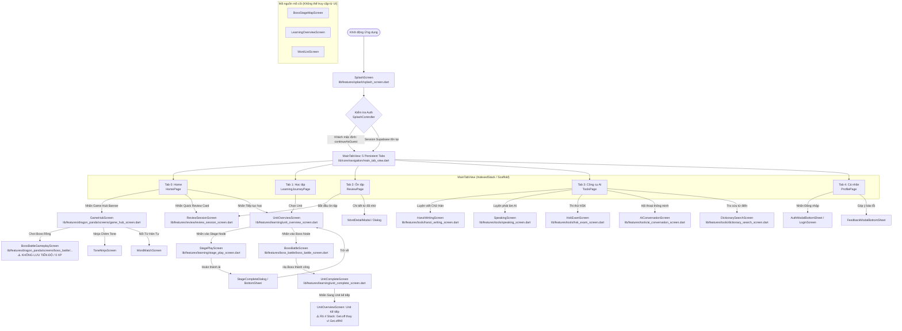
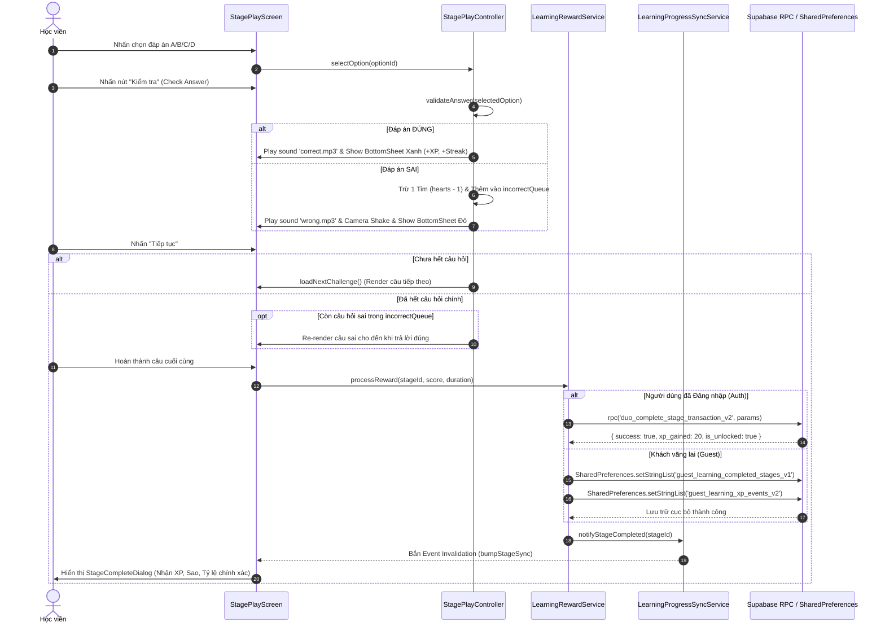
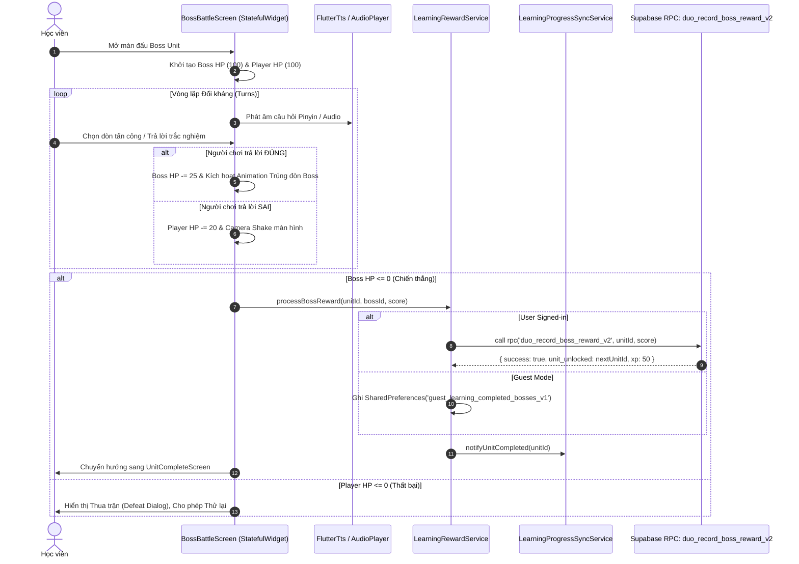
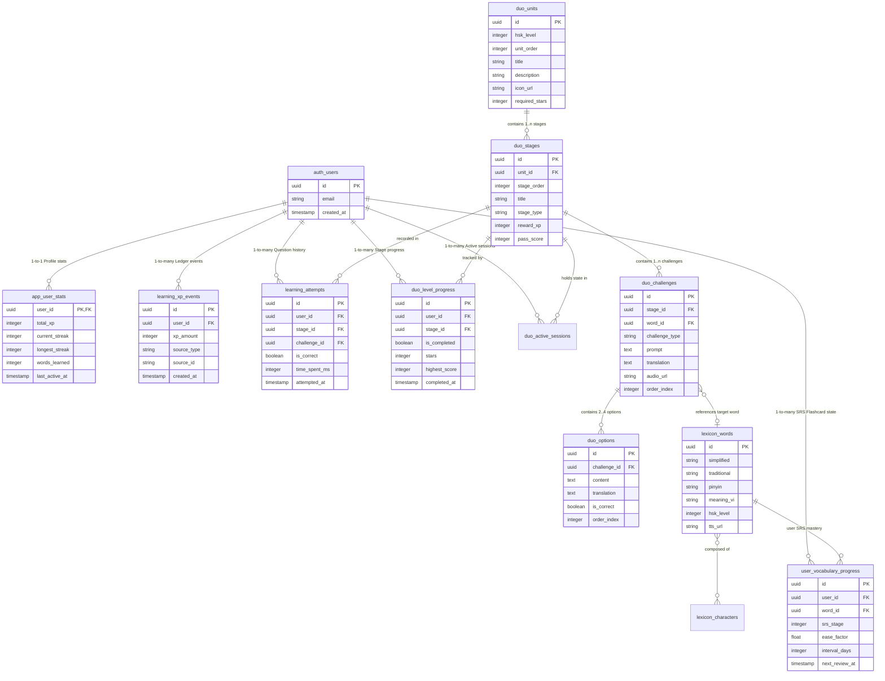
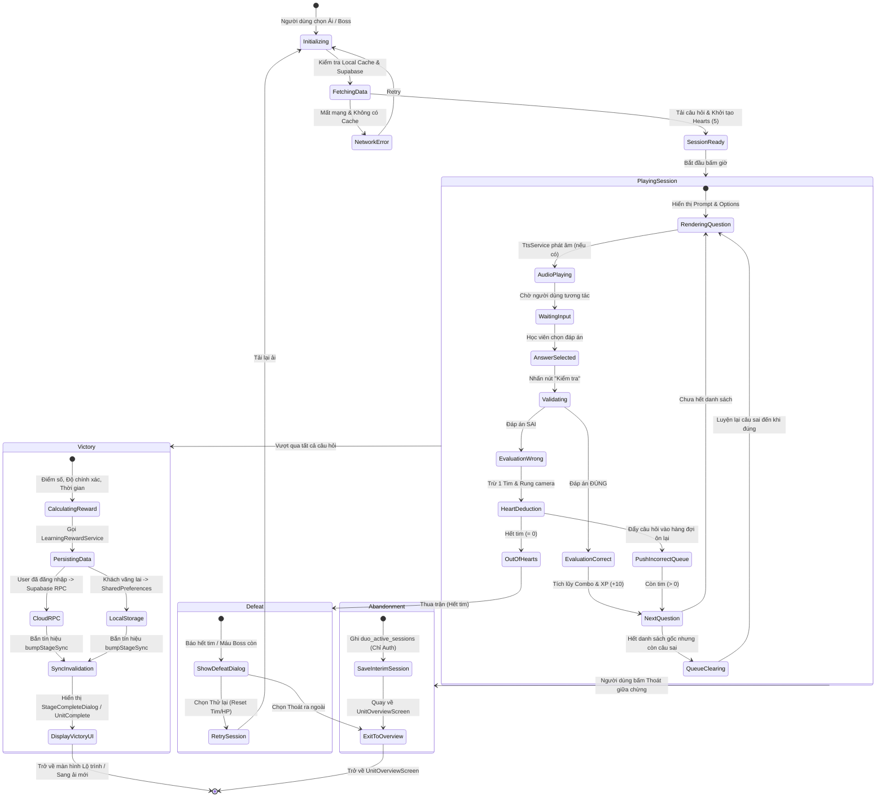
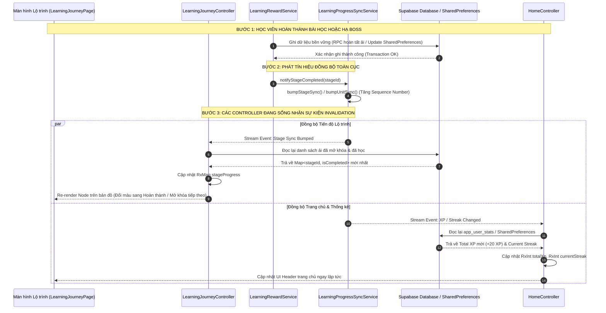

# BÁO CÁO KIỂM TOÁN KIẾN TRÚC & DỮ LIỆU TOÀN DIỆN (FULL APPLICATION LOGIC & DATA AUDIT)
## 11. TẬP HỢP TOÀN BỘ SƠ ĐỒ HỆ THỐNG MERMAID (MERMAID SYSTEM DIAGRAMS)

> **Mục tiêu**: Tập hợp trực quan hóa toàn bộ hệ thống Pandarin từ mã nguồn và cấu trúc cơ sở dữ liệu thực tế: Kiến trúc ứng dụng, cây điều hướng, các luồng tương tác người dùng trọng yếu, sơ đồ thực thể liên kết dữ liệu (ERD), máy trạng thái trò chơi (Game State Machine) và luồng đồng bộ dữ liệu hai tầng (Data Sync Pipeline).

---

### Sơ đồ A: Kiến trúc Ứng dụng Thực tế (Application Architecture)

Mô hình kiến trúc GetX 3 tầng kết hợp Dual-Persistence (Supabase Server-Authoritative & SharedPreferences Client-Authoritative):

```mermaid
flowchart TB
    subgraph UI_Layer["1. GIAO DIỆN NGƯỜI DÙNG (PRESENTATION LAYER)"]
        direction TB
        V_Home["HomePage / HomeContent<br>Tab 0: Tiến độ, Unit, Quick Actions"]
        V_Learn["LearningJourneyPage<br>Tab 1: Lộ trình HSK 1-6 & Stage Node"]
        V_Review["ReviewPage<br>Tab 2: Ôn tập Flashcards SRS & Quản lý từ"]
        V_Tools["ToolsPage<br>Tab 3: AI Speaking, Hanzi, HSK Exam, Dict"]
        V_Profile["ProfilePage<br>Tab 4: Cài đặt, Đăng nhập, Thống kê XP"]
        V_Game["GameHubScreen / BossGameplay<br>Minigames: Tone Ninja, Word Match, Game Hub Boss"]
        V_Stage["StagePlayScreen / LessonScreen<br>Duo Runner: Multiple Choice, Listen, Order, Match"]
        V_Boss["BossBattleScreen<br>Curriculum Boss Battle (StatefulWidget)"]
    end

    subgraph State_DI_Layer["2. TẦNG QUẢN LÝ TRẠNG THÁI & DI (GETX CONTROLLERS & BINDINGS)"]
        direction TB
        C_Main["MainTabController<br>(Permanent)"]
        C_Auth["AuthController<br>(Permanent: Rx<User?>)"]
        C_Home["HomeController<br>(Fenix: true: streak, dailyGoal, stats)"]
        C_Journey["LearningJourneyController<br>(Fenix: true: units, stages, activeStage)"]
        C_Review["ReviewController<br>(Route-scoped: SRS queue, card flip)"]
        C_Stage["StagePlayController<br>(Route-scoped: hearts, score, streak, timer)"]
        C_BossOrphan["BossBattleController<br>(Orphaned / Unused by UI)"]
        C_Tools["HanziWritingController / SpeakingController / ToolsController"]
    end

    subgraph Domain_Service_Layer["3. TẦNG NGHIỆP VỤ & ĐỒNG BỘ (SERVICES & DOMAIN REPOSITORIES)"]
        direction TB
        S_Sync["LearningProgressSyncService<br>(Bus Broadcast Invalidation: bumpStageSync, bumpUnitSync)"]
        S_Reward["LearningRewardService<br>(Transaction Processor: processReward, processBossReward)"]
        S_Audio["AudioService & TtsService<br>(Audioplayers remote URL & FlutterTts fallback)"]
        S_Speech["SpeechService & GeminiAiService<br>(SpeechToText microphone & Supabase Edge Function gateway)"]
        R_Unit["LearningUnitRepository & LearningStageRepository"]
        R_Vocab["VocabularyRepository & FlashcardRepository"]
    end

    subgraph Data_Persistence_Layer["4. TẦNG DỮ LIỆU & LƯU TRỮ (DUAL-PERSISTENCE LAYER)"]
        direction TB
        subgraph Cloud_Supabase["Supabase Cloud (PostgreSQL 15)"]
            DB_Lexicon[("lexicon_words / lexicon_characters")]
            DB_Duo[("duo_units / duo_stages / duo_challenges / duo_options")]
            DB_Progress[("duo_level_progress / duo_active_sessions")]
            DB_Ledger[("learning_xp_events / learning_attempts / app_user_stats")]
            DB_RPC[["RPCs: duo_complete_stage_transaction_v2 / duo_record_boss_reward_v2"]]
        end

        subgraph Local_Storage["Thiết bị cục bộ (Local Client)"]
            SP_Pref[("SharedPreferences<br>guest_learning_*, duo_game_session_*")]
            FS_Log[("Local File: history_logs.json<br>AI Dictionary & HSK Exam Logs")]
            RAM_Mem[("Volatile RAM State<br>GameHubScreen.currentBossStageLevel")]
        end
    end

    %% UI to Controller bindings
    V_Home --> C_Home
    V_Learn --> C_Journey
    V_Review --> C_Review
    V_Tools --> C_Tools
    V_Profile --> C_Auth
    V_Stage --> C_Stage
    V_Boss -.->|KHÔNG SỬ DỤNG| C_BossOrphan
    V_Boss --> S_Reward

    %% Controller to Services
    C_Stage --> S_Reward
    C_Stage --> S_Audio
    C_Stage --> S_Sync
    C_Journey --> R_Unit
    C_Journey --> S_Sync
    C_Review --> R_Vocab
    C_Review --> S_Audio
    C_Tools --> S_Speech

    %% Services to Repositories & Invalidation Loop
    S_Reward --> S_Sync
    S_Sync -.->|Lắng nghe Stream / Event| C_Journey
    S_Sync -.->|Lắng nghe Stream / Event| C_Home

    %% Services to Data Sources
    S_Reward -->|Authenticated User| DB_RPC
    S_Reward -->|Guest Mode| SP_Pref
    R_Unit --> DB_Duo
    R_Unit --> DB_Progress
    R_Vocab --> DB_Lexicon
    S_Speech -->|Edge Function| Cloud_Supabase
    C_Tools --> FS_Log
    V_Game --> RAM_Mem
```

---

### Sơ đồ B: Cây Điều hướng Ứng dụng (Screen Navigation Tree)

---

### Sơ đồ C: Luồng Tương tác Người dùng Trọng yếu (User Interaction Flows)

#### C.1. Luồng Học Ải Tiêu chuẩn (Stage Quiz Flow)

#### C.2. Luồng Hạ Boss Giáo trình (Curriculum Boss Battle Flow)

---

### Sơ đồ D: Sơ đồ Thực thể Liên kết Dữ liệu (Database ERD)

---

### Sơ đồ E: Máy Trạng thái Trò chơi & Ải học (Game State Machine)

---

### Sơ đồ F: Luồng Đồng bộ & Vòng lặp Hủy bộ nhớ đệm (Data Sync & Invalidation Flow)

