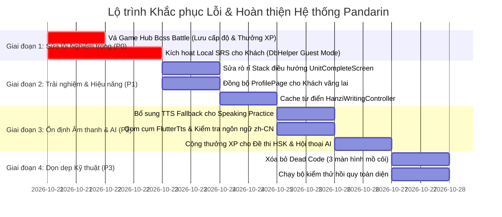

# BÁO CÁO KIỂM TOÁN KIẾN TRÚC & DỮ LIỆU TOÀN DIỆN (FULL APPLICATION LOGIC & DATA AUDIT)
## 12. ĐỀ XUẤT CẢI TIẾN VÀ KẾ HOẠCH BẢO TOÀN KIẾN TRÚC (RECOMMENDATIONS & PRESERVATION PLAN)

> **Nguyên tắc chỉ đạo tối thượng**: **BẢO TOÀN KIẾN TRÚC HIỆN TẠI (NO-REWRITE POLICY)**.  
> Toàn bộ các đề xuất dưới đây được thiết kế để vá chính xác các điểm nghẽn, lỗi logic và sự phân mảnh dữ liệu mà không làm thay đổi cấu trúc nền tảng GetX + Dual-Persistence (Supabase / SharedPreferences) sẵn có.

---

### 1. Bảng Tổng hợp Thứ tự Ưu tiên Kỹ thuật (Action Priority Matrix)

| Mức độ ưu tiên | Mục tiêu hành động | Tệp mã nguồn tác động | Mức độ phức tạp | Tác động hệ thống |
| :---: | :--- | :--- | :---: | :--- |
| **P0 (Critical)** | **Đấu nối Game Hub Boss Battle vào Sổ cái XP & Lưu trữ bền vững** | `lib/features/dragon_panda/screens/boss_battle/boss_battle_gameplay_screen.dart`<br>`lib/features/dragon_panda/screens/game_hub_screen.dart` | Thấp (10-20 dòng) | Loại bỏ hoàn toàn lỗi thắng Boss không được thưởng và mất cấp độ khi thoát app. |
| **P0 (Critical)** | **Kích hoạt Bộ nhớ đệm Cục bộ cho Flashcards SRS ở Chế độ Khách (Guest)** | `lib/core/services/db_helper.dart`<br>`lib/features/review/review_controller.dart` | Trung bình (40-60 dòng) | Mở khóa 100% tính năng Ôn tập lặp lại ngắt quãng (SRS) cho người dùng chưa đăng nhập. |
| **P1 (High)** | **Khắc phục Rò rỉ Ngăn xếp Điều hướng sau khi hoàn tất Unit** | `lib/features/learning/unit_complete_screen.dart` | Rất thấp (3 dòng) | Giải phóng RAM màn hình cũ, ngăn chặn Back Button quay lại Unit đã hoàn thành. |
| **P1 (High)** | **Đồng bộ hóa Chỉ số Hồ sơ Cá nhân (ProfilePage) cho Chế độ Khách** | `lib/features/profile/profile_page.dart`<br>`lib/core/services/db_helper.dart` | Thấp (25 dòng) | Hiển thị chính xác tổng XP và Streak cho khách, xóa bỏ hoàn toàn hiện tượng 0 điểm ảo. |
| **P1 (High)** | **Khắc phục Nghẽn Hiệu năng Luyện viết Chữ Hán (Hanzi Writing)** | `lib/features/tools/hanzi_writing_screen.dart` (`HanziWritingController`) | Thấp (15 dòng) | Chấm dứt việc quét 1000 từ vựng trên mỗi nét viết, tăng tốc độ chuyển chữ tức thì. |
| **P2 (Medium)** | **Bổ sung Fallback sang TTS cho Màn hình Luyện nói (Speaking Practice)** | `lib/features/tools/speaking_screen.dart` | Rất thấp (10 dòng) | Đảm bảo 100% từ vựng đều có âm thanh mẫu ngay cả khi thiếu file audio trên Cloud CDN. |
| **P2 (Medium)** | **Kiểm tra Ngôn ngữ Tiếng Trung trong TtsService & Gom cụm Instance** | `lib/core/services/tts_service.dart`<br>`lib/features/boss_battle/boss_battle_screen.dart` | Trung bình (30 dòng) | Ngăn ngừa Crash trên các máy Android thiếu gói giọng `zh-CN` và giải phóng RAM TTS. |
| **P2 (Medium)** | **Đấu nối Hoạt động AI (HSK Exam, Hội thoại) vào Hệ thống XP** | `lib/features/tools/hsk_exam_screen.dart`<br>`lib/features/tools/ai_conversation_screen.dart` | Thấp (20 dòng) | Khuyến khích người dùng luyện thi AI nhờ được cộng điểm thưởng vào sổ cái chung. |
| **P2 (Medium)** | **Hợp nhất hoặc Dọn dẹp Controller Mồ côi `BossBattleController`** | `lib/features/boss_battle/boss_battle_controller.dart`<br>`lib/features/boss_battle/boss_battle_screen.dart` | Trung bình (Tái cấu trúc) | Chuẩn hóa kiến trúc MVC cho màn đấu Boss giáo trình. |
| **P3 (Low)** | **Dọn dẹp Mã nguồn Mồ côi (Dead Code Elimination)** | `lib/features/learning/boss_stage_map_screen.dart`<br>`lib/features/learning/learning_overview_screen.dart` | Rất thấp (Xóa file) | Giảm dung lượng APK/IPA và tránh gây nhầm lẫn cho lập trình viên bảo trì. |

---

### 2. Kế hoạch Chi tiết Triển khai Từng Hạng mục

#### 2.1. Hạng mục Ưu tiên P0 (Critical - Bắt buộc xử lý ngay)

##### Đề xuất 1: Đấu nối Game Hub Boss Battle vào Sổ cái XP & Lưu trữ
- **Vấn đề thực tế**: `BossBattleGameplayScreen` khi thắng chỉ gọi `widget.onVictory()`. `GameHubScreen` chỉ tăng biến RAM `currentBossStageLevel = level + 1;`. Khi đóng ứng dụng, cấp độ Boss quay về màn 1, không cộng XP và không ghi nhận lịch sử.
- **Giải pháp bảo toàn**:
  1. Trong `GameHubScreen.initState()`, đọc cấp độ Boss đã lưu từ `SharedPreferences`:
     ```dart
     final prefs = await SharedPreferences.getInstance();
     currentBossStageLevel = prefs.getInt('game_hub_boss_highest_level') ?? 1;
     ```
  2. Trong hàm `_onBossVictory(int level, int score)` của `GameHubScreen`, gọi `LearningRewardService`:
     ```dart
     // 1. Thưởng XP và cập nhật tiến độ
     final rewardService = Get.find<LearningRewardService>();
     await rewardService.processBossReward(
       unitId: 'game_hub_boss_stage_$level',
       bossId: 'dragon_boss_level_$level',
       score: score,
       timeSpentSeconds: 60,
     );
     // 2. Lưu bền vững cấp độ Boss đạt được
     final prefs = await SharedPreferences.getInstance();
     if (level >= currentBossStageLevel) {
       currentBossStageLevel = level + 1;
       await prefs.setInt('game_hub_boss_highest_level', currentBossStageLevel);
     }
     ```
  3. Kết quả: Vừa thưởng XP vào Sổ cái chính thức, vừa bảo toàn tiến độ qua các lần khởi động lại app.

##### Đề xuất 2: Kích hoạt Bộ nhớ đệm Cục bộ cho Flashcards SRS ở Chế độ Khách (Guest)
- **Vấn đề thực tế**: `DbHelper.getReviewWords()`, `upsertProgress()` và `markLearned()` kiểm tra `if (currentUser == null) return [];`. Người dùng Khách không thể sử dụng tính năng Flashcard SRS.
- **Giải pháp bảo toàn**:
  1. Mở rộng `DbHelper` để khi `currentUser == null`, hệ thống sẽ đọc/ghi vào `SharedPreferences` dưới key `guest_vocabulary_srs_v1`.
  2. Cấu trúc lưu trữ JSON cục bộ:
     ```json
     {
       "word_id_1": {
         "srs_stage": 2,
         "ease_factor": 2.5,
         "interval_days": 3,
         "next_review_at": "2026-10-23T10:00:00.000Z"
       }
     }
     ```
  3. Trong `DbHelper.getReviewWords()`: Nếu là Khách, đọc danh sách từ `lexicon_words` cục bộ và lọc các từ có `next_review_at <= DateTime.now()`.
  4. Trong `DbHelper.updateReviewProgress()`: Cập nhật chỉ số SRS vào SharedPreferences nếu là Khách, giữ nguyên RPC Supabase nếu là Authenticated User.

---

#### 2.2. Hạng mục Ưu tiên P1 (High - Trải nghiệm & Hiệu năng)

##### Đề xuất 3: Khắc phục Rò rỉ Ngăn xếp Điều hướng sau khi hoàn tất Unit
- **Tệp mã nguồn**: [unit_complete_screen.dart](file:///d:/Projects/Flutter_Project/learnchinesene/lib/features/learning/unit_complete_screen.dart#L135-L145)
- **Vấn đề thực tế**:
  ```dart
  // Mã nguồn hiện tại gây rò rỉ:
  Get.off(() => UnitOverviewScreen(unit: nextUnit));
  ```
  Lệnh `Get.off()` chỉ thay thế `UnitCompleteScreen`, trong khi `UnitOverviewScreen` của Unit cũ vẫn nằm nguyên dưới đáy stack.
- **Giải pháp bảo toàn**:
  Thay thế bằng `Get.offNamedUntil` hoặc pop toàn bộ về lộ trình chính rồi mới mở Unit mới:
  ```dart
  Get.offAll(
    () => UnitOverviewScreen(unit: nextUnit),
    predicate: (route) => route.isFirst, // Giữ lại MainTabView ở đáy ngăn xếp
  );
  ```

##### Đề xuất 4: Đồng bộ hóa Chỉ số Hồ sơ Cá nhân (ProfilePage) cho Chế độ Khách
- **Tệp mã nguồn**: [profile_page.dart](file:///d:/Projects/Flutter_Project/learnchinesene/lib/features/profile/profile_page.dart#L58-L80)
- **Vấn đề thực tế**: `ProfilePage` gọi trực tiếp `DbHelper.getStats()` (vốn chỉ query bảng `app_user_stats` của Supabase). Với khách, hàm trả về 0 XP và 0 Streak, dù Trang chủ hiển thị điểm đầy đủ.
- **Giải pháp bảo toàn**:
  1. Trong `ProfilePage`, kiểm tra trạng thái đăng nhập:
     ```dart
     final auth = Get.find<AuthController>();
     if (auth.currentUser.value == null) {
       // Khách vãng lai: Lấy chỉ số từ HomeController hoặc SharedPreferences
       final homeCtrl = Get.find<HomeController>();
       userXp.value = homeCtrl.totalXp.value;
       userStreak.value = homeCtrl.currentStreak.value;
     } else {
       // Đã đăng nhập: Query DB như cũ
       final stats = await DbHelper.getStats();
       ...
     }
     ```

##### Đề xuất 5: Khắc phục Nghẽn Hiệu năng Luyện viết Chữ Hán (Hanzi Writing)
- **Tệp mã nguồn**: [hanzi_writing_screen.dart](file:///d:/Projects/Flutter_Project/learnchinesene/lib/features/tools/hanzi_writing_screen.dart#L280-L315)
- **Vấn đề thực tế**: Khi bấm nút "Chữ tiếp theo", controller gọi `_database.getCharactersForWriting()`. Hàm này query lại toàn bộ danh mục từ vựng (1000 từ) và giải mã JSON trên main thread.
- **Giải pháp bảo toàn**:
  Chuyển sang cơ chế nạp sẵn (Pre-fetch & In-memory Cache):
  ```dart
  // Nạp 1 lần duy nhất trong onInit():
  @override
  void onInit() {
    super.onInit();
    _loadAllCharactersOnce();
  }

  // Khi chuyển chữ: Chỉ tăng con trỏ index, không gọi DB:
  void nextCharacter() {
    if (currentIndex.value < characterList.length - 1) {
      currentIndex.value++;
      currentChar.value = characterList[currentIndex.value];
      strokes.clear();
    }
  }
  ```

---

#### 2.3. Hạng mục Ưu tiên P2 (Medium - Độ ổn định tính năng)

##### Đề xuất 6: Fallback sang TTS cho Màn hình Luyện nói (Speaking Practice)
- **Tệp mã nguồn**: [speaking_screen.dart](file:///d:/Projects/Flutter_Project/learnchinesene/lib/features/tools/speaking_screen.dart#L210-L235)
- **Vấn đề thực tế**: Nếu `word.ttsUrl` là rỗng hoặc null, nút nghe mẫu bị vô hiệu hóa (`onPressed: null`).
- **Giải pháp bảo toàn**:
  Đấu nối `TtsService` làm kênh dự phòng:
  ```dart
  void playReferenceAudio() async {
    if (currentWord.audioUrl != null && currentWord.audioUrl!.isNotEmpty) {
      await _audioService.playUrl(currentWord.audioUrl!);
    } else {
      // Fallback sang tổng hợp giọng nói offline
      final tts = Get.find<TtsService>();
      await tts.speak(currentWord.simplified);
    }
  }
  ```

##### Đề xuất 7: Quản lý Tập trung `FlutterTts` & Kiểm tra Ngôn ngữ
- **Tệp mã nguồn**: [tts_service.dart](file:///d:/Projects/Flutter_Project/learnchinesene/lib/core/services/tts_service.dart#L20-L55)
- **Vấn đề thực tế**: `TtsService` thiết lập `await _tts.setLanguage("zh-CN")` nhưng không kiểm tra xem gói ngôn ngữ Trung Quốc đã được cài đặt trên thiết bị Android của người dùng hay chưa (`isLanguageAvailable`). Ngoài ra, `BossBattleScreen` và `ToneNinjaScreen` lại tự tạo instance `FlutterTts` riêng rẽ.
- **Giải pháp bảo toàn**:
  1. Trong `TtsService.init()`:
     ```dart
     final isAvailable = await _tts.isLanguageAvailable("zh-CN");
     if (!isAvailable) {
       logWarning("Ngôn ngữ zh-CN chưa có sẵn trên thiết bị. Đang thử zh-TW hoặc cmn-Hans-CN...");
     }
     ```
  2. Loại bỏ các lệnh `FlutterTts()` cục bộ rải rác; tiêm `TtsService` vào `BossBattleScreen` và `ToneNinjaScreen`.

##### Đề xuất 8: Tích hợp Hoạt động AI vào Sổ cái XP Chung
- **Tệp mã nguồn**: [hsk_exam_screen.dart](file:///d:/Projects/Flutter_Project/learnchinesene/lib/features/tools/hsk_exam_screen.dart), [ai_conversation_screen.dart](file:///d:/Projects/Flutter_Project/learnchinesene/lib/features/tools/ai_conversation_screen.dart)
- **Vấn đề thực tế**: Hoàn thành đề thi thử HSK 100 câu hoặc thực hiện hội thoại AI chỉ ghi nhật ký vào `history_logs.json`, hoàn toàn không nhận được điểm kinh nghiệm XP.
- **Giải pháp bảo toàn**:
  Khi hoàn tất đề thi HSK hoặc đạt mốc hội thoại (ví dụ: mỗi 5 lượt chat):
  ```dart
  final reward = Get.find<LearningRewardService>();
  await reward.recordCustomXp(
    amount: score >= 60 ? 30 : 10,
    sourceType: 'ai_hsk_mock_exam',
    sourceId: examId,
  );
  ```

---

#### 2.4. Hạng mục Ưu tiên P3 (Low - Tối ưu hóa & Dọn dẹp)

##### Đề xuất 9: Dọn dẹp Mã nguồn Mồ côi (Orphaned Code)
- Xóa các màn hình không có bất kỳ Route hay Widget nào gọi đến:
  - `lib/features/learning/boss_stage_map_screen.dart` (Bản đồ chọn boss cũ)
  - `lib/features/learning/learning_overview_screen.dart` (Giao diện lộ trình cũ)
  - `lib/features/learning/word_list_screen.dart` (Danh sách từ đơn lẻ cũ)
- Giúp giảm độ phức tạp mã nguồn và dung lượng build.

##### Đề xuất 10: Tự động hóa Kiểm thử cho Luồng Thưởng (Reward Testing)
- Bổ sung Unit Test giả lập chuyển đổi trạng thái mạng (Network Interruption during Reward RPC) để đảm bảo khi RPC Supabase bị ngắt giữa chừng, cơ chế Retry hoặc Fallback sang SharedPreferences hoạt động 100% không mất dữ liệu.

---

### 3. Lộ trình Triển khai Đề xuất (Implementation Roadmap)


