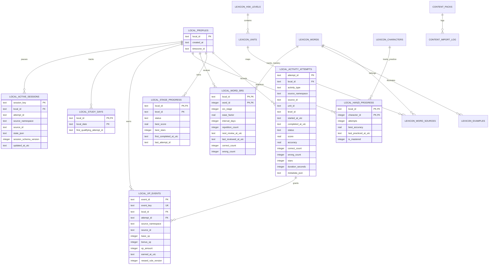

# PANDARIN LOCAL-FIRST ARCHITECTURE
## 01. CƠ SỞ DỮ LIỆU SQLITE: SCHEMA DDL, INDEXES & ERD

> **Tệp cơ sở dữ liệu trên thiết bị**: `pandarin.db`  
> **Cơ chế**: `sqflite` (Mobile) / `sqflite_common_ffi` (Desktop & Unit Test)  
> **Phiên bản Schema (v1)**: Tách bạch rõ ràng giữa Bảng Người học (Mutable User Tables) và Bảng Giáo trình (Read-Only Content Tables).

---

### 1. Sơ đồ Thực thể Liên kết Dữ liệu (Mermaid ERD)



---

### 2. DDL Chi tiết Bảng Người học (Learner Tables)

```sql
PRAGMA foreign_keys = ON;

-- 1. Hồ sơ người học cục bộ (Local Identity)
CREATE TABLE IF NOT EXISTS local_profiles (
  local_id TEXT PRIMARY KEY,
  created_at TEXT NOT NULL,
  timezone_id TEXT NOT NULL DEFAULT 'Asia/Ho_Chi_Minh'
);

-- 2. Nhật ký lượt làm bài / thực hành chi tiết (Attempts Ledger)
CREATE TABLE IF NOT EXISTS local_activity_attempts (
  attempt_id TEXT PRIMARY KEY,
  local_id TEXT NOT NULL REFERENCES local_profiles(local_id),
  activity_type TEXT NOT NULL,          -- vocabulary, listening, boss, hanzi, review
  source_namespace TEXT NOT NULL,       -- duo | lexicon | hanzi | mini_game
  source_id TEXT NOT NULL,
  unit_namespace TEXT,
  unit_id TEXT,
  level_id TEXT,
  started_at_utc TEXT NOT NULL,
  completed_at_utc TEXT,
  status TEXT NOT NULL CHECK(status IN ('started','passed','failed','abandoned')),
  score REAL NOT NULL DEFAULT 0,
  accuracy REAL CHECK(accuracy IS NULL OR (accuracy BETWEEN 0 AND 1)),
  correct_count INTEGER NOT NULL DEFAULT 0 CHECK(correct_count >= 0),
  wrong_count INTEGER NOT NULL DEFAULT 0 CHECK(wrong_count >= 0),
  stars INTEGER NOT NULL DEFAULT 0 CHECK(stars BETWEEN 0 AND 3),
  duration_seconds INTEGER NOT NULL DEFAULT 0 CHECK(duration_seconds >= 0),
  metadata_json TEXT NOT NULL DEFAULT '{}'
);

CREATE INDEX IF NOT EXISTS idx_attempts_by_user_time
  ON local_activity_attempts(local_id, started_at_utc DESC);
CREATE INDEX IF NOT EXISTS idx_attempts_by_source
  ON local_activity_attempts(source_namespace, source_id);

-- 3. Tiến độ mở khóa & vượt ải (Stage Progress)
CREATE TABLE IF NOT EXISTS local_stage_progress (
  local_id TEXT NOT NULL REFERENCES local_profiles(local_id),
  level_id TEXT NOT NULL,
  status TEXT NOT NULL DEFAULT 'locked' CHECK(status IN ('locked','available','completed')),
  best_score REAL NOT NULL DEFAULT 0,
  best_stars INTEGER NOT NULL DEFAULT 0 CHECK(best_stars BETWEEN 0 AND 3),
  first_completed_at_utc TEXT,
  last_attempt_id TEXT,
  PRIMARY KEY(local_id, level_id)
);

-- 4. Trạng thái Ôn tập Thẻ ghi nhớ ngắt quãng (Spaced Repetition System)
CREATE TABLE IF NOT EXISTS local_word_srs (
  local_id TEXT NOT NULL REFERENCES local_profiles(local_id),
  word_id INTEGER NOT NULL,
  srs_stage INTEGER NOT NULL DEFAULT 0 CHECK(srs_stage >= 0),
  ease_factor REAL NOT NULL DEFAULT 2.5,
  interval_days INTEGER NOT NULL DEFAULT 0 CHECK(interval_days >= 0),
  repetition_count INTEGER NOT NULL DEFAULT 0 CHECK(repetition_count >= 0),
  next_review_at_utc TEXT NOT NULL,
  last_reviewed_at_utc TEXT,
  correct_count INTEGER NOT NULL DEFAULT 0,
  wrong_count INTEGER NOT NULL DEFAULT 0,
  PRIMARY KEY(local_id, word_id)
);

CREATE INDEX IF NOT EXISTS idx_due_srs
  ON local_word_srs(local_id, next_review_at_utc);

-- 5. Tiến độ luyện viết Chữ Hán (Hanzi Stroke Practice)
CREATE TABLE IF NOT EXISTS local_hanzi_progress (
  local_id TEXT NOT NULL REFERENCES local_profiles(local_id),
  character_id INTEGER NOT NULL,
  attempts INTEGER NOT NULL DEFAULT 0,
  best_accuracy REAL NOT NULL DEFAULT 0,
  last_practiced_at_utc TEXT,
  is_mastered INTEGER NOT NULL DEFAULT 0 CHECK(is_mastered IN (0,1)),
  PRIMARY KEY(local_id, character_id)
);

-- 6. Sổ cái Điểm kinh nghiệm Bất biến (Immutable XP Ledger)
CREATE TABLE IF NOT EXISTS local_xp_events (
  event_id TEXT PRIMARY KEY,
  event_key TEXT NOT NULL UNIQUE,       -- Ngăn chặn cộng điểm trùng cho cùng 1 hành động
  local_id TEXT NOT NULL REFERENCES local_profiles(local_id),
  attempt_id TEXT REFERENCES local_activity_attempts(attempt_id),
  source_namespace TEXT NOT NULL,
  source_id TEXT NOT NULL,
  base_xp INTEGER NOT NULL DEFAULT 0 CHECK(base_xp >= 0),
  bonus_xp INTEGER NOT NULL DEFAULT 0 CHECK(bonus_xp >= 0),
  xp_amount INTEGER NOT NULL DEFAULT 0 CHECK(xp_amount >= 0),
  earned_at_utc TEXT NOT NULL,
  reward_rule_version INTEGER NOT NULL DEFAULT 1
);

CREATE INDEX IF NOT EXISTS idx_xp_user_date
  ON local_xp_events(local_id, earned_at_utc DESC);

-- 7. Ngày học ghi nhận chuỗi chuyên cần (Study Days & Streak)
CREATE TABLE IF NOT EXISTS local_study_days (
  local_id TEXT NOT NULL REFERENCES local_profiles(local_id),
  local_date TEXT NOT NULL,              -- YYYY-MM-DD
  first_qualifying_attempt_id TEXT,
  PRIMARY KEY(local_id, local_date)
);

-- 8. Phiên làm bài dở dang (Active Session Checkpoints)
CREATE TABLE IF NOT EXISTS local_active_sessions (
  session_key TEXT PRIMARY KEY,
  local_id TEXT NOT NULL REFERENCES local_profiles(local_id),
  attempt_id TEXT,
  source_namespace TEXT NOT NULL,
  source_id TEXT NOT NULL,
  state_json TEXT NOT NULL,
  session_schema_version INTEGER NOT NULL,
  updated_at_utc TEXT NOT NULL
);

-- 9. Lịch sử Di chuyển Dữ liệu Khách cũ (Migration Log)
CREATE TABLE IF NOT EXISTS local_migration_log (
  migration_id TEXT PRIMARY KEY,
  source_key TEXT NOT NULL,
  source_checksum TEXT,
  rows_imported INTEGER NOT NULL DEFAULT 0,
  warnings_json TEXT NOT NULL DEFAULT '[]',
  completed_at_utc TEXT NOT NULL
);

-- 10. Dữ liệu chưa đối chiếu được (Unresolved Legacy Records)
CREATE TABLE IF NOT EXISTS unresolved_legacy_progress (
  id TEXT PRIMARY KEY,
  source_key TEXT NOT NULL,
  source_record_json TEXT NOT NULL,
  unresolved_reason TEXT NOT NULL,
  recorded_at_utc TEXT NOT NULL
);

-- 11. Hộp thư đồng bộ chuẩn bị cho tương lai (Future Sync Outbox - Hiện chưa kích hoạt)
CREATE TABLE IF NOT EXISTS local_sync_outbox (
  event_id TEXT PRIMARY KEY,
  entity_type TEXT NOT NULL,
  entity_id TEXT NOT NULL,
  payload_json TEXT NOT NULL,
  created_at_utc TEXT NOT NULL,
  local_revision INTEGER NOT NULL,
  status TEXT NOT NULL DEFAULT 'pending'
);
```

---

### 3. DDL Bảng Giáo trình & Nội dung Học tập (Read-Only Content Tables)

```sql
-- 1. Quản lý các gói nội dung đóng gói sẵn
CREATE TABLE IF NOT EXISTS content_packs (
  pack_id TEXT PRIMARY KEY,
  version INTEGER NOT NULL,
  checksum TEXT,
  content_schema_version INTEGER NOT NULL DEFAULT 1,
  imported_at TEXT NOT NULL,
  status TEXT NOT NULL DEFAULT 'active'
);

-- 2. Cấp độ HSK (HSK 1 - 4 chuẩn thực tế)
CREATE TABLE IF NOT EXISTS lexicon_hsk_levels (
  id INTEGER PRIMARY KEY,
  section_number INTEGER,
  name TEXT NOT NULL,
  description TEXT,
  sort_order INTEGER
);

-- 3. Bài học theo HSK (130 bài)
CREATE TABLE IF NOT EXISTS lexicon_units (
  id INTEGER PRIMARY KEY,
  hsk_level_id INTEGER NOT NULL REFERENCES lexicon_hsk_levels(id),
  title TEXT NOT NULL,
  sort_order INTEGER,
  unit_number INTEGER
);
CREATE INDEX IF NOT EXISTS idx_units_by_hsk ON lexicon_units(hsk_level_id, unit_number);

-- 4. Kho Từ vựng Tiếng Trung (2.205 từ)
CREATE TABLE IF NOT EXISTS lexicon_words (
  id INTEGER PRIMARY KEY,
  hsk_level_id INTEGER REFERENCES lexicon_hsk_levels(id),
  simplified TEXT NOT NULL,
  traditional TEXT,
  pinyin TEXT NOT NULL,
  meaning_vi TEXT NOT NULL,
  tts_url TEXT
);
CREATE INDEX IF NOT EXISTS idx_words_by_hsk ON lexicon_words(hsk_level_id);
CREATE INDEX IF NOT EXISTS idx_words_simplified ON lexicon_words(simplified);

-- 5. Bảng liên kết Từ vựng ↔ Bài học ↔ Chủ đề (4.052 dòng)
CREATE TABLE IF NOT EXISTS lexicon_word_sources (
  id INTEGER PRIMARY KEY,
  word_id INTEGER NOT NULL REFERENCES lexicon_words(id),
  unit_id INTEGER NOT NULL REFERENCES lexicon_units(id),
  topic_id INTEGER,
  source_sheet TEXT,
  source_row INTEGER
);
CREATE INDEX IF NOT EXISTS idx_word_sources_unit ON lexicon_word_sources(unit_id);
CREATE INDEX IF NOT EXISTS idx_word_sources_word ON lexicon_word_sources(word_id);

-- 6. Hán tự & Dữ liệu Nét viết SVG (935 chữ)
CREATE TABLE IF NOT EXISTS lexicon_characters (
  id INTEGER PRIMARY KEY,
  character TEXT NOT NULL UNIQUE,
  pinyin TEXT,
  radical TEXT,
  stroke_count INTEGER,
  stroke_paths TEXT NOT NULL
);
CREATE INDEX IF NOT EXISTS idx_character_char ON lexicon_characters(character);

-- 7. Câu ví dụ minh họa (7.925 câu)
CREATE TABLE IF NOT EXISTS lexicon_examples (
  id INTEGER PRIMARY KEY,
  word_id INTEGER REFERENCES lexicon_words(id),
  chinese TEXT NOT NULL,
  pinyin TEXT,
  vietnamese TEXT NOT NULL
);
CREATE INDEX IF NOT EXISTS idx_examples_word ON lexicon_examples(word_id);
```
